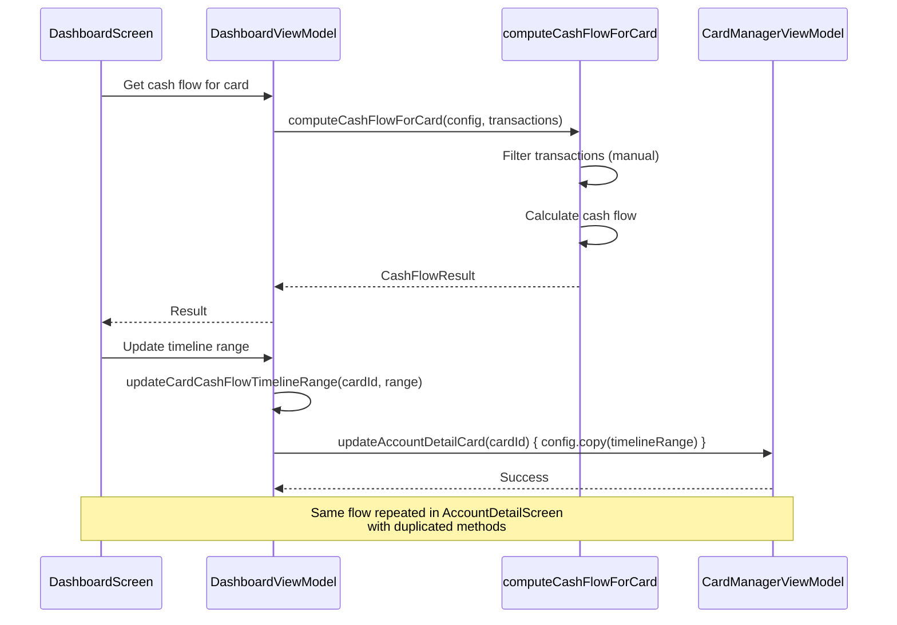
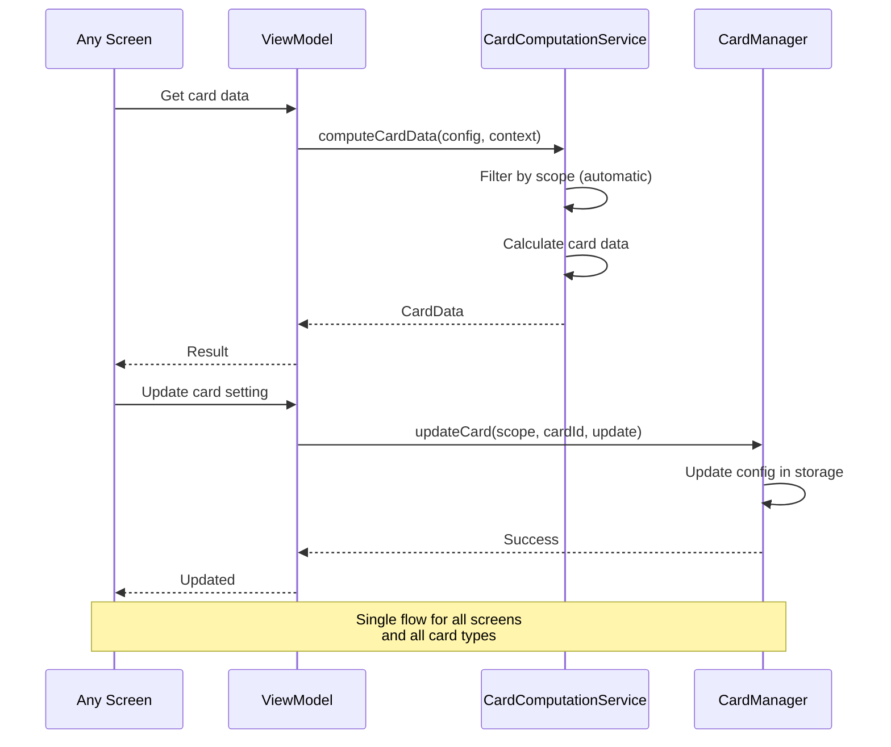
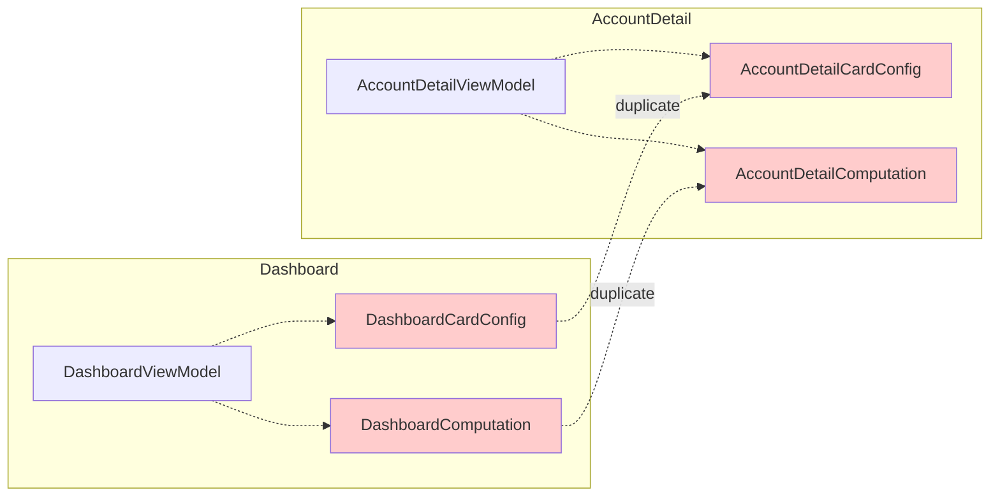
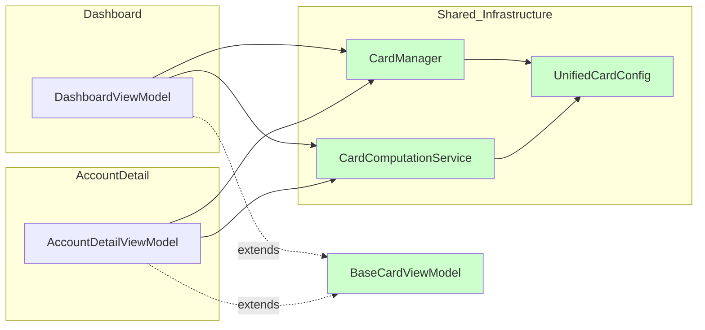

# Card Architecture Redesign Document

## Current State Analysis

### Existing Card Systems

#### Dashboard Cards
- `NetWorthCardConfig` - Net worth with cash flow
- `CurrencyBalancesCardConfig` - Currency breakdown
- `CashFlowCardConfig` - Income/expense flow
- `AccountsCardConfig` - Account summaries
- `BudgetsCardConfig` - Budget tracking
- `RecentActivitiesCardConfig` - Recent transactions

#### Account Detail Cards
- `AccountHeroCardConfig` - Account summary card
- `AccountCashFlowCardConfig` - Account-specific cash flow
- `AccountCurrencyBalancesCardConfig` - Account-specific currency balances

### Current Issues

1. **Code Duplication**
   - `CashFlowCardConfig` and `AccountCashFlowCardConfig` are nearly identical
   - `CurrencyBalancesCardConfig` and `AccountCurrencyBalancesCardConfig` share 90% of fields
   - Computation methods duplicated in `DashboardViewModel` and `AccountDetailViewModel`
   - Update methods (e.g., `updateCardCashFlowTimelineRange`) duplicated across viewmodels

2. **Tight Coupling**
   - Card configurations are screen-specific
   - Computation methods are tied to specific viewmodels
   - Cannot easily reuse card types across different screens

3. **Inconsistent Patterns**
   - Some cards have `timelineRange`, others don't
   - Some cards have `showBaseConversion`, others don't
   - Inconsistent naming conventions (AccountXxx vs Xxx)

4. **Maintenance Burden**
   - Adding a new card requires changes in multiple places
   - Bug fixes need to be applied in multiple locations
   - Hard to ensure consistency across screens

## Architecture Flow Charts

### Before: Current Architecture

```mermaid
graph TB
    subgraph Dashboard_Screen
        DS[DashboardScreen]
        DVM[DashboardViewModel]
        DC[DashboardCardsConfig]
        DCM[CardManagerViewModel]
    end

    subgraph Account_Detail_Screen
        ADS[AccountDetailScreen]
        ADVM[AccountDetailViewModel]
        ADC[AccountDetailCardsConfig]
        ADCM[CardManagerViewModel]
    end

    subgraph Card_Configs_Dashboard
        NW[NetWorthCardConfig]
        CB[CurrencyBalancesCardConfig]
        CF[CashFlowCardConfig]
        AC[AccountsCardConfig]
        BD[BudgetsCardConfig]
        RA[RecentActivitiesCardConfig]
    end

    subgraph Card_Configs_Account
        AH[AccountHeroCardConfig]
        ACF[AccountCashFlowCardConfig]
        ACB[AccountCurrencyBalancesCardConfig]
    end

    subgraph Computation_Logic
        DCF[computeCashFlowForCard]
        DCCT[computeCurrencyTotalsForCard]
        DCNW[computeNetWorthForCard]
        ADCF[computeCashFlowForCard]
        ADCCT[computeCurrencyTotalsForCard]
    end

    subgraph Update_Methods
        DUT[updateCardCashFlowTimelineRange]
        DUSB[updateCardCashFlowShowBaseConversion]
        ADUT[updateCardCashFlowTimelineRange]
        ADUSB[updateCardCashFlowShowBaseConversion]
    end

    DS --> DVM
    DVM --> DC
    DC --> NW
    DC --> CB
    DC --> CF
    DC --> AC
    DC --> BD
    DC --> RA
    DVM --> DCF
    DVM --> DCCT
    DVM --> DCNW
    DVM --> DUT
    DVM --> DUSB
    DVM --> DCM

    ADS --> ADVM
    ADVM --> ADC
    ADC --> AH
    ADC --> ACF
    ADC --> ACB
    ADVM --> ADCF
    ADVM --> ADCCT
    ADVM --> ADUT
    ADVM --> ADUSB
    ADVM --> ADCM

    style DCF fill:#ff9999
    style DCCT fill:#ff9999
    style DCNW fill:#ff9999
    style ADCF fill:#ff9999
    style ADCCT fill:#ff9999
    style DUT fill:#ff9999
    style DUSB fill:#ff9999
    style ADUT fill:#ff9999
    style ADUSB fill:#ff9999

    style CF fill:#ffcc99
    style ACF fill:#ffcc99
    style CB fill:#ffcc99
    style ACB fill:#ffcc99
```



**Current Architecture Issues:**
- 🔴 **Duplicated computation methods** (highlighted in red) - Same logic in both viewmodels
- 🟠 **Duplicated card configs** (highlighted in orange) - CashFlowCardConfig vs AccountCashFlowCardConfig
- 🔴 **Duplicated update methods** (highlighted in red) - Same update logic in both viewmodels
- Tight coupling between screens and their specific card managers
- No reuse of card types across screens

### After: Proposed Architecture

```mermaid
graph TB
    subgraph Unified_Card_System
        CCS[CardComputationService]
        CM[CardManager]
        BCVM[BaseCardViewModel]
    end

    subgraph Dashboard_Screen
        DS[DashboardScreen]
        DVM[DashboardViewModel]
    end

    subgraph Account_Detail_Screen
        ADS[AccountDetailScreen]
        ADVM[AccountDetailViewModel]
    end

    subgraph Unified_Card_Configs
        UCF[CashFlowCardConfig]
        UCB[CurrencyBalancesCardConfig]
        UNW[NetWorthCardConfig]
        UAC[AccountsCardConfig]
        UBD[BudgetsCardConfig]
        URA[RecentActivitiesCardConfig]
        UAH[AccountHeroCardConfig]
    end

    subgraph Card_Scopes
        GS[GLOBAL Scope]
        AS[ACCOUNT Scope]
    end

    subgraph Generic_Computation
        GCF[computeCashFlow]
        GCCT[computeCurrencyTotals]
        GCNW[computeNetWorth]
    end

    subgraph Generic_Update_Methods
        GUT[updateCardTimelineRange]
        GUSB[updateCardShowBaseConversion]
        GUL[updateCardLayout]
        GR[removeCard]
    end

    DS --> DVM
    DVM -->|extends| BCVM
    DVM --> CM
    DVM --> CCS

    ADS --> ADVM
    ADVM -->|extends| BCVM
    ADVM --> CM
    ADVM --> CCS

    CM --> UCF
    CM --> UCB
    CM --> UNW
    CM --> UAC
    CM --> UBD
    CM --> URA
    CM --> UAH

    UCF --> GS
    UCF --> AS
    UCB --> GS
    UCB --> AS
    UAH --> AS

    CCS --> GCF
    CCS --> GCCT
    CCS --> GCNW

    BCVM --> GUT
    BCVM --> GUSB
    BCVM --> GUL
    BCVM --> GR

    style GCF fill:#99ff99
    style GCCT fill:#99ff99
    style GCNW fill:#99ff99
    style GUT fill:#99ff99
    style GUSB fill:#99ff99
    style GUL fill:#99ff99
    style GR fill:#99ff99
    style UCF fill:#99ccff
    style UCB fill:#99ccff
    style CCS fill:#ccffcc
    style CM fill:#ccffcc
    style BCVM fill:#ccffcc
```



**Proposed Architecture Benefits:**
- 🟢 **Single computation service** (highlighted in green) - One implementation for all cards
- 🟢 **Generic update methods** (highlighted in green) - Reusable across all viewmodels
- 🔵 **Unified card configs** (highlighted in blue) - Single config per card type with scope
- 🟢 **Generic infrastructure** (highlighted in light green) - Reusable service and manager
- Cards can be reused across different screens
- Scope-based filtering for data computation
- Extensible for future card types and scopes

### Data Flow Comparison

#### Before: Current Data Flow


#### After: Proposed Data Flow


### Component Relationship Diagram

#### Before: Component Relationships


#### After: Component Relationships


## Proposed Redesign

### 1. Generic Card Configuration System

#### Base Card Configuration
```kotlin
@Serializable
sealed class BaseCardConfig {
    abstract val cardId: String
    abstract val title: String
    abstract val isEnabled: Boolean
    abstract val order: Int
    abstract val cardType: CardType
}

enum class CardType {
    NET_WORTH,
    CURRENCY_BALANCES,
    CASH_FLOW,
    ACCOUNTS,
    BUDGETS,
    RECENT_ACTIVITIES,
    ACCOUNT_HERO
}
```

#### Common Card Settings
```kotlin
@Serializable
data class CardSettings(
    val timelineRange: TimelineRange = TimelineRange.AllTime,
    val showBaseConversion: Boolean = true,
    val layout: String = "grid" // for cards that support layout switching
)
```

#### Card Configuration with Scope
```kotlin
@Serializable
sealed class CardConfig : BaseCardConfig {
    abstract val settings: CardSettings
    abstract val scope: CardScope
}

enum class CardScope {
    GLOBAL,        // Dashboard - all accounts
    ACCOUNT,       // Account Detail - single account
    PROFILE        // Future: profile-level cards
}
```

### 2. Unified Card Types

#### Cash Flow Card (Unified)
```kotlin
@Serializable
data class CashFlowCardConfig(
    override val cardId: String,
    override val title: String = "CASH FLOW",
    override val isEnabled: Boolean = true,
    override val order: Int = 0,
    override val settings: CardSettings = CardSettings(),
    override val scope: CardScope = CardScope.GLOBAL,
    val accountId: String? = null // null for global, set for account scope
) : CardConfig()
```

#### Currency Balances Card (Unified)
```kotlin
@Serializable
data class CurrencyBalancesCardConfig(
    override val cardId: String,
    override val title: String = "CURRENCY BALANCES",
    override val isEnabled: Boolean = true,
    override val order: Int = 0,
    override val settings: CardSettings = CardSettings(),
    override val scope: CardScope = CardScope.GLOBAL,
    val accountId: String? = null
) : CardConfig()
```

#### Account Hero Card (Account Scope Only)
```kotlin
@Serializable
data class AccountHeroCardConfig(
    override val cardId: String,
    override val title: String = "ACCOUNT SUMMARY",
    override val isEnabled: Boolean = true,
    override val order: Int = 0,
    override val settings: CardSettings = CardSettings(),
    override val scope: CardScope = CardScope.ACCOUNT,
    val showCurrencyBadges: Boolean = true,
    val accountId: String // Required for account scope
) : CardConfig()
```

### 3. Generic Card Computation Service

#### Card Computation Interface
```kotlin
interface CardComputationService {
    suspend fun computeCashFlow(
        config: CashFlowCardConfig,
        transactions: List<Transaction>,
        baseCurrency: String,
        exchangeRates: Map<String, BigDecimal>,
        precision: Int
    ): CashFlowResult

    suspend fun computeCurrencyTotals(
        config: CurrencyBalancesCardConfig,
        accounts: List<Account>,
        transactions: List<Transaction>,
        baseCurrency: String,
        exchangeRates: Map<String, BigDecimal>,
        precision: Int
    ): List<CurrencyAggregationItem>

    suspend fun computeNetWorth(
        config: NetWorthCardConfig,
        accounts: List<Account>,
        transactions: List<Transaction>,
        baseCurrency: String,
        exchangeRates: Map<String, BigDecimal>,
        precision: Int
    ): Pair<BigDecimal, CashFlowResult>
}
```

#### Implementation
```kotlin
class CardComputationServiceImpl(
    private val financialUseCases: FinancialUseCases
) : CardComputationService {
    
    override suspend fun computeCashFlow(
        config: CashFlowCardConfig,
        transactions: List<Transaction>,
        baseCurrency: String,
        exchangeRates: Map<String, BigDecimal>,
        precision: Int
    ): CashFlowResult {
        // Filter transactions based on scope
        val filteredTransactions = if (config.scope == CardScope.ACCOUNT) {
            transactions.filter { it.accountId == config.accountId }
        } else {
            transactions
        }
        
        return financialUseCases.calculateCashFlow(
            allTransactions = filteredTransactions,
            timelineRange = config.settings.timelineRange,
            baseCurrency = baseCurrency,
            exchangeRates = exchangeRates,
            precision = precision
        )
    }
    
    // Similar implementations for other methods...
}
```

### 4. Generic Card Manager

#### Unified Card Config Storage
```kotlin
@Serializable
data class CardsConfig(
    val cards: List<CardConfig> = emptyList(),
    val scope: CardScope = CardScope.GLOBAL
)
```

#### Generic Card Manager
```kotlin
class CardManager(
    private val settingsDataStore: SettingsDataStore
) {
    // Generic methods that work with any card type
    suspend fun <T : CardConfig> updateCard(
        scope: CardScope,
        cardId: String,
        update: (T) -> CardConfig
    )
    
    suspend fun removeCard(scope: CardScope, cardId: String)
    suspend fun reorderCards(scope: CardScope, cards: List<CardConfig>)
    suspend fun addCard(scope: CardScope, cardConfig: CardConfig)
    
    // Scope-specific getters
    val globalCardsConfig: Flow<CardsConfig>
    val accountCardsConfig: Flow<CardsConfig>
}
```

### 5. Generic Card ViewModel

#### Base Card ViewModel
```kotlin
abstract class BaseCardViewModel(
    protected val cardManager: CardManager,
    protected val computationService: CardComputationService
) {
    // Generic update methods
    fun updateCardTimelineRange(scope: CardScope, cardId: String, range: TimelineRange)
    fun updateCardShowBaseConversion(scope: CardScope, cardId: String, show: Boolean)
    fun updateCardLayout(scope: CardScope, cardId: String, layout: String)
    fun removeCard(scope: CardScope, cardId: String)
    
    // Generic computation methods
    suspend fun computeCardData(
        config: CardConfig,
        context: CardContext
    ): CardData
}
```

#### Card Context
```kotlin
data class CardContext(
    val scope: CardScope,
    val accountId: String? = null,
    val accounts: List<Account>,
    val transactions: List<Transaction>,
    val baseCurrency: String,
    val exchangeRates: Map<String, BigDecimal>,
    val precision: Int
)
```

#### Card Data
```kotlin
sealed class CardData {
    data class CashFlow(val result: CashFlowResult) : CardData()
    data class CurrencyTotals(val totals: List<CurrencyAggregationItem>) : CardData()
    data class NetWorth(val netWorth: BigDecimal, val cashFlow: CashFlowResult) : CardData()
    data class AccountSummary(val account: Account, val balance: BigDecimal) : CardData()
}
```

### 6. Generic Card Composable

#### Base Card Composable
```kotlin
@Composable
fun GenericCard(
    config: CardConfig,
    data: CardData,
    onUpdate: (CardConfig) -> Unit,
    onDelete: () -> Unit,
    modifier: Modifier = Modifier
) {
    when (config) {
        is CashFlowCardConfig -> CashFlowCard(
            config = config,
            data = data as CardData.CashFlow,
            onUpdate = onUpdate,
            onDelete = onDelete,
            modifier = modifier
        )
        is CurrencyBalancesCardConfig -> CurrencyBalancesCard(
            config = config,
            data = data as CardData.CurrencyTotals,
            onUpdate = onUpdate,
            onDelete = onDelete,
            modifier = modifier
        )
        // ... other card types
    }
}
```

#### Card Rendering Helper
```kotlin
@Composable
fun CardReorderableList(
    config: CardsConfig,
    context: CardContext,
    computationService: CardComputationService,
    onReorder: (List<CardConfig>) -> Unit,
    modifier: Modifier = Modifier
) {
    CardReorderableList(
        items = config.cards.sortedBy { it.order },
        key = { it.cardId },
        onReorder = onReorder,
        modifier = modifier
    ) { cardConfig, isDragging, dragModifier ->
        val cardData by produceState<CardData?>(initialValue = null, cardConfig, context) {
            value = computationService.computeCardData(cardConfig, context)
        }
        
        cardData?.let { data ->
            GenericCard(
                config = cardConfig,
                data = data,
                onUpdate = { /* update logic */ },
                onDelete = { /* delete logic */ },
                modifier = Modifier.fillMaxWidth(),
                headerModifier = dragModifier
            )
        } ?: Box(modifier = Modifier.size(0.dp))
    }
}
```

## Migration Strategy

### Phase 1: Create Generic Infrastructure (Week 1)
1. Create `CardConfig` base classes and unified card types
2. Implement `CardComputationService` interface
3. Create `CardManager` to replace screen-specific managers
4. Add migration logic to convert existing configs to new format

### Phase 2: Migrate Dashboard (Week 2)
1. Update `DashboardViewModel` to use `CardManager`
2. Replace dashboard-specific card configs with unified ones
3. Update `DashboardScreen` to use generic card rendering
4. Test all dashboard cards

### Phase 3: Migrate Account Detail (Week 3)
1. Update `AccountDetailViewModel` to use `CardManager`
2. Replace account-specific card configs with unified ones
3. Update `AccountDetailScreen` to use generic card rendering
4. Test all account detail cards

### Phase 4: Cleanup (Week 4)
1. Remove old screen-specific card configs
2. Remove old computation methods from viewmodels
3. Update tests to use new architecture
4. Documentation updates

## Benefits

### 1. Code Reusability
- Single implementation for each card type
- Shared computation logic across screens
- Reusable card components

### 2. Maintainability
- Bug fixes in one place
- Easier to add new card types
- Consistent patterns across screens

### 3. Extensibility
- Easy to add new scopes (e.g., Profile, Category)
- Easy to add new card types
- Flexible for future requirements

### 4. Type Safety
- Strong typing for card configurations
- Compile-time checks for card operations
- Better IDE support

### 5. Testability
- Easier to unit test card computation
- Can mock card manager for UI tests
- Isolated card logic

## Implementation Considerations

### Data Migration
- Need to migrate existing user configs
- Handle backward compatibility during transition
- Provide fallback for missing fields

### Performance
- Ensure computation service is efficient
- Cache computed data where appropriate
- Use produceState for reactive updates

### Backward Compatibility
- Support old config format during transition
- Gradual migration approach
- Warn users of config changes

### Testing
- Unit tests for computation service
- Integration tests for card manager
- UI tests for card rendering

## Future Enhancements

### 1. Card Templates
- Pre-configured card sets for different use cases
- One-click card addition
- Smart card suggestions

### 2. Card Customization
- Custom card types via plugin system
- User-defined card configurations
- Card sharing between profiles

### 3. Advanced Filtering
- More granular timeline options
- Custom date ranges
- Advanced filtering options

### 4. Card Analytics
- Track card usage
- Suggest optimal card configurations
- Performance metrics

## Conclusion

This redesign will significantly improve the card architecture by:
- Eliminating code duplication
- Creating a generic, reusable system
- Improving maintainability and extensibility
- Providing a solid foundation for future enhancements

The migration should be done incrementally to minimize risk and ensure stability throughout the process.
