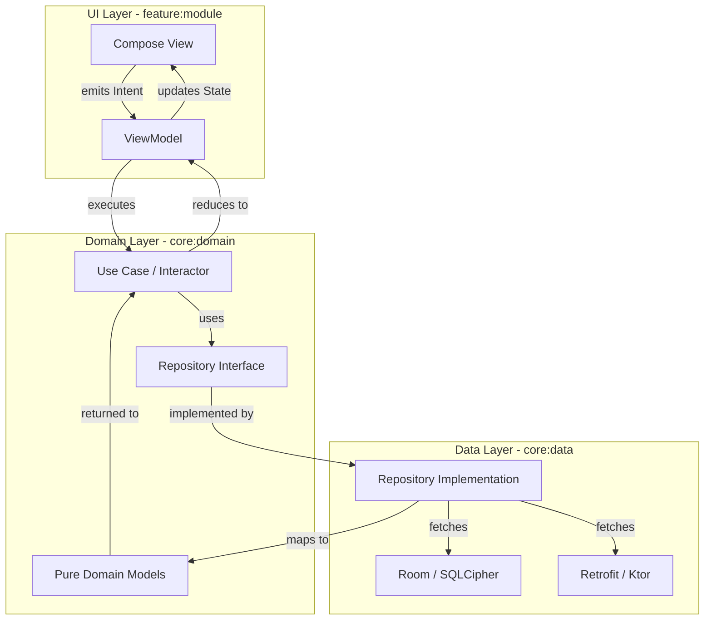

# OssWallet — Architecture Spine
**Status:** DRAFT (Technical Reference) · **Updated:** 2026-06-25 · **Altitude:** Initiative

This document fixes the **invariants** for OssWallet: the consistency contract that prevents technical drift across independently-built features.

---

## 1. The Paradigm
OssWallet follows **Clean Architecture** with a **Unidirectional Data Flow (MVI/UDF)** UI pattern. 

*   **Binds:** All business logic and UI state management.
*   **Prevents:** Fragmented state, logic leakage into ViewModels/UI, and framework coupling.
*   **The Rule:** The **Domain** is the source of truth for logic; the **UI** is a stateless reflection of an immutable **UiState**, driven by discrete **Intents**.

---

## 2. Invariants (Architectural Decisions)

### AD-1: Domain Pureness
*   **Binds:** All business and financial logic in `domain`.
*   **Prevents:** Direct SQLite/Room or framework leakage into core logic.
*   **The Rule:** Domain services/use cases must operate exclusively on **Pure Domain Models**. Data-layer query services must be abstracted behind interfaces. No raw SQL generation allowed in `domain`.

### AD-2: Feature-First Modularization
*   **Binds:** Project structure and dependency graph.
*   **Prevents:** Tightly-coupled monolithic "spaghetti" code.
*   **The Rule:** Modularize by **Feature first** (e.g., `:feature:dashboard`, `:feature:web_companion`), then by **Layer** (`:core:domain`, `:core:data`, `:core:ui`). Features must not depend on other features; they communicate via a centralized `:core:navigation` or `:core:domain` event bus.

### AD-3: Mandatory UDF/MVI
*   **Binds:** All UI screens and ViewModels.
*   **Prevents:** Logic leakage into Composables and non-deterministic state mutations.
*   **The Rule:** Every screen must consume a single immutable `UiState` and emit discrete `Intents`. ViewModels are responsible for mapping Intents to Use Case calls and reducing results into the next State.

### AD-4: Centralized Cache Lifecycle
*   **Binds:** All caching mechanisms (`QueryCache`, `CardRenderCache`).
*   **Prevents:** Cache invalidation logic leaking into the `Application` class.
*   **The Rule:** Cache lifecycles (initialization and invalidation) must be managed by a scoped DI **`CacheCoordinator`**. The `Application` class must remain a zero-logic entry point.

### AD-5: Standardized Search Strategy
*   **Binds:** Transaction search and indexing.
*   **Prevents:** Manual trigger sync errors and schema mismatches (docid/rowid bugs).
*   **The Rule:** Standardize on **Room-native FTS4** support. All search indexing must use explicitly managed Room entity relationships, eliminating custom manual SQLite triggers in migrations.

### AD-6: Serialization Standardization
*   **Binds:** API, DataStore, and Database JSON serialization.
*   **Prevents:** Mixed serialization stacks (Moshi + Kotlinx) and binary bloat.
*   **The Rule:** Standardize globally on **`kotlinx.serialization`**. Retrofit must use the Kotlinx converter; all `BigDecimal` math must use a consistent Kotlinx serializer.

### AD-7: Result-Based Error Propagation
*   **Binds:** Repository and Use Case return types.
*   **Prevents:** UI crashes from unhandled Data-layer exceptions.
*   **The Rule:** All layer boundaries must return a **`DomainResult<T>`** (or similar functional wrapper). Exceptions must be caught at the source (Data/Network) and converted to a domain-level error state.

### AD-8: Domain-First Testing
*   **Binds:** Quality assurance and logic verification.
*   **Prevents:** Regressions in complex financial aggregation logic.
*   **The Rule:** **100% Code Coverage** for all Domain Use Cases and pure logic. UI and Data layers are verified via narrow, focused integration tests; never use UI tests to verify business rules.

### AD-9: Dependency-Injected Concurrency
*   **Binds:** All asynchronous operations (Coroutines).
*   **Prevents:** Hardcoded threading bugs and untestable background work.
*   **The Rule:** Hardcoded `Dispatchers` are banned. All classes performing async work must receive their dispatchers via a Hilt-injected **`DispatcherProvider`**.

---

## 3. Visual Identity Invariants ("H — Editorial Instrument")

### AD-10: Component-Level Glass Policy
*   **Binds:** UI Glassmorphism (`Haze`).
*   **Prevents:** Unreadable or inconsistent UI depth.
*   **The Rule:** Glass usage is determined at the **Component Level**. While structural cards are typically opaque hairline panels for readability, specific UI components may opt-in to glass depth to maximize aesthetic fit and context.

---

## 4. Gaps & Remediation (The Debt Registry)

| Gap Found | AD Reference | Remediation Step |
| :--- | :--- | :--- |
| `CardAggregationService` injects `DatabaseQueryService` | AD-1 | Abstract query generation behind a Domain interface. |
| Cache invalidation logic lives in `OssWalletApp.kt` | AD-4 | Move to a `CacheCoordinator` injected via Hilt. |
| Mixed serialization (Moshi + Kotlinx) | AD-6 | Migrate Retrofit and `BigDecimal` adapters to Kotlinx. |
| Hardcoded `Dispatchers.IO` in repositories | AD-9 | Inject `DispatcherProvider` and update unit tests. |
| `AeonExpressiveCard` mixes glass and dialog logic | AD-10 | Extract glass-depth policy to a centralized theme provider. |
| Sparse testing coverage for aggregation logic | AD-8 | Implement Unit Tests for all `CardDataComputer` strategies. |

---

## 5. Seed (Starting Stack)
*   **Language:** Kotlin 2.1+ (Strict explicit backing properties)
*   **Async:** Kotlin Coroutines + Flow
*   **DI:** Hilt (`@Singleton`, `@ViewModelScoped`)
*   **DB:** Room + SQLCipher (FTS4)
*   **UI:** Jetpack Compose (Material 3 + Haze)
*   **Serialization:** kotlinx.serialization
