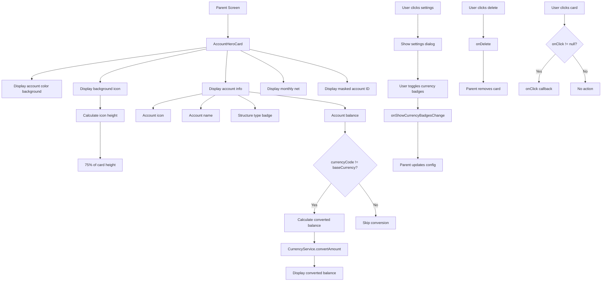

# AccountHeroCard Functional Logic

## 1. Component Overview
- **Component Name**: AccountHeroCard
- **Purpose**: Hero card showing account balance with currency conversion, monthly net, and account details
- **Parent Screen**: AccountDetailScreen
- **Related Components**: None (self-contained)
- **Configuration Class**: AccountHeroCardConfig

## 2. Input Analysis

### Component Inputs (Parent Screen → Component)
- **account**: Account - Account entity
- **balance**: BigDecimal - Current account balance
- **netBalance**: BigDecimal - Monthly net balance
- **baseCurrency**: String - Base currency for conversions
- **exchangeRates**: Map<String, BigDecimal> - Exchange rates for currency conversion
- **precision**: Int - Decimal precision for currency formatting
- **showCurrencyBadges**: Boolean - Whether to show currency badges (config setting)
- **onShowCurrencyBadgesChange**: (Boolean) -> Unit - Toggle currency badges
- **onClick**: (() -> Unit)? - Optional click callback for navigation
- **onDelete**: () -> Unit - Delete card callback

### Component Inputs (ViewModel → Parent Screen)
- **Account**: From AccountViewModel
- **balance**: Computed from transactions (account balance)
- **netBalance**: Computed from monthly transactions
- **exchangeRates**: From AnalyticsViewModel or CurrencyViewModel

### Component Internal State
- **showSettings**: Boolean - Settings dialog visibility
- **cardSize**: IntSize - Card size for icon scaling

## 3. Output Analysis

### Component Outputs (Component → Parent Screen)
- **Navigation Events**:
  - onClick() - Optional navigation (typically to edit account)
- **Configuration Changes**:
  - onShowCurrencyBadgesChange(show) - Toggle currency badges display
  - onDelete() - Delete card from configuration

### Displayed Data Structure
```kotlin
// Card displays:
- Account icon (background, large, 75% of card height)
- Account name (uppercase)
- Account structure type badge
- Account balance (large display)
- Converted balance in base currency (if different currency)
- Monthly net balance
- Account ID (last 4 digits, masked)
- Settings button
```

## 4. Computation Logic

### Value: Account Color
- **Value Name**: accountColor
- **Input Data**: account.colorHex
- **Computation Formula/Logic**:
  ```kotlin
  val accountColor = try {
      Color(account.colorHex.toColorInt())
  } catch (e: Exception) {
      MaterialTheme.colorScheme.primary
  }
  ```
- **Use Case Involvement**: None
- **Transformation Steps**: Hex string → Color (with fallback)

### Value: Content Color
- **Value Name**: contentColor
- **Input Data**: accountColor
- **Computation Formula/Logic**:
  ```kotlin
  val isDark = accountColor.isDark()
  val contentColor = if (isDark) Color.White else Color.Black
  ```
- **Use Case Involvement**: None
- **Transformation Steps**: Color luminance check → White or Black

### Value: Account Icon
- **Value Name**: icon
- **Input Data**: account.icon
- **Computation Formula/Logic**:
  ```kotlin
  val icon = AccountIconMap[account.icon] ?: Icons.Rounded.AccountBalance
  ```
- **Use Case Involvement**: None
- **Transformation Steps**: Icon name lookup → Icon (with fallback)

### Value: Icon Height
- **Value Name**: iconHeight
- **Input Data**: cardSize.height, density
- **Computation Formula/Logic**:
  ```kotlin
  val iconHeight = with(density) { (cardSize.height * 0.75f).toDp() }
  ```
- **Use Case Involvement**: None
- **Transformation Steps**: Card height → 75% in dp

### Value: Converted Balance
- **Value Name**: convertedBalance
- **Input Data**: balance, account.currencyCode, baseCurrency, exchangeRates, precision
- **Computation Formula/Logic**:
  ```kotlin
  val convertedBalance = CurrencyService.convertAmount(
      balance, 
      account.currencyCode, 
      baseCurrency, 
      exchangeRates, 
      precision
  )
  ```
- **Use Case Involvement**: CurrencyService.convertAmount
- **Transformation Steps**: Balance × exchange rate → Converted amount

### Value: Account ID Display
- **Value Name**: maskedId
- **Input Data**: account.id
- **Computation Formula/Logic**:
  ```kotlin
  account.id.takeLast(4).let { "**** $it" }
  ```
- **Use Case Involvement**: None
- **Transformation Steps**: Take last 4 chars → Mask with "****"

## 5. Data Flow Diagram



## 6. Data Sources
- **Repository Interfaces**: AccountRepository, TransactionRepository (via ViewModel)
- **Database Entities**: AccountEntity, TransactionEntity
- **Remote Data Sources**: None
- **Local Data Stores**: SettingsDataStore (base currency, accountDetailCardsConfig)

## 7. Business Logic Summary
- **Key Business Rules**:
  - Card color uses account's colorHex with fallback to primary
  - Content color (text/icon) automatically selected based on background luminance
  - Background icon sized to 75% of card height
  - Currency conversion shown only if account currency differs from base currency
  - Monthly net displayed in account currency
  - Account ID masked for security (show last 4 digits only)
  - Settings dialog allows toggle for currency badges
  - Card is clickable if onClick callback provided
  - Structure type displayed as badge
  - Balance displayed in large text (displayMedium, 36sp)
- **Validation Logic**: None
- **Calculations Performed**:
  - Color luminance check for content color
  - Icon height calculation (75% of card height)
  - Currency conversion
  - Account ID masking
- **State Management Approach**:
  - Local state for settings dialog visibility
  - Local state for card size (for icon scaling)
  - Configuration passed as parameters
  - Callbacks for configuration changes
  - Stateless rendering (minimal internal state)

## 8. Dependencies

### Component Dependencies
- AccountIconMap (icon lookup map)
- CurrencyService (for currency conversion)

### Parent Screen Dependencies
- AccountViewModel (for Account, balance, netBalance)
- AnalyticsViewModel or CurrencyViewModel (for exchangeRates)
- SettingsDataStore (for base currency, accountDetailCardsConfig)

### External Services/APIs
- None
