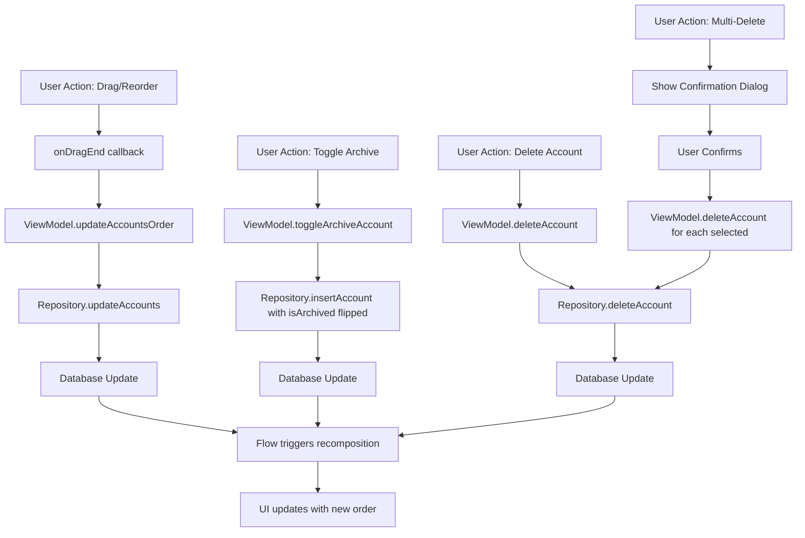

# AccountManagementScreen Functional Logic

## 1. Component Overview
- **Screen Name**: AccountManagementScreen
- **Purpose**: Allows users to manage their financial accounts, including reordering, archiving/unarchiving, and bulk deletion of accounts
- **ViewModel Class**: AccountViewModel
- **Related Use Cases**: None (uses direct repository methods)

## 2. Input Analysis

### Component Inputs (UI → ViewModel)
- **onBackClick**: Navigation callback to return to previous screen
- **onAddAccountClick**: Navigation callback to add a new account
- **onAccountClick(accountId: String)**: Navigation callback to view account details
- **User Actions**:
  - Drag and drop to reorder accounts
  - Toggle archive status via switch
  - Select multiple accounts for deletion
  - Move accounts up/down in list
  - Delete individual accounts

### ViewModel Inputs (Use Cases/Repositories)
- **Data Sources**:
  - AccountRepository: For CRUD operations on accounts
  - TransactionRepository: For creating initial balance transactions
  - SettingsDataStore: For default currency and profile ID
- **Initial State Parameters**: None (uses default profile from SettingsDataStore)
- **Configuration Parameters**: None

## 3. Output Analysis

### ViewModel Outputs (UI State)
```kotlin
val accounts: StateFlow<List<Account>>
val defaultCurrency: StateFlow<String>
```

**Account Model Structure**:
```kotlin
data class Account(
    val id: String,
    val name: String,
    val balance: BigDecimal,
    val currencyCode: String,
    val structureType: String,
    val colorHex: String,
    val icon: String,
    val allowedCurrencies: List<String>,
    val isArchived: Boolean,
    val displayOrder: Int
)
```

**Loading/Error States**: None (uses empty list as initial state)

**Navigation Events**: None (handled via callback parameters)

### Component Outputs (User Actions)
- **Navigation**: onBackClick, onAddAccountClick, onAccountClick
- **Side Effects**: 
  - Show multi-delete confirmation dialog
  - Show more options menu
  - Archive/unarchive accounts
  - Delete accounts

## 4. Computation Logic

### Value: Sorted Accounts List
- **Value Name**: accounts (sorted by displayOrder)
- **Input Data**: List<Account> from repository
- **Computation Formula/Logic**:
  ```kotlin
  accounts: StateFlow<List<Account>> = settingsDataStore.currentProfileId
      .flatMapLatest { profileId ->
          repository.getAllAccounts(profileId)
      }
      .map { it.sortedBy { account -> account.displayOrder } }
  ```
- **Use Case Involvement**: None (direct repository access)
- **Transformation Steps**: Entity → Domain Model (Account) → Sorted List

### Value: Default Currency
- **Value Name**: defaultCurrency
- **Input Data**: SettingsDataStore.currency
- **Computation Formula/Logic**: Direct StateFlow from DataStore
- **Use Case Involvement**: None
- **Transformation Steps**: None

## 5. Data Flow Diagram



## 6. Data Sources
- **Repository Interfaces**: AccountRepository, TransactionRepository
- **Database Entities**: AccountEntity (mapped to Account domain model)
- **Remote Data Sources**: None
- **Local Data Stores**: SettingsDataStore (for profile ID and default currency)

## 7. Business Logic Summary
- **Key Business Rules**:
  - Accounts are sorted by displayOrder
  - Archived accounts are visually dimmed (alpha = 0.6f)
  - Multi-selection mode allows bulk deletion
  - Reordering updates displayOrder for all affected accounts
- **Validation Logic**: None
- **Calculations Performed**: None
- **State Management Approach**: 
  - Uses StateFlow for reactive data
  - Local state for UI-only concerns (selection mode, dialog visibility)
  - Navigation trigger guard to prevent double navigation

## 8. Dependencies

### ViewModel Dependencies
- AccountRepository
- TransactionRepository
- SettingsDataStore

### Use Case Dependencies
- None (ViewModel uses repository directly)

### External Services/APIs
- None
