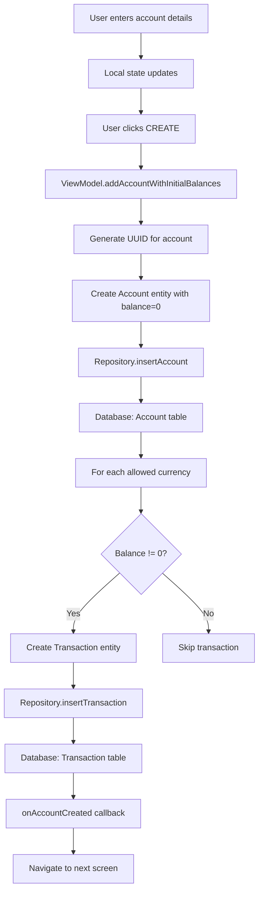

# AccountSetupScreen Functional Logic

## 1. Component Overview
- **Screen Name**: AccountSetupScreen
- **Purpose**: Allows users to create a new financial account with initial balances in multiple currencies
- **ViewModel Class**: AccountViewModel
- **Related Use Cases**: None (uses direct repository methods)

## 2. Input Analysis

### Component Inputs (UI → ViewModel)
- **onBackClick**: Navigation callback to return to previous screen
- **onAccountCreated**: Navigation callback after successful account creation
- **User Actions**:
  - Enter account name
  - Select structure type (Savings, Credit Card, Checking, Investment, Cash, Other)
  - Select primary currency
  - Select allowed currencies
  - Enter initial balances for each allowed currency
  - Select account icon
  - Select accent color
  - Save account

### ViewModel Inputs (Use Cases/Repositories)
- **Data Sources**:
  - AccountRepository: For inserting new account
  - TransactionRepository: For creating initial balance transactions
  - SettingsDataStore: For default currency and profile ID
- **Initial State Parameters**: None
- **Configuration Parameters**: None

## 3. Output Analysis

### ViewModel Outputs (UI State)
```kotlin
val defaultCurrency: StateFlow<String>
val accounts: StateFlow<List<Account>>
```

**Account Model Structure**:
```kotlin
data class Account(
    val id: String,
    val name: String,
    val balance: BigDecimal,
    val currencyCode: String,
    val structureType: String,
    val colorHex: String,
    val icon: String,
    val allowedCurrencies: List<String>,
    val isArchived: Boolean,
    val displayOrder: Int
)
```

**Loading/Error States**: None (synchronous operation)

**Navigation Events**: None (handled via callback parameters)

### Component Outputs (User Actions)
- **Navigation**: onBackClick, onAccountCreated
- **Side Effects**: 
  - Show structure type selection menu
  - Show currency management section
  - Show numpad for amount input
  - Show visual identity section (icon/color picker)

## 4. Computation Logic

### Value: Form Validation
- **Value Name**: canCreate
- **Input Data**: accountName, initialBalances, primaryCurrency, allowedCurrencies
- **Computation Formula/Logic**:
  ```kotlin
  val isBalanceValid = initialBalances.values.all { it.isEmpty() || it.toBigDecimalOrNull() != null }
  val canCreate = accountName.isNotBlank() && isBalanceValid && primaryCurrency.isNotBlank() && allowedCurrencies.isNotEmpty()
  ```
- **Use Case Involvement**: None
- **Transformation Steps**: String validation → Boolean

### Value: Account Creation with Initial Balances
- **Value Name**: addAccountWithInitialBalances
- **Input Data**: name, initialBalances (Map<String, String>), currency, structureType, colorHex, icon, allowedCurrencies
- **Computation Formula/Logic**:
  ```kotlin
  fun addAccountWithInitialBalances(...) {
      viewModelScope.launch {
          withProfile { profileId ->
              // 1. Create Account with balance = 0
              val account = Account(
                  id = UUID.randomUUID().toString(),
                  name = name,
                  balance = BigDecimal.ZERO,
                  currencyCode = currency,
                  structureType = structureType,
                  colorHex = colorHex,
                  icon = icon,
                  allowedCurrencies = allowedCurrencies,
                  isArchived = false,
                  displayOrder = accounts.value.size
              )
              repository.insertAccount(account, profileId)
              
              // 2. Create initial balance transactions for each currency
              allowedCurrencies.forEach { currencyCode ->
                  val balance = initialBalances[currencyCode]?.toBigDecimalOrNull() ?: BigDecimal.ZERO
                  if (balance.signum() != 0) {
                      val transactionType = if (balance.signum() > 0) "income" else "expense"
                      val initialTransaction = Transaction(
                          title = "Initial Balance",
                          amount = balance,
                          category = "Adjustment",
                          timestamp = System.currentTimeMillis(),
                          currency = currencyCode,
                          transactionType = transactionType,
                          accountId = accountId,
                          note = "Initial balance for $name in $currencyCode",
                          paymentMethod = structureType,
                          payee = "System"
                      )
                      transactionRepository.insertTransaction(initialTransaction, profileId)
                  }
              }
          }
      }
  }
  ```
- **Use Case Involvement**: None (direct repository access)
- **Transformation Steps**: Form data → Account entity → Transaction entities → Database

## 5. Data Flow Diagram



## 6. Data Sources
- **Repository Interfaces**: AccountRepository, TransactionRepository
- **Database Entities**: AccountEntity, TransactionEntity
- **Remote Data Sources**: None
- **Local Data Stores**: SettingsDataStore (for profile ID and default currency)

## 7. Business Logic Summary
- **Key Business Rules**:
  - Account balance is always set to 0 initially; actual balance comes from transactions
  - Initial balances are created as separate "Adjustment" category transactions
  - Positive balances create income transactions
  - Negative balances create expense transactions
  - Account display order is set to current count of accounts
- **Validation Logic**:
  - Account name must not be blank
  - All balance inputs must be valid BigDecimal or empty
  - Primary currency must be selected
  - At least one allowed currency must be selected
- **Calculations Performed**: None
- **State Management Approach**: 
  - Local state for form fields
  - Navigation trigger guard to prevent double navigation
  - Reactive state from ViewModel for default currency

## 8. Dependencies

### ViewModel Dependencies
- AccountRepository
- TransactionRepository
- SettingsDataStore

### Use Case Dependencies
- None (ViewModel uses repository directly)

### External Services/APIs
- None
