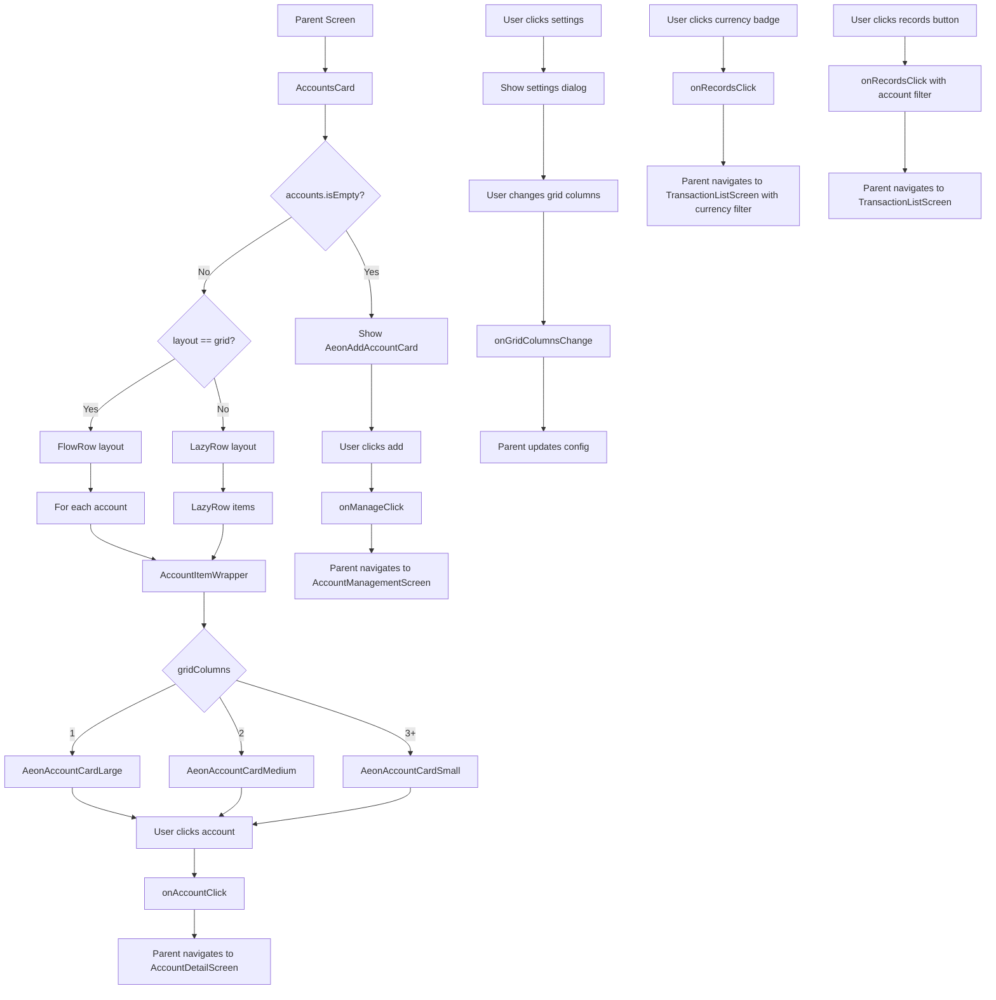

# AccountsCard Functional Logic

## 1. Component Overview
- **Component Name**: AccountsCard
- **Purpose**: Displays accounts in grid or scroll layout with account statistics and navigation to account details
- **Parent Screen**: DashboardScreen, AccountsViewScreen
- **Related Components**: AeonAccountCardLarge, AeonAccountCardMedium, AeonAccountCardSmall, AeonAddAccountCard
- **Configuration Class**: AccountsSectionSettings

## 2. Input Analysis

### Component Inputs (Parent Screen → Component)
- **onManageClick**: () -> Unit - Navigate to account management
- **onAccountClick**: (String) -> Unit - Navigate to account detail (account ID)
- **onRecordsClick**: (RecordsFilterContext?) -> Unit - Navigate to filtered transaction list
- **onGridColumnsChange**: (String, Int) -> Unit - Update grid columns (cardId, columns)
- **accounts**: List<Account> - List of accounts to display
- **accountStats**: Map<String, AccountSummaryItem> - Account statistics by account ID
- **baseCurrency**: String - Base currency for conversions
- **currentTheme**: String - Current app theme
- **cardId**: String - Unique card identifier
- **gridColumns**: Int - Number of grid columns (1, 2, 3, 4)
- **layout**: String - Layout mode ("grid" or "scroll")
- **precision**: Int - Decimal precision for currency
- **timelineRange**: TimelineRange - Timeline range for statistics
- **onLayoutChange**: (String, String) -> Unit - Update layout (cardId, layout)
- **onTimelineRangeChange**: (String, TimelineRange) -> Unit - Update timeline range
- **onHeaderClick**: (() -> Unit)? - Optional header click callback
- **showAddAccountCard**: Boolean - Whether to show add account card
- **onShowAddAccountCardChange**: (String, Boolean) -> Unit - Toggle add account card
- **onDelete**: () -> Unit - Delete card callback

### Component Inputs (ViewModel → Parent Screen)
- **Account list**: From AccountViewModel
- **AccountSummaryItem**: From AccountsViewViewModel or AccountViewModel
- **Base currency**: From SettingsDataStore
- **Current theme**: From SettingsDataStore

## 3. Output Analysis

### Component Outputs (Component → Parent Screen)
- **Navigation Events**:
  - onManageClick() - Navigate to AccountManagementScreen
  - onAccountClick(accountId) - Navigate to AccountDetailScreen
  - onRecordsClick(filter) - Navigate to TransactionListScreen with account filter
- **Configuration Changes**:
  - onGridColumnsChange(cardId, columns) - Update grid columns
  - onLayoutChange(cardId, layout) - Update layout mode
  - onTimelineRangeChange(cardId, range) - Update timeline range
  - onShowAddAccountCardChange(cardId, show) - Toggle add account card
  - onDelete() - Delete card from configuration

### Displayed Data Structure
```kotlin
// Account card displays:
- Account name
- Account balance (in account currency and base currency)
- Currency badges (for multi-currency accounts)
- Income/expense (for large cards)
- Account icon
- Account color
```

## 4. Computation Logic

### Value: Timeline Label
- **Value Name**: timelineLabel
- **Input Data**: timelineRange
- **Computation Formula/Logic**:
  ```kotlin
  val timelineLabel = when (timelineRange) {
      is TimelineRange.AllTime -> "All Time"
      is TimelineRange.ThisPeriod -> timelineRange.period.label
      is TimelineRange.LastPeriod -> timelineRange.period.label
      is TimelineRange.CustomRange -> {
          val formatter = DateTimeFormatter.ofPattern("MMM d, yyyy").withZone(ZoneId.systemDefault())
          val start = formatter.format(Instant.ofEpochMilli(timelineRange.start))
          val end = formatter.format(Instant.ofEpochMilli(timelineRange.end))
          "$start - $end"
      }
  }
  ```
- **Use Case Involvement**: None
- **Transformation Steps**: TimelineRange → Display string

### Value: Account Card Size Selection
- **Value Name**: AeonAccountCard (Large/Medium/Small)
- **Input Data**: gridColumns, account, accountStats
- **Computation Formula/Logic**:
  ```kotlin
  when (gridColumns) {
      1 -> AeonAccountCardLarge(...)
      2 -> AeonAccountCardMedium(...)
      else -> AeonAccountCardSmall(...)
  }
  ```
- **Use Case Involvement**: None
- **Transformation Steps**: Grid columns → Card size variant

### Value: Theme Detection
- **Value Name**: isDarkTheme, isAmoled
- **Input Data**: currentTheme
- **Computation Formula/Logic**:
  ```kotlin
  val isDarkTheme = when (currentTheme) {
      "Light" -> false
      "Dark", "Amoled" -> true
      else -> isSystemInDarkTheme()
  }
  val isAmoled = currentTheme == "Amoled"
  ```
- **Use Case Involvement**: None
- **Transformation Steps**: Theme string → Boolean flags

### Value: Balance in Base Currency
- **Value Name**: totalInBase
- **Input Data**: accountStats[account.id]
- **Computation Formula/Logic**:
  ```kotlin
  val stats = accountStats[account.id]
  val totalInBase = stats?.balanceInBase ?: BigDecimal.ZERO
  ```
- **Use Case Involvement**: None (computed in ViewModel)
- **Transformation Steps**: AccountSummaryItem → Balance in base currency

### Value: Grid Layout Spacing
- **Value Name**: Spacer count for grid alignment
- **Input Data**: accounts.size, gridColumns, showAddAccountCard
- **Computation Formula/Logic**:
  ```kotlin
  if (showAddAccountCard) {
      // Add account card included in layout
  } else if (gridColumns > 1 && accounts.size % gridColumns != 0) {
      repeat(gridColumns - (accounts.size % gridColumns)) {
          Spacer(modifier = Modifier.weight(1f))
      }
  }
  ```
- **Use Case Involvement**: None
- **Transformation Steps**: Calculate remaining slots → Add spacers

## 5. Data Flow Diagram



## 6. Data Sources
- **Repository Interfaces**: AccountRepository, TransactionRepository (via ViewModel)
- **Database Entities**: AccountEntity, TransactionEntity
- **Remote Data Sources**: None
- **Local Data Stores**: SettingsDataStore (base currency, theme, accountsViewCardsConfig)

## 7. Business Logic Summary
- **Key Business Rules**:
  - Layout can be grid or scroll mode
  - Grid supports 1-4 columns
  - Card size varies based on grid columns (1=Large, 2=Medium, 3+=Small)
  - Add account card can be shown or hidden
  - Theme affects card styling (Light/Dark/Amoled)
  - Timeline range affects account statistics
  - Empty state shows only add account card
  - Grid layout uses spacers to align items
  - Settings dialog allows configuration changes
- **Validation Logic**: None
- **Calculations Performed**:
  - Theme detection
  - Timeline label formatting
  - Grid spacing calculation
- **State Management Approach**:
  - Local state for settings dialog visibility
  - Configuration passed as parameters
  - Callbacks for all configuration changes
  - Stateless rendering (no internal state)

## 8. Dependencies

### Component Dependencies
- AeonAccountCardLarge
- AeonAccountCardMedium
- AeonAccountCardSmall
- AeonAddAccountCard
- TimelineFilterBar
- AeonLayoutToggle
- AeonGridColumnsSettings
- AeonSettingsToggle

### Parent Screen Dependencies
- AccountViewModel (for accounts)
- AccountsViewViewModel (for accountStats)
- SettingsDataStore (for theme, base currency)
- CardManagerViewModel (for card configuration)

### External Services/APIs
- None
