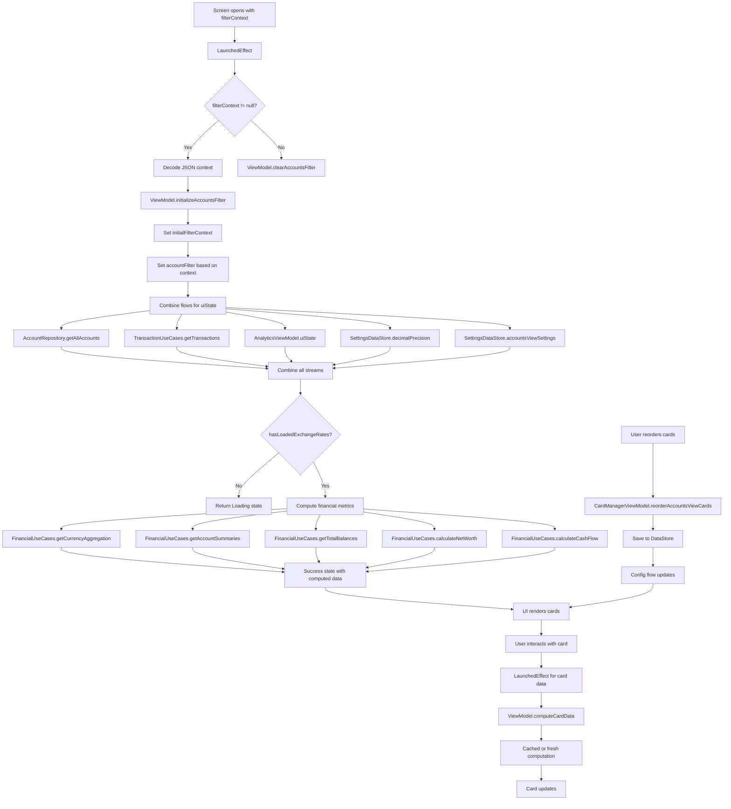

# AccountsViewScreen Functional Logic

## 1. Component Overview
- **Screen Name**: AccountsViewScreen
- **Purpose**: Displays a comprehensive view of accounts with customizable cards (Net Worth, Currency Balances, Cash Flow, Accounts List) and navigation drawer
- **ViewModel Class**: AccountsViewViewModel (primary), plus multiple supporting ViewModels
- **Related Use Cases**: FinancialUseCases, TransactionUseCases, CardComputationService

## 2. Input Analysis

### Component Inputs (UI → ViewModel)
- **Navigation Callbacks**:
  - onDashboardClick, onRecordsClick, onAnalyticsClick, onBudgetsClick, onLoansClick
  - onExchangeRatesClick, onTemplatesClick, onManageAccountsClick, onSettingsClick
  - onAccountClick(accountId: String), onAddAccountClick, onAddClick(type, template)
- **User Actions**:
  - Open/close navigation drawer
  - Add/remove/reorder cards
  - Filter accounts by type, currency, balance range
  - Expand FAB menu for quick actions
  - Click on card elements (currency, income/expense, account)
- **Context Parameters**: filterContext (String?) for initial filter from navigation

### ViewModel Inputs (Use Cases/Repositories)
- **Data Sources**:
  - AccountRepository: For account data
  - TransactionUseCases: For transaction data and filtering
  - SettingsDataStore: For configuration and settings
  - AnalyticsViewModel: For exchange rates and currency selection
  - FinancialUseCases: For financial computations (net worth, cash flow, etc.)
  - CardComputationService: For card-specific data computation
  - CardManagerViewModel: For card configuration management
- **Initial State Parameters**: filterContext (optional navigation parameter)
- **Configuration Parameters**: 
  - AccountsViewSettings from DataStore
  - AnalyticsCardsConfig from DataStore

## 3. Output Analysis

### ViewModel Outputs (UI State)
```kotlin
val uiState: StateFlow<AccountsViewUiState>
val sectionOrder: StateFlow<List<AccountsViewSection>>
val accountsViewCardsConfig: StateFlow<DashboardCardsConfig>
val accountFilter: StateFlow<AccountFilter>
val initialFilterContext: StateFlow<AccountsFilterContext>
```

**AccountsViewUiState Structure**:
```kotlin
sealed class AccountsViewUiState {
    object Loading : AccountsViewUiState()
    data class Success(
        val accounts: List<Account>,
        val allTransactions: List<Transaction>,
        val baseCurrency: String,
        val exchangeRates: Map<String, BigDecimal>,
        val currencyTotals: List<CurrencyAggregationItem>,
        val decimalPrecision: Int,
        val accountStats: Map<String, AccountSummaryItem>,
        val gridColumns: Int,
        val accountsLayout: String,
        val showAddAccountCard: Boolean,
        val accountsTimelineRange: TimelineRange,
        val currencyBalancesLayout: String,
        val showBaseConversion: Boolean,
        val currencyBalancesTimelineRange: TimelineRange,
        val cashFlowShowBaseConversion: Boolean,
        val cashFlowTimelineRange: TimelineRange,
        val netWorth: BigDecimal,
        val netIncome: BigDecimal,
        val netExpense: BigDecimal,
        val netWorthFontSize: String,
        val netWorthTimelineRange: TimelineRange,
        val cashFlowResult: CashFlowResult?
    ) : AccountsViewUiState()
    data class Error(val message: String) : AccountsViewUiState()
}
```

**Loading/Error States**: Loading state while exchange rates load, Error state for failures

**Navigation Events**: None (handled via callback parameters)

### Component Outputs (User Actions)
- **Navigation**: All navigation callbacks passed to screen
- **Side Effects**:
  - Show/hide FAB menu
  - Show add card dialog
  - Navigate to filtered records view
  - Navigate to account detail

## 4. Computation Logic

### Value: Net Worth Card Data
- **Value Name**: computeNetWorthCard
- **Input Data**: NetWorthCardConfig, accounts, transactions, baseCurrency, exchangeRates, precision
- **Computation Formula/Logic**:
  ```kotlin
  suspend fun computeNetWorthCard(
      cardConfig: NetWorthCardConfig,
      accounts: List<Account>,
      transactions: List<Transaction>,
      baseCurrency: String,
      exchangeRates: Map<String, BigDecimal>,
      precision: Int
  ): Pair<BigDecimal, CashFlowResult> {
      val cacheKey = "networth_${cardConfig.cardId}_${cardConfig.timelineRange}"
      return getCachedOrCompute(cacheKey) {
          cardConfig.computeNetWorth(
              accounts = accounts,
              transactions = transactions,
              engine = financialUseCasesCardComputationAdapter,
              context = ComputationContext(baseCurrency, exchangeRates, precision)
          )
      }
  }
  ```
- **Use Case Involvement**: FinancialUseCasesCardComputationAdapter
- **Transformation Steps**: Account/Transaction entities → ComputationContext → Net Worth + Cash Flow

### Value: Currency Balances Card Data
- **Value Name**: computeCurrencyBalancesCard
- **Input Data**: CurrencyBalancesCardConfig, accounts, transactions, baseCurrency, exchangeRates, precision
- **Computation Formula/Logic**:
  ```kotlin
  suspend fun computeCurrencyBalancesCard(...): List<CurrencyAggregationItem> {
      val cacheKey = "currency_${cardConfig.cardId}_${cardConfig.timelineRange}"
      return getCachedOrCompute(cacheKey) {
          cardConfig.computeCurrencyTotals(
              accounts = accounts,
              transactions = transactions,
              engine = financialUseCasesCardComputationAdapter,
              context = ComputationContext(baseCurrency, exchangeRates, precision)
          )
      }
  }
  ```
- **Use Case Involvement**: FinancialUseCasesCardComputationAdapter
- **Transformation Steps**: Account/Transaction entities → Currency aggregation items

### Value: Cash Flow Card Data
- **Value Name**: computeCashFlowCard
- **Input Data**: CashFlowCardConfig, transactions, baseCurrency, exchangeRates, precision
- **Computation Formula/Logic**:
  ```kotlin
  suspend fun computeCashFlowCard(...): CashFlowResult {
      val cacheKey = "cashflow_${cardConfig.cardId}_${cardConfig.timelineRange}"
      return getCachedOrCompute(cacheKey) {
          cardConfig.computeCashFlow(
              transactions = transactions,
              engine = financialUseCasesCardComputationAdapter,
              context = ComputationContext(baseCurrency, exchangeRates, precision)
          )
      }
  }
  ```
- **Use Case Involvement**: FinancialUseCasesCardComputationAdapter
- **Transformation Steps**: Transaction entities → Cash flow analysis

### Value: Accounts Card Data
- **Value Name**: computeAccountsCard
- **Input Data**: AccountsCardConfig, accounts, transactions, baseCurrency, exchangeRates, precision
- **Computation Formula/Logic**:
  ```kotlin
  suspend fun computeAccountsCard(...): Pair<List<Account>, Map<String, AccountSummaryItem>> {
      val cacheKey = "accounts_${cardConfig.cardId}_${cardConfig.timelineRange}"
      return getCachedOrCompute(cacheKey) {
          cardConfig.computeAccountStats(
              accounts = accounts,
              transactions = transactions,
              engine = cardComputationService,
              context = ComputationContext(baseCurrency, exchangeRates, precision)
          )
      }
  }
  ```
- **Use Case Involvement**: CardComputationService
- **Transformation Steps**: Account/Transaction entities → Account statistics

### Value: Filter Initialization
- **Value Name**: initializeAccountsFilter
- **Input Data**: AccountsFilterContext (navigation parameter)
- **Computation Formula/Logic**:
  ```kotlin
  fun initializeAccountsFilter(context: AccountsFilterContext) {
      _initialFilterContext.value = context
      val filter = when (context) {
          is AccountsFilterContext.None -> AccountFilter()
          is AccountsFilterContext.ByType -> AccountFilter(accountTypes = listOf(context.accountType))
          is AccountsFilterContext.ByCurrency -> AccountFilter(currencies = listOf(context.currency))
          is AccountsFilterContext.Custom -> AccountFilter(
              accountTypes = context.accountTypes,
              currencies = context.currencies,
              minBalance = context.minBalance?.let { java.math.BigDecimal(it) },
              maxBalance = context.maxBalance?.let { java.math.BigDecimal(it) },
              includeHidden = context.includeHidden
          )
      }
      _accountFilter.value = filter
  }
  ```
- **Use Case Involvement**: None
- **Transformation Steps**: Navigation context → AccountFilter

## 5. Data Flow Diagram



## 6. Data Sources
- **Repository Interfaces**: AccountRepository, TransactionRepository (via TransactionUseCases)
- **Database Entities**: AccountEntity, TransactionEntity
- **Remote Data Sources**: CurrencyRepository (via AnalyticsViewModel for exchange rates)
- **Local Data Stores**: SettingsDataStore (accountsViewSettings, decimalPrecision, currentProfileId)

## 7. Business Logic Summary
- **Key Business Rules**:
  - Cards use caching (5-minute expiration) to avoid recomputation
  - Filter context can be passed via navigation for deep linking
  - Filter is cleared when leaving the screen (DisposableEffect)
  - Each card has independent configuration (timeline range, layout, etc.)
  - Card data is computed on-demand via LaunchedEffect per card
- **Validation Logic**: None
- **Calculations Performed**:
  - Net worth calculation with currency conversion
  - Currency aggregation and totals
  - Cash flow analysis (income/expense)
  - Account statistics per timeline range
- **State Management Approach**:
  - Central uiState combines all data sources
  - Per-card data computed separately with caching
  - Filter state managed independently
  - Navigation trigger guard to prevent double navigation

## 8. Dependencies

### ViewModel Dependencies
- AccountRepository
- TransactionUseCases
- SettingsDataStore
- AnalyticsViewModel
- FinancialUseCases
- CardManagerViewModel
- CardComputationService
- FinancialUseCasesCardComputationAdapter

### Use Case Dependencies
- TransactionUseCases (getTransactions, getFilteredTransactions)
- FinancialUseCases (getCurrencyAggregation, getAccountSummaries, getTotalBalances, calculateNetWorth, calculateCashFlow)
- CardComputationService (computeAccountStats)

### External Services/APIs
- CurrencyRepository (via AnalyticsViewModel for exchange rate fetching)
