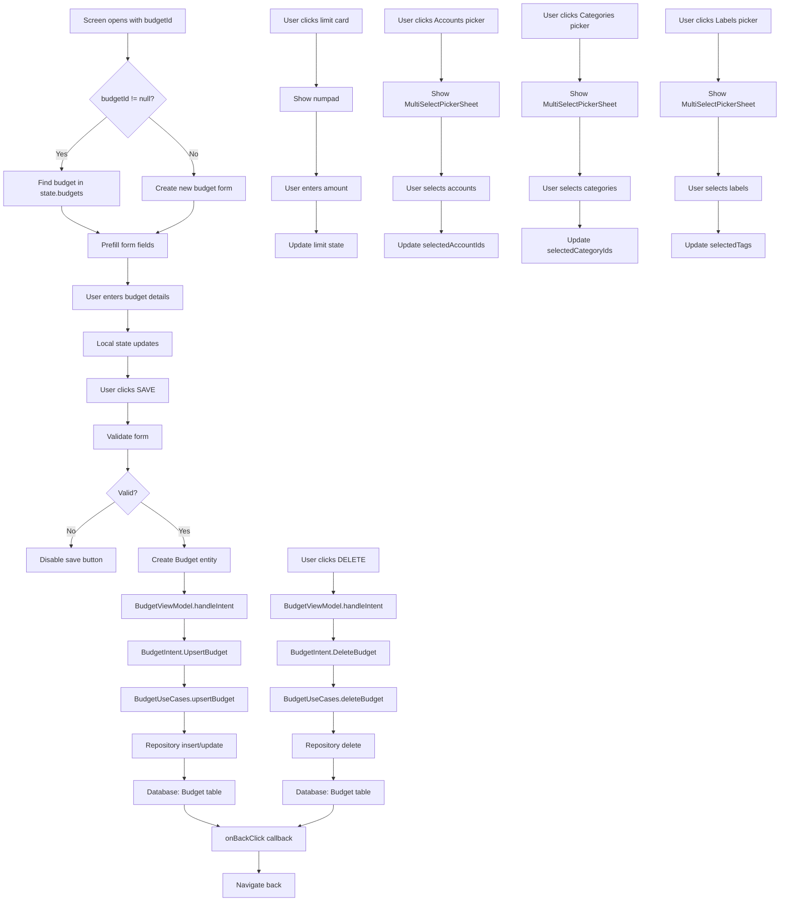

# AddEditBudgetScreen Functional Logic

## 1. Component Overview
- **Screen Name**: AddEditBudgetScreen
- **Purpose**: Allows users to create or edit budget limits with scope filtering (accounts, categories, labels)
- **ViewModel Class**: BudgetViewModel (primary), plus supporting ViewModels
- **Related Use Cases**: BudgetUseCases

## 2. Input Analysis

### Component Inputs (UI → ViewModel)
- **budgetId**: String? (null for new budget, existing ID for edit)
- **onBackClick**: Navigation callback to return to previous screen
- **User Actions**:
  - Enter budget name
  - Enter budget limit (via numpad)
  - Select budget period (Monthly, Weekly, Yearly, Custom)
  - Select accounts to include in budget
  - Select categories to include in budget
  - Select labels/tags to include in budget
  - Save budget
  - Delete budget (edit mode only)

### ViewModel Inputs (Use Cases/Repositories)
- **Data Sources**:
  - BudgetUseCases: For budget CRUD operations and analysis
  - AccountViewModel: For account list (account picker)
  - TransactionViewModel: For category list (category picker)
  - TagViewModel: For tag list (tag picker)
- **Initial State Parameters**: budgetId (optional)
- **Configuration Parameters**: None

## 3. Output Analysis

### ViewModel Outputs (UI State)
```kotlin
val state: StateFlow<BudgetState>
val budgets: StateFlow<List<Budget>>
```

**BudgetState Structure**:
```kotlin
data class BudgetState(
    val budgets: List<BudgetAnalysis> = emptyList(),
    val isLoading: Boolean = false,
    val error: String? = null
)
```

**Budget Model Structure**:
```kotlin
data class Budget(
    val id: String,
    val name: String,
    val limit: BigDecimal,
    val spent: BigDecimal,
    val period: BudgetPeriod,
    val currency: String,
    val filter: TransactionFilter
)
```

**BudgetPeriod Enum**: Monthly, Weekly, Yearly, Custom

**Loading/Error States**: isLoading during operations, error message on failure

**Navigation Events**: None (handled via callback parameters)

### Component Outputs (User Actions)
- **Navigation**: onBackClick
- **Side Effects**:
  - Show numpad for amount input
  - Show account picker (multi-select)
  - Show category picker (multi-select)
  - Show tag picker (multi-select)

## 4. Computation Logic

### Value: Budget Creation/Update
- **Value Name**: handleIntent(UpsertBudget)
- **Input Data**: Budget entity with name, limit, period, filter
- **Computation Formula/Logic**:
  ```kotlin
  private fun upsertBudget(budget: Budget) {
      viewModelScope.launch {
          budgetUseCases.upsertBudget(budget)
      }
  }
  ```
- **Use Case Involvement**: BudgetUseCases.upsertBudget
- **Transformation Steps**: Form data → Budget entity → Repository → Database

### Value: Budget Deletion
- **Value Name**: handleIntent(DeleteBudget)
- **Input Data**: budgetId: String
- **Computation Formula/Logic**:
  ```kotlin
  private fun deleteBudget(id: String) {
      viewModelScope.launch {
          budgetUseCases.deleteBudget(id)
      }
  }
  ```
- **Use Case Involvement**: BudgetUseCases.deleteBudget
- **Transformation Steps**: budgetId → Repository deletion

### Value: Budget Loading with Analysis
- **Value Name**: loadBudgets
- **Input Data**: None (loads all budgets for current profile)
- **Computation Formula/Logic**:
  ```kotlin
  private fun loadBudgets() {
      viewModelScope.launch {
          _state.update { it.copy(isLoading = true) }
          budgetUseCases.getBudgetsWithAnalysis()
              .catch { e -> _state.update { it.copy(isLoading = false, error = e.message) } }
              .collect { analysis ->
                  _state.update { it.copy(budgets = analysis, isLoading = false) }
              }
      }
  }
  ```
- **Use Case Involvement**: BudgetUseCases.getBudgetsWithAnalysis
- **Transformation Steps**: Budget entities → BudgetAnalysis (with spent calculation)

### Value: Form Validation
- **Value Name**: saveButtonEnabled
- **Input Data**: name, limit
- **Computation Formula/Logic**:
  ```kotlin
  enabled = name.isNotBlank() && limit.toBigDecimalOrNull() != null
  ```
- **Use Case Involvement**: None
- **Transformation Steps**: String validation → Boolean

### Value: Editing Budget Prefill
- **Value Name**: editingBudget
- **Input Data**: budgetId, state.budgets
- **Computation Formula/Logic**:
  ```kotlin
  val editingBudget = remember(budgetId, state.budgets) {
      state.budgets.find { it.budget.id == budgetId }?.budget
  }
  ```
- **Use Case Involvement**: None
- **Transformation Steps**: BudgetAnalysis → Budget (if found)

## 5. Data Flow Diagram



## 6. Data Sources
- **Repository Interfaces**: BudgetRepository (via BudgetUseCases)
- **Database Entities**: BudgetEntity (mapped to Budget domain model)
- **Remote Data Sources**: None
- **Local Data Stores**: None

## 7. Business Logic Summary
- **Key Business Rules**:
  - Budgets can filter by accounts, categories, and tags
  - Budget filter defaults to "expense" transaction type
  - When editing, existing budget data is prefilled
  - Multi-select pickers allow selecting multiple items
  - Budget limit must be a valid BigDecimal
  - Budget name must not be blank
- **Validation Logic**:
  - Name must not be blank
  - Limit must be valid BigDecimal
- **Calculations Performed**: None (spent calculation done in BudgetUseCases.getBudgetsWithAnalysis)
- **State Management Approach**:
  - Local state for form fields
  - BudgetViewModel state for budget list
  - Supporting ViewModels for picker data
  - Navigation trigger guard to prevent double navigation

## 8. Dependencies

### ViewModel Dependencies
- BudgetViewModel (primary)
- AccountViewModel (for account picker)
- TransactionViewModel (for category picker)
- TagViewModel (for tag picker)

### Use Case Dependencies
- BudgetUseCases (upsertBudget, deleteBudget, getBudgetsWithAnalysis)

### External Services/APIs
- None
