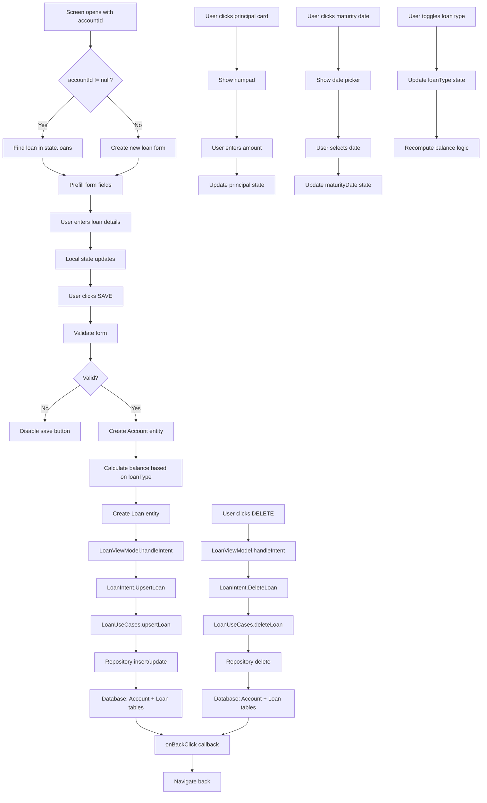

# AddEditLoanScreen Functional Logic

## 1. Component Overview
- **Screen Name**: AddEditLoanScreen
- **Purpose**: Allows users to create or edit loan/debt entries with principal amount, interest rate, and maturity date
- **ViewModel Class**: LoanViewModel
- **Related Use Cases**: LoanUseCases

## 2. Input Analysis

### Component Inputs (UI → ViewModel)
- **accountId**: String? (null for new loan, existing ID for edit)
- **onBackClick**: Navigation callback to return to previous screen
- **User Actions**:
  - Enter loan title/provider name
  - Enter principal amount (via numpad)
  - Enter interest rate (%)
  - Select loan type (Credit/Debt)
  - Select maturity date (via date picker)
  - Save loan
  - Delete loan (edit mode only)

### ViewModel Inputs (Use Cases/Repositories)
- **Data Sources**:
  - LoanUseCases: For loan CRUD operations and analysis
- **Initial State Parameters**: accountId (optional)
- **Configuration Parameters**: None

## 3. Output Analysis

### ViewModel Outputs (UI State)
```kotlin
val state: StateFlow<LoanState>
val loans: StateFlow<List<Loan>>
```

**LoanState Structure**:
```kotlin
data class LoanState(
    val loans: List<LoanAnalysis> = emptyList(),
    val isLoading: Boolean = false,
    val error: String? = null
)
```

**Loan Model Structure**:
```kotlin
data class Loan(
    val account: Account,
    val principal: BigDecimal,
    val interestRate: BigDecimal,
    val maturityDate: Long,
    val loanType: LoanType
)
```

**LoanType Enum**: Credit, Debt

**Account Model Structure** (embedded in Loan):
```kotlin
data class Account(
    val id: String,
    val name: String,
    val balance: BigDecimal,
    val currencyCode: String,
    val structureType: String,
    val colorHex: String,
    val icon: String,
    val allowedCurrencies: List<String>,
    val isArchived: Boolean,
    val displayOrder: Int
)
```

**Loading/Error States**: isLoading during operations, error message on failure

**Navigation Events**: None (handled via callback parameters)

### Component Outputs (User Actions)
- **Navigation**: onBackClick
- **Side Effects**:
  - Show numpad for principal amount input
  - Show date picker for maturity date

## 4. Computation Logic

### Value: Loan Creation/Update
- **Value Name**: handleIntent(UpsertLoan)
- **Input Data**: Loan entity with account, principal, interestRate, maturityDate, loanType
- **Computation Formula/Logic**:
  ```kotlin
  private fun upsertLoan(loan: Loan) {
      viewModelScope.launch {
          loanUseCases.upsertLoan(loan)
      }
  }
  ```
- **Use Case Involvement**: LoanUseCases.upsertLoan
- **Transformation Steps**: Form data → Loan entity → Repository → Database

### Value: Loan Deletion
- **Value Name**: handleIntent(DeleteLoan)
- **Input Data**: accountId: String
- **Computation Formula/Logic**:
  ```kotlin
  private fun deleteLoan(accountId: String) {
      viewModelScope.launch {
          loanUseCases.deleteLoan(accountId)
      }
  }
  ```
- **Use Case Involvement**: LoanUseCases.deleteLoan
- **Transformation Steps**: accountId → Repository deletion

### Value: Loan Loading with Analysis
- **Value Name**: loadLoans
- **Input Data**: None (loads all loans for current profile)
- **Computation Formula/Logic**:
  ```kotlin
  private fun loadLoans() {
      viewModelScope.launch {
          _state.update { it.copy(isLoading = true) }
          loanUseCases.getLoansWithAnalysis()
              .catch { e -> _state.update { it.copy(isLoading = false, error = e.message) } }
              .collect { analysis ->
                  _state.update { it.copy(loans = analysis, isLoading = false) }
              }
      }
  }
  ```
- **Use Case Involvement**: LoanUseCases.getLoansWithAnalysis
- **Transformation Steps**: Loan entities → LoanAnalysis (with principal paid calculation)

### Value: Account Balance Calculation
- **Value Name**: account.balance (in Loan creation)
- **Input Data**: principal, loanType
- **Computation Formula/Logic**:
  ```kotlin
  balance = if (loanType == LoanType.CREDIT) principalVal.negate() else principalVal
  ```
- **Use Case Involvement**: None
- **Transformation Steps**: Principal → Balance (negative for Credit, positive for Debt)

### Value: Form Validation
- **Value Name**: saveButtonEnabled
- **Input Data**: title, principal
- **Computation Formula/Logic**:
  ```kotlin
  enabled = title.isNotBlank() && principal.toBigDecimalOrNull() != null
  ```
- **Use Case Involvement**: None
- **Transformation Steps**: String validation → Boolean

### Value: Editing Loan Prefill
- **Value Name**: editingLoan
- **Input Data**: accountId, state.loans
- **Computation Formula/Logic**:
  ```kotlin
  val editingLoan = remember(accountId, state.loans) {
      state.loans.find { it.loan.account.id == accountId }?.loan
  }
  ```
- **Use Case Involvement**: None
- **Transformation Steps**: LoanAnalysis → Loan (if found)

### Value: Maturity Date Display
- **Value Name**: formatDateTime
- **Input Data**: maturityDate (Long timestamp)
- **Computation Formula/Logic**: Formats timestamp to readable date string
- **Use Case Involvement**: None
- **Transformation Steps**: Long → String (formatted date)

## 5. Data Flow Diagram



## 6. Data Sources
- **Repository Interfaces**: LoanRepository (via LoanUseCases), AccountRepository (via LoanUseCases)
- **Database Entities**: LoanEntity, AccountEntity (mapped to domain models)
- **Remote Data Sources**: None
- **Local Data Stores**: None

## 7. Business Logic Summary
- **Key Business Rules**:
  - Loans are represented as accounts with special "Loan" structure type
  - Credit loans have negative balance (liability)
  - Debt loans have positive balance (asset)
  - Loan type determines the balance sign
  - Maturity date tracks when the loan is due
  - Interest rate is stored as percentage (e.g., 5.0 = 5%)
  - Fixed color (#FF5722) and icon (CreditCard) for all loans
- **Validation Logic**:
  - Title must not be blank
  - Principal must be valid BigDecimal
- **Calculations Performed**:
  - Balance calculation: principal (negated for Credit, positive for Debt)
  - Principal paid calculation (in LoanUseCases.getLoansWithAnalysis)
- **State Management Approach**:
  - Local state for form fields
  - LoanViewModel state for loan list
  - Navigation trigger guard to prevent double navigation

## 8. Dependencies

### ViewModel Dependencies
- LoanViewModel (primary)

### Use Case Dependencies
- LoanUseCases (upsertLoan, deleteLoan, getLoansWithAnalysis)

### External Services/APIs
- None
