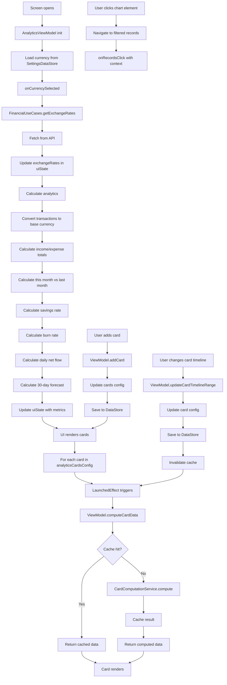

# AnalyticsScreen Functional Logic

## 1. Component Overview
- **Screen Name**: AnalyticsScreen
- **Purpose**: Displays comprehensive financial analytics with customizable cards for category breakdown, timeline trajectory, cash flow trends, forecasts, and more
- **ViewModel Class**: AnalyticsViewModel (primary), plus multiple supporting ViewModels
- **Related Use Cases**: FinancialUseCases, TransactionUseCases, CardComputationService

## 2. Input Analysis

### Component Inputs (UI → ViewModel)
- **Navigation Callbacks**:
  - onBackClick, onAccountsViewClick, onRecordsClick, onBudgetsClick, onLoansClick
  - onExchangeRatesClick, onTemplatesClick, onManageAccountsClick, onSettingsClick
  - onAccountClick(accountId: String), onAddClick(type, template)
- **User Actions**:
  - Open/close navigation drawer
  - Add/remove/reorder analytics cards
  - Change card timeline ranges
  - Change card filter parameters
  - Click on chart elements (categories, time periods)
- **Context Parameters**: None

### ViewModel Inputs (Use Cases/Repositories)
- **Data Sources**:
  - TransactionUseCases: For transaction data
  - FinancialUseCases: For financial computations (exchange rates, etc.)
  - SettingsDataStore: For configuration (currency, precision, cards config)
  - CardComputationService: For card-specific data computation
  - AccountRepository: For account data
- **Initial State Parameters**: None
- **Configuration Parameters**: 
  - AnalyticsCardsConfig from DataStore
  - Currency from SettingsDataStore
  - Decimal precision from SettingsDataStore

## 3. Output Analysis

### ViewModel Outputs (UI State)
```kotlin
val uiState: StateFlow<AnalyticsUiState>
val exchangeRates: StateFlow<Map<String, BigDecimal>>
val decimalPrecision: StateFlow<Int>
val analyticsCardsConfig: StateFlow<AnalyticsCardsConfig>
```

**AnalyticsUiState Structure**:
```kotlin
data class AnalyticsUiState(
    val currentBalance: BigDecimal = BigDecimal.ZERO,
    val savingsRate: Double = 0.0,
    val lastMonthSavingsRate: Double = 0.0,
    val burnRate: BigDecimal = BigDecimal.ZERO,
    val thisMonthSpending: BigDecimal = BigDecimal.ZERO,
    val lastMonthSpending: BigDecimal = BigDecimal.ZERO,
    val dailyNetFlow: Map<Long, BigDecimal> = emptyMap(),
    val forecast: Map<Long, BigDecimal> = emptyMap(),
    val selectedCurrency: String = "USD",
    val exchangeRates: Map<String, BigDecimal> = emptyMap(),
    val decimalPrecision: Int = 2,
    val isLoading: Boolean = false,
    val hasLoadedExchangeRates: Boolean = false,
    val allTransactions: List<Transaction> = emptyList(),
    val accounts: List<Account> = emptyList()
)
```

**Loading/Error States**: isLoading during exchange rate fetch, hasLoadedExchangeRates flag

**Navigation Events**: None (handled via callback parameters)

### Component Outputs (User Actions)
- **Navigation**: All navigation callbacks passed to screen
- **Side Effects**:
  - Show add card dialog
  - Navigate to filtered records view
  - Navigate to account detail

## 4. Computation Logic

### Value: Exchange Rate Loading
- **Value Name**: onCurrencySelected
- **Input Data**: currencyCode: String
- **Computation Formula/Logic**:
  ```kotlin
  fun onCurrencySelected(currencyCode: String) {
      if (_uiState.value.selectedCurrency == currencyCode && _uiState.value.exchangeRates.isNotEmpty()) {
          return
      }
      ratesJob?.cancel()
      ratesJob = viewModelScope.launch {
          _uiState.update { it.copy(isLoading = true, hasLoadedExchangeRates = false) }
          val rates = financialUseCases.getExchangeRates(currencyCode).mapValues { BigDecimal.valueOf(it.value) }
          _uiState.update { it.copy(
              selectedCurrency = currencyCode,
              exchangeRates = rates,
              isLoading = false,
              hasLoadedExchangeRates = true
          ) }
          calculateAnalytics()
      }
  }
  ```
- **Use Case Involvement**: FinancialUseCases.getExchangeRates
- **Transformation Steps**: Currency code → Exchange rates map

### Value: Analytics Calculation
- **Value Name**: calculateAnalytics
- **Input Data**: allTransactions, selectedCurrency, exchangeRates, decimalPrecision
- **Computation Formula/Logic**:
  ```kotlin
  private fun calculateAnalytics() {
      val selectedCurrency = _uiState.value.selectedCurrency
      val currentRates = _uiState.value.exchangeRates
      
      // Convert all transactions to selected currency
      val convertedTransactions = allTransactions.map { tx ->
          val convertedAmount = CurrencyService.convertAmount(
              amount = tx.amount,
              fromCurrency = tx.currency,
              toCurrency = selectedCurrency,
              exchangeRates = currentRates,
              precision = _currentPrecision + 4
          )
          tx.copy(amount = convertedAmount)
      }

      // Calculate totals
      val totalIncome = convertedTransactions.filter { it.amount.signum() >= 0 }
          .fold(BigDecimal.ZERO) { acc, tx -> acc.add(tx.amount) }
          .setScale(_currentPrecision, RoundingMode.HALF_UP)
      val totalExpense = convertedTransactions.filter { it.amount.signum() < 0 }
          .fold(BigDecimal.ZERO) { acc, tx -> acc.add(tx.amount) }
          .setScale(_currentPrecision, RoundingMode.HALF_UP)
      val currentBalance = totalIncome.add(totalExpense)
      
      // Calculate this month vs last month
      val thisMonthTransactions = convertedTransactions.filter { 
          val cal = Calendar.getInstance().apply { timeInMillis = it.timestamp }
          cal.get(Calendar.MONTH) == currentMonth && cal.get(Calendar.YEAR) == currentYear
      }
      val thisMonthIncome = thisMonthTransactions.filter { it.amount.signum() >= 0 }
          .fold(BigDecimal.ZERO) { acc, tx -> acc.add(tx.amount) }
      val thisMonthExpense = thisMonthTransactions.filter { it.amount.signum() < 0 }
          .fold(BigDecimal.ZERO) { acc, tx -> acc.add(tx.amount) }
      val thisMonthSavingsRate = if (thisMonthIncome.signum() > 0) {
          thisMonthIncome.add(thisMonthExpense).divide(thisMonthIncome, 4, RoundingMode.HALF_UP).toDouble()
      } else 0.0

      // Calculate burn rate and forecast
      val daysActive = if (firstTx != null) {
          (System.currentTimeMillis() - firstTx.timestamp) / (24 * 60 * 60 * 1000L).coerceAtLeast(1)
      } else 1
      val dailyExpenseAvg = totalExpense.divide(BigDecimal.valueOf(daysActive), _currentPrecision, RoundingMode.HALF_UP)
      val monthlyBurnRate = dailyExpenseAvg.multiply(BigDecimal.valueOf(30))

      // Calculate forecast
      val forecast = (1..30).map { day ->
          val timestamp = System.currentTimeMillis() + day * 24 * 60 * 60 * 1000L
          val projectedBalance = currentBalance.add(avgDailyNetFlow.multiply(BigDecimal.valueOf(day.toLong())))
          timestamp to projectedBalance
      }

      _uiState.update { 
          it.copy(
              currentBalance = currentBalance,
              savingsRate = thisMonthSavingsRate,
              burnRate = monthlyBurnRate,
              thisMonthSpending = thisMonthExpense,
              lastMonthSpending = lastMonthExpense,
              dailyNetFlow = dailyNetFlow,
              forecast = forecast.toMap(),
              decimalPrecision = _currentPrecision,
              isLoading = false
          )
      }
  }
  ```
- **Use Case Involvement**: CurrencyService.convertAmount
- **Transformation Steps**: Raw transactions → Currency-converted transactions → Aggregated metrics

### Value: Card-Specific Computations
- **Value Name**: compute[CardType]Card (multiple methods)
- **Input Data**: CardConfig, allTransactions, accounts, ComputationContext
- **Computation Formula/Logic**:
  ```kotlin
  suspend fun computeCategoryBreakdownCard(config: CategoryBreakdownCardConfig): List<CategoryBreakdownData> {
      val cacheKey = "category_breakdown_${config.cardId}_${config.filter.hashCode()}"
      return getCachedOrCompute(cacheKey) {
          computeCategoryBreakdownForCard(config, allTransactions)
      }
  }
  ```
  Similar pattern for:
  - computeTimelineTrajectoryCard
  - computeCategoryExpenseTreemapCard
  - computeIncomeExpensesSummaryCard
  - computePeriodComparisonCard
  - computeCashFlowTrendCard
  - computeCashFlowProgressCard
  - computeBalanceForecastCard
  - computePlannedPaymentsCard
  - computeIncomeExpensesBookCard
  - computeCashFlowTableCard
  - computePlannedPaymentsTimelineCard
  - computeBalanceByAccountsCard
  - computeBalanceTrendCard
- **Use Case Involvement**: CardComputationService (delegates to specific computation methods)
- **Transformation Steps**: CardConfig + Data → Card-specific data structure

### Value: Card Management
- **Value Name**: addCard, removeCard, updateCardTimelineRange, updateCardConfigById, reorderCards
- **Input Data**: CardConfig or cardId with update function
- **Computation Formula/Logic**:
  ```kotlin
  suspend fun addCard(cardConfig: CardConfig) {
      _analyticsCardsConfig.value = _analyticsCardsConfig.value.copy(
          cards = _analyticsCardsConfig.value.cards + cardConfig
      )
      settingsDataStore.saveAnalyticsCardsConfig(Json.encodeToString(_analyticsCardsConfig.value))
  }
  ```
- **Use Case Involvement**: None
- **Transformation Steps**: Card config update → JSON serialization → DataStore save

## 5. Data Flow Diagram



## 6. Data Sources
- **Repository Interfaces**: TransactionRepository (via TransactionUseCases), AccountRepository, CurrencyRepository
- **Database Entities**: TransactionEntity, AccountEntity
- **Remote Data Sources**: Currency API (via CurrencyRepository for exchange rates)
- **Local Data Stores**: SettingsDataStore (currency, decimalPrecision, analyticsCardsConfig)

## 7. Business Logic Summary
- **Key Business Rules**:
  - Exchange rates are fetched from API and cached
  - All transactions are converted to selected base currency for analytics
  - Card data is cached (5-minute expiration) to avoid recomputation
  - Cache is invalidated when transactions or accounts change
  - Analytics calculations use 4 extra precision for intermediate steps
  - Forecast projects 30 days based on average daily net flow
  - Burn rate calculated as daily average × 30
  - Savings rate = (income + expense) / income
- **Validation Logic**: None
- **Calculations Performed**:
  - Currency conversion for all transactions
  - Income/expense totals
  - Monthly comparisons (this month vs last month)
  - Savings rate calculation
  - Daily expense average
  - Monthly burn rate
  - Daily net flow aggregation
  - 30-day balance forecast
  - Card-specific computations (category breakdown, timeline, etc.)
- **State Management Approach**:
  - Central uiState for global metrics
  - Per-card data computed separately with caching
  - Exchange rates loaded asynchronously
  - Card configuration persisted in DataStore

## 8. Dependencies

### ViewModel Dependencies
- TransactionUseCases
- FinancialUseCases
- SettingsDataStore
- CardComputationService
- AccountRepository

### Use Case Dependencies
- TransactionUseCases (getTransactions)
- FinancialUseCases (getExchangeRates)
- CardComputationService (computeCategoryBreakdown, computeTimelineTrajectory, etc.)

### External Services/APIs
- Currency API (via CurrencyRepository for exchange rate fetching)
