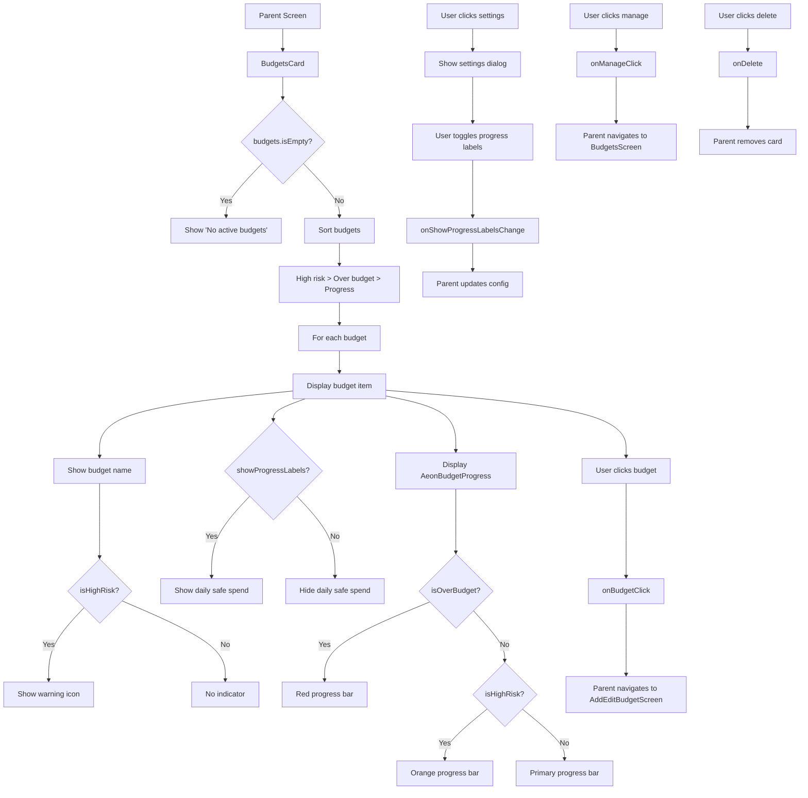

# BudgetsCard Functional Logic

## 1. Component Overview
- **Component Name**: BudgetsCard
- **Purpose**: Displays budget progress indicators with risk assessment and daily safe spend calculation
- **Parent Screen**: DashboardScreen, AccountsViewScreen
- **Related Components**: AeonBudgetProgress, AeonSettingsToggle
- **Configuration Class**: BudgetSettings

## 2. Input Analysis

### Component Inputs (Parent Screen → Component)
- **onManageClick**: () -> Unit - Navigate to budget management
- **onBudgetClick**: (String) -> Unit - Navigate to budget edit (budget ID)
- **onRecordsClick**: (RecordsFilterContext) -> Unit - Navigate to filtered transaction list
- **budgets**: List<BudgetAnalysis> - Budget analysis data
- **baseCurrency**: String - Base currency for display
- **cardId**: String - Unique card identifier
- **precision**: Int - Decimal precision for currency formatting
- **showProgressLabels**: Boolean - Whether to show daily safe spend labels
- **timelineRange**: TimelineRange - Timeline range (not used in sorting but available)
- **onShowProgressLabelsChange**: (String, Boolean) -> Unit - Toggle progress labels (cardId, show)
- **onDelete**: () -> Unit - Delete card callback

### Component Inputs (ViewModel → Parent Screen)
- **BudgetAnalysis**: From BudgetViewModel
  - budget: Budget
    - id: String
    - name: String
    - limit: BigDecimal
    - spent: BigDecimal
    - progress: Float
    - isOverBudget: Boolean
    - filter: BudgetFilter
  - dailySafeSpend: BigDecimal
  - isHighRisk: Boolean

## 3. Output Analysis

### Component Outputs (Component → Parent Screen)
- **Navigation Events**:
  - onBudgetClick(budgetId) - Navigate to AddEditBudgetScreen (edit mode)
  - onManageClick() - Navigate to BudgetsScreen
  - onRecordsClick(filter) - Navigate to TransactionListScreen with budget filter
- **Configuration Changes**:
  - onShowProgressLabelsChange(cardId, show) - Toggle daily safe spend labels
  - onDelete() - Delete card from configuration

### Displayed Data Structure
```kotlin
// For each budget:
- Budget name (uppercase)
- High risk indicator (warning icon if isHighRisk)
- Daily safe spend label (if showProgressLabels)
- Progress bar showing spent vs limit
- Progress bar color:
  - Red if over budget
  - Orange if high risk
  - Primary color otherwise
```

## 4. Computation Logic

### Value: Budget Sorting
- **Value Name**: sortedBudgets
- **Input Data**: budgets
- **Computation Formula/Logic**:
  ```kotlin
  val sortedBudgets = remember(budgets) {
      budgets.sortedWith(
          compareByDescending<BudgetAnalysis> { it.isHighRisk }
              .thenByDescending { it.budget.isOverBudget }
              .thenByDescending { it.budget.progress }
      )
  }
  ```
- **Use Case Involvement**: None
- **Transformation Steps**: Sort by high risk (desc) → over budget (desc) → progress (desc)

### Value: Progress Bar Color
- **Value Name**: color
- **Input Data**: budget.isOverBudget, analysis.isHighRisk
- **Computation Formula/Logic**:
  ```kotlin
  color = if (budget.isOverBudget) MaterialTheme.colorScheme.error 
         else if (analysis.isHighRisk) Color(0xFFFFA000) // Orange
         else MaterialTheme.colorScheme.primary
  ```
- **Use Case Involvement**: None
- **Transformation Steps**: Risk status → Color

### Value: Daily Safe Spend Label Color
- **Value Name**: labelColor
- **Input Data**: analysis.isHighRisk
- **Computation Formula/Logic**:
  ```kotlin
  color = if (analysis.isHighRisk) MaterialTheme.colorScheme.error 
         else MaterialTheme.colorScheme.primary.copy(alpha = 0.6f)
  ```
- **Use Case Involvement**: None
- **Transformation Steps**: Risk status → Color with alpha

### Value: Records Filter Context
- **Value Name**: filter
- **Input Data**: budget.filter
- **Computation Formula/Logic**:
  ```kotlin
  RecordsFilterContext.Custom(
      categoryIds = budget.filter.categoryIds.map { it.toString() },
      accountIds = budget.filter.accountIds,
      startDate = null, // Filter handles period
      endDate = null
  )
  ```
- **Use Case Involvement**: None
- **Transformation Steps**: Budget filter → RecordsFilterContext

## 5. Data Flow Diagram



## 6. Data Sources
- **Repository Interfaces**: BudgetRepository, TransactionRepository (via ViewModel)
- **Database Entities**: BudgetEntity, TransactionEntity
- **Remote Data Sources**: None
- **Local Data Stores**: SettingsDataStore (base currency, dashboardCardsConfig)

## 7. Business Logic Summary
- **Key Business Rules**:
  - Budgets sorted by priority: high risk > over budget > highest progress
  - High risk budgets shown with warning icon
  - Daily safe spend labels can be toggled
  - Progress bar color indicates status (red/over budget, orange/high risk, primary/normal)
  - Empty state shows "No active budgets"
  - Clicking budget navigates to edit screen
  - Settings dialog allows manage navigation and label toggle
  - Daily safe spend color red for high risk, primary otherwise
- **Validation Logic**: None
- **Calculations Performed**:
  - Budget sorting logic
  - Progress bar color selection
  - Daily safe spend label color selection
- **State Management Approach**:
  - Local state for settings dialog visibility
  - Configuration passed as parameters
  - Callbacks for all configuration changes
  - Stateless rendering (no internal state)

## 8. Dependencies

### Component Dependencies
- AeonBudgetProgress
- AeonSettingsToggle

### Parent Screen Dependencies
- BudgetViewModel (for BudgetAnalysis)
- SettingsDataStore (for base currency, dashboardCardsConfig)

### External Services/APIs
- None
