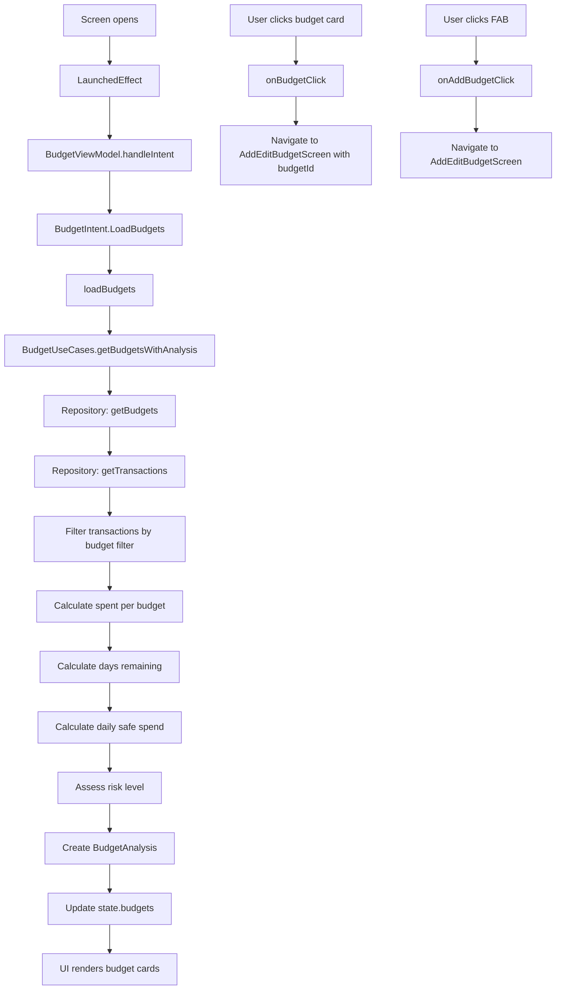

# BudgetsScreen Functional Logic

## 1. Component Overview
- **Screen Name**: BudgetsScreen
- **Purpose**: Displays a list of all budgets with progress indicators, daily safe spend calculation, and days remaining
- **ViewModel Class**: BudgetViewModel (primary), plus supporting ViewModel
- **Related Use Cases**: BudgetUseCases

## 2. Input Analysis

### Component Inputs (UI → ViewModel)
- **onBackClick**: Navigation callback to return to previous screen
- **onAddBudgetClick**: Navigation callback to add new budget
- **onBudgetClick**: Navigation callback to edit/view budget details (budgetId: String)
- **User Actions**:
  - Click on budget card to view details
  - Click FAB to add new budget

### ViewModel Inputs (Use Cases/Repositories)
- **Data Sources**:
  - BudgetUseCases: For budget data and analysis
  - SettingsDataStore: For base currency (via SettingsViewModel)
- **Initial State Parameters**: None
- **Configuration Parameters**: None

## 3. Output Analysis

### ViewModel Outputs (UI State)
```kotlin
val state: StateFlow<BudgetState>
```

**BudgetState Structure**:
```kotlin
data class BudgetState(
    val budgets: List<BudgetAnalysis> = emptyList(),
    val isLoading: Boolean = false,
    val error: String? = null
)
```

**BudgetAnalysis Structure**:
```kotlin
data class BudgetAnalysis(
    val budget: Budget,
    val isHighRisk: Boolean,
    val dailySafeSpend: BigDecimal,
    val daysRemaining: Int
)
```

**Budget Model Structure**:
```kotlin
data class Budget(
    val id: String,
    val name: String,
    val limit: BigDecimal,
    val spent: BigDecimal,
    val period: BudgetPeriod,
    val currency: String,
    val filter: TransactionFilter
)
```

**BudgetPeriod Enum**: Monthly, Weekly, Yearly, Custom

**Loading/Error States**: isLoading during operations, error message on failure

**Navigation Events**: None (handled via callback parameters)

### Component Outputs (User Actions)
- **Navigation**: onBackClick, onAddBudgetClick, onBudgetClick
- **Side Effects**: None

## 4. Computation Logic

### Value: Budget Loading with Analysis
- **Value Name**: loadBudgets
- **Input Data**: None (loads all budgets for current profile)
- **Computation Formula/Logic**:
  ```kotlin
  private fun loadBudgets() {
      viewModelScope.launch {
          _state.update { it.copy(isLoading = true) }
          budgetUseCases.getBudgetsWithAnalysis()
              .catch { e -> _state.update { it.copy(isLoading = false, error = e.message) } }
              .collect { analysis ->
                  _state.update { it.copy(budgets = analysis, isLoading = false) }
              }
      }
  }
  ```
- **Use Case Involvement**: BudgetUseCases.getBudgetsWithAnalysis
- **Transformation Steps**: Budget entities → BudgetAnalysis (with spent calculation, risk assessment, daily safe spend)

### Value: Budget Analysis Calculations
- **Value Name**: BudgetAnalysis (computed in BudgetUseCases)
- **Input Data**: Budget entity, transactions matching budget filter
- **Computation Formula/Logic**:
  ```kotlin
  // Spent calculation
  spent = sum of transactions matching budget filter within period
  
  // Days remaining calculation
  daysRemaining = periodEndDate - currentDate
  
  // Daily safe spend calculation
  dailySafeSpend = (limit - spent) / daysRemaining
  
  // High risk assessment
  isHighRisk = spent > (limit * 0.8) || daysRemaining < 5
  ```
- **Use Case Involvement**: BudgetUseCases
- **Transformation Steps**: Budget + Transactions → BudgetAnalysis

## 5. Data Flow Diagram



## 6. Data Sources
- **Repository Interfaces**: BudgetRepository (via BudgetUseCases), TransactionRepository (via BudgetUseCases)
- **Database Entities**: BudgetEntity, TransactionEntity
- **Remote Data Sources**: None
- **Local Data Stores**: SettingsDataStore (base currency via SettingsViewModel)

## 7. Business Logic Summary
- **Key Business Rules**:
  - Budgets display progress based on spent vs limit
  - Progress color changes based on budget status (error if over budget, orange if high risk, primary otherwise)
  - Daily safe spend shows how much can be spent per day to stay within budget
  - Days remaining shows time left in budget period
  - High risk indicator shows if budget is at risk of being exceeded
  - Budget cards are clickable for editing/viewing details
- **Validation Logic**: None
- **Calculations Performed**:
  - Spent amount (sum of filtered transactions)
  - Days remaining (period end date - current date)
  - Daily safe spend ((limit - spent) / days remaining)
  - Risk assessment (spent > 80% of limit or < 5 days remaining)
- **State Management Approach**:
  - BudgetViewModel state for budget list with analysis
  - SettingsViewModel for base currency
  - Reactive state loading via LaunchedEffect

## 8. Dependencies

### ViewModel Dependencies
- BudgetViewModel (primary)
- SettingsViewModel (for base currency)

### Use Case Dependencies
- BudgetUseCases (getBudgetsWithAnalysis)

### External Services/APIs
- None
