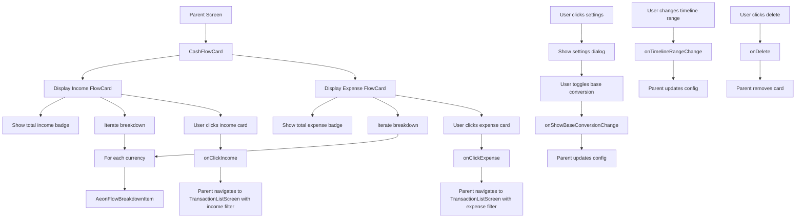

# CashFlowCard Functional Logic

## 1. Component Overview
- **Component Name**: CashFlowCard
- **Purpose**: Displays income/expense breakdown by currency with optional base currency conversion
- **Parent Screen**: DashboardScreen, AccountsViewScreen
- **Related Components**: AeonFlowCard, AeonFlowBreakdownItem, AeonBaseConversionToggle
- **Configuration Class**: CashFlowSettings

## 2. Input Analysis

### Component Inputs (Parent Screen → Component)
- **cashFlowResult**: CashFlowResult? - Cash flow data with breakdown by currency
- **baseCurrency**: String - Base currency for conversions
- **currentTheme**: String - Current app theme for styling
- **cardId**: String - Unique card identifier
- **showTitle**: Boolean - Whether to show card title
- **precision**: Int - Decimal precision for currency formatting
- **showBaseConversion**: Boolean - Whether to show base currency conversion
- **timelineRange**: TimelineRange - Timeline range for calculations
- **onShowBaseConversionChange**: (String, Boolean) -> Unit - Toggle base conversion (cardId, show)
- **onTimelineRangeChange**: (String, TimelineRange) -> Unit - Update timeline range
- **onDelete**: () -> Unit - Delete card callback
- **onClickIncome**: (TimelineRange) -> Unit - Navigate to income transactions
- **onClickExpense**: (TimelineRange) -> Unit - Navigate to expense transactions

### Component Inputs (ViewModel → Parent Screen)
- **CashFlowResult**: From AccountsViewViewModel or AnalyticsViewModel
  - totalIncomeInBase: BigDecimal
  - totalExpensesInBase: BigDecimal
  - breakdown: List<CurrencyBreakdown>
    - currency: String
    - income: BigDecimal
    - incomeInBase: BigDecimal
    - expense: BigDecimal
    - expenseInBase: BigDecimal

## 3. Output Analysis

### Component Outputs (Component → Parent Screen)
- **Navigation Events**:
  - onClickIncome(timelineRange) - Navigate to TransactionListScreen with income filter
  - onClickExpense(timelineRange) - Navigate to TransactionListScreen with expense filter
- **Configuration Changes**:
  - onShowBaseConversionChange(cardId, show) - Toggle base conversion display
  - onTimelineRangeChange(cardId, range) - Update timeline range
  - onDelete() - Delete card from configuration

### Displayed Data Structure
```kotlin
// Card displays two side-by-side flow cards:
// Income Card:
- Total income in base currency (badge)
- Income breakdown by currency
- Each currency shows:
  - Currency code
  - Income amount in original currency
  - Income amount in base currency (if enabled)

// Expense Card:
- Total expense in base currency (badge)
- Expense breakdown by currency
- Each currency shows:
  - Currency code
  - Expense amount in original currency
  - Expense amount in base currency (if enabled)
```

## 4. Computation Logic

### Value: Timeline Label
- **Value Name**: timelineLabel
- **Input Data**: timelineRange
- **Computation Formula/Logic**:
  ```kotlin
  val timelineLabel = when (timelineRange) {
      is TimelineRange.AllTime -> "All Time"
      is TimelineRange.ThisPeriod -> timelineRange.period.label
      is TimelineRange.LastPeriod -> timelineRange.period.label
      is TimelineRange.CustomRange -> {
          val formatter = DateTimeFormatter.ofPattern("MMM d, yyyy").withZone(ZoneId.systemDefault())
          val start = formatter.format(Instant.ofEpochMilli(timelineRange.start))
          val end = formatter.format(Instant.ofEpochMilli(timelineRange.end))
          "$start - $end"
      }
  }
  ```
- **Use Case Involvement**: None
- **Transformation Steps**: TimelineRange → Display string

### Value: Total Income in Base
- **Value Name**: totalIncomeInBase
- **Input Data**: cashFlowResult
- **Computation Formula/Logic**:
  ```kotlin
  val totalIncomeInBase = cashFlowResult?.totalIncomeInBase ?: BigDecimal.ZERO
  ```
- **Use Case Involvement**: None (computed in ViewModel)
- **Transformation Steps**: Extract from CashFlowResult

### Value: Total Expense in Base
- **Value Name**: totalExpenseInBase
- **Input Data**: cashFlowResult
- **Computation Formula/Logic**:
  ```kotlin
  val totalExpenseInBase = cashFlowResult?.totalExpensesInBase ?: BigDecimal.ZERO
  ```
- **Use Case Involvement**: None (computed in ViewModel)
- **Transformation Steps**: Extract from CashFlowResult

### Value: Flow Card Color
- **Value Name**: color
- **Input Data**: type (CashFlowType.INCOME or EXPENSE)
- **Computation Formula/Logic**:
  ```kotlin
  val color = if (type == CashFlowType.INCOME) incomeColor else expenseColor
  // incomeColor = Color(0xFF4CAF50) (green)
  // expenseColor = Color(0xFFF44336) (red)
  ```
- **Use Case Involvement**: None
- **Transformation Steps**: CashFlowType → Color

### Value: Flow Card Icon
- **Value Name**: icon
- **Input Data**: type (CashFlowType.INCOME or EXPENSE)
- **Computation Formula/Logic**:
  ```kotlin
  val icon = if (type == CashFlowType.INCOME) Icons.Rounded.ArrowUpward else Icons.Rounded.ArrowDownward
  ```
- **Use Case Involvement**: None
- **Transformation Steps**: CashFlowType → Icon

### Value: Icon Height
- **Value Name**: iconHeight
- **Input Data**: cardSize.height, density
- **Computation Formula/Logic**:
  ```kotlin
  val iconHeight = with(density) { (cardSize.height * 0.6f).toDp() }
  ```
- **Use Case Involvement**: None
- **Transformation Steps**: Card height → 60% of height in dp

## 5. Data Flow Diagram



## 6. Data Sources
- **Repository Interfaces**: TransactionRepository (via ViewModel)
- **Database Entities**: TransactionEntity
- **Remote Data Sources**: None
- **Local Data Stores**: SettingsDataStore (base currency, dashboardCardsConfig)

## 7. Business Logic Summary
- **Key Business Rules**:
  - Displays income and expense side-by-side
  - Each flow card shows total in base currency as badge
  - Breakdown by currency shown in card content
  - Base currency conversion can be toggled
  - Theme affects card styling
  - Title can be hidden (for use in other contexts)
  - Flow cards have background icons (60% of card height)
  - Income uses green color and up arrow
  - Expense uses red color and down arrow
  - Timeline range affects cash flow calculation
- **Validation Logic**: None
- **Calculations Performed**:
  - Timeline label formatting
  - Icon height calculation (60% of card height)
- **State Management Approach**:
  - Local state for settings dialog visibility
  - Local state for card size (for icon sizing)
  - Configuration passed as parameters
  - Callbacks for all configuration changes
  - Stateless rendering (minimal internal state)

## 8. Dependencies

### Component Dependencies
- AeonFlowCard
- AeonFlowBreakdownItem
- AeonBaseConversionToggle
- TimelineFilterBar

### Parent Screen Dependencies
- AccountsViewViewModel or AnalyticsViewModel (for CashFlowResult)
- SettingsDataStore (for base currency, dashboardCardsConfig)

### External Services/APIs
- None
