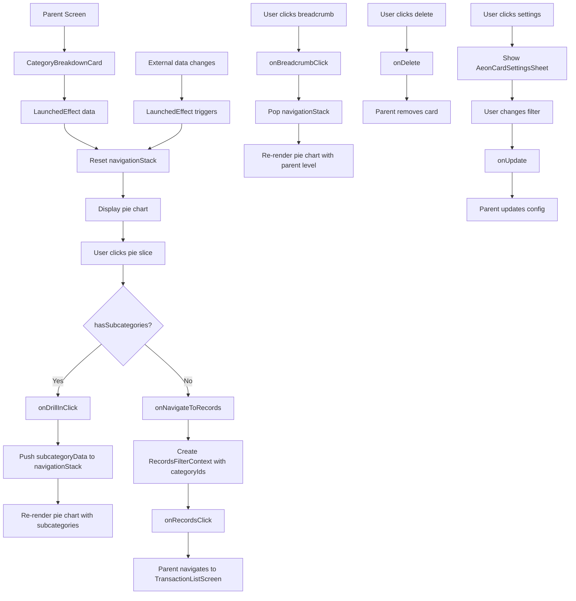

# CategoryBreakdownCard Functional Logic

## 1. Component Overview
- **Component Name**: CategoryBreakdownCard
- **Purpose**: Pie chart showing category spending breakdown with drill-down capability to subcategories
- **Parent Screen**: AnalyticsScreen
- **Related Components**: AeonPieChart, CategoryLegend, AeonCardSettingsSheet
- **Configuration Class**: CategoryBreakdownCardConfig

## 2. Input Analysis

### Component Inputs (Parent Screen → Component)
- **config**: CategoryBreakdownCardConfig - Card configuration
- **data**: List<CategoryBreakdownData> - Category breakdown data
- **onUpdate**: (CategoryBreakdownCardConfig) -> Unit - Update configuration
- **onDelete**: () -> Unit - Delete card callback
- **onRecordsClick**: (RecordsFilterContext) -> Unit - Navigate to filtered transaction list
- **accounts**: List<Account> - Account list for filter configuration
- **allCategories**: List<CategoryEntity> - Category list for filter configuration
- **savedFilters**: List<FilterEntity> - Saved filters for filter configuration

### Component Inputs (ViewModel → Parent Screen)
- **CategoryBreakdownData**: From AnalyticsViewModel via CardComputationService
  - category: String
  - categoryId: Long?
  - netBalance: BigDecimal
  - income: BigDecimal
  - expense: BigDecimal
  - colorHex: Int
  - percentage: Float
  - hasSubcategories: Boolean
  - subcategoryData: List<CategoryBreakdownData>?

### Component Internal State
- **navigationStack**: List<List<CategoryBreakdownData>> - Stack for drill-down navigation
- **showSettings**: Boolean - Settings sheet visibility

## 3. Output Analysis

### Component Outputs (Component → Parent Screen)
- **Navigation Events**:
  - onRecordsClick(filter) - Navigate to TransactionListScreen with category filter
- **Configuration Changes**:
  - onUpdate(config) - Update card configuration (filter changes)
  - onDelete() - Delete card from configuration
- **In-Card Navigation**:
  - Drill-down to subcategories (navigation stack management)
  - Breadcrumb navigation (navigation stack pop)

### Displayed Data Structure
```kotlin
// Pie chart displays:
- Category slices with:
  - Value (netBalance.abs())
  - Label (category name)
  - Color (colorHex)
  - Percentage of total
  - Subcategory indicator
  - Subcategory count

// Legend displays:
- Top 5 categories
- Color indicator
- Category name
- Amount
- "+X more categories" if > 5
```

## 4. Computation Logic

### Value: Data Grouping and "Other" Category
- **Value Name**: groupedData
- **Input Data**: currentData
- **Computation Formula/Logic**:
  ```kotlin
  val groupedData = remember(currentData) {
      val sorted = currentData.sortedByDescending { it.netBalance.abs() }
      // Group everything after top 10 into "Other"
      if (sorted.size > 12) {
          val top = sorted.take(10)
          val others = sorted.drop(10)
          val otherSum = others.sumOf { it.netBalance }
          val otherPercentage = others.sumOf { it.percentage.toDouble() }.toFloat()
          
          top + CategoryBreakdownData(
              category = "Other",
              categoryId = -1L, // Special ID for "Other"
              netBalance = otherSum,
              income = others.sumOf { it.income },
              expense = others.sumOf { it.expense },
              colorHex = 0xFF9E9E9E.toInt(), // Grey
              percentage = otherPercentage,
              hasSubcategories = true,
              subcategoryData = others
          )
      } else {
          sorted
      }
  }
  ```
- **Use Case Involvement**: None
- **Transformation Steps**: Sort by balance → Take top 10 → Group rest as "Other"

### Value: Total Global Balance
- **Value Name**: totalGlobal
- **Input Data**: data
- **Computation Formula/Logic**:
  ```kotlin
  val totalGlobal = remember(data) { data.sumOf { it.netBalance }.abs() }
  ```
- **Use Case Involvement**: None
- **Transformation Steps**: Sum of absolute net balances

### Value: Pie Chart Slices
- **Value Name**: slices
- **Input Data**: groupedData, totalGlobal
- **Computation Formula/Logic**:
  ```kotlin
  val slices = groupedData.map { item ->
      AeonPieChartSlice(
          value = item.netBalance.abs(),
          label = item.category,
          color = Color(item.colorHex),
          hasSubcategories = item.hasSubcategories && !item.subcategoryData.isNullOrEmpty(),
          subcategoryCount = item.subcategoryData?.size ?: 0,
          percentageOfTotal = if (totalGlobal.signum() != 0) 
              item.netBalance.abs().divide(totalGlobal, 4, java.math.RoundingMode.HALF_UP).toFloat() 
              else 0f,
          id = item.categoryId
      )
  }
  ```
- **Use Case Involvement**: None
- **Transformation Steps**: CategoryBreakdownData → AeonPieChartSlice

### Value: Drill-In Navigation
- **Value Name**: onDrillInClick
- **Input Data**: slice (AeonPieChartSlice)
- **Computation Formula/Logic**:
  ```kotlin
  onDrillInClick = { slice ->
      val clickedItem = groupedData.find { it.category == slice.label }
      if (clickedItem?.hasSubcategories == true && !clickedItem.subcategoryData.isNullOrEmpty()) {
          navigationStack = navigationStack + listOf(clickedItem.subcategoryData)
      }
  }
  ```
- **Use Case Involvement**: None
- **Transformation Steps**: Push subcategory data to navigation stack

### Value: Breadcrumb Navigation
- **Value Name**: onBreadcrumbClick
- **Input Data**: index (breadcrumb level)
- **Computation Formula/Logic**:
  ```kotlin
  onBreadcrumbClick = { index ->
      // index is -1 for Home, 0 for first sub, etc.
      navigationStack = navigationStack.take(index + 2)
  }
  ```
- **Use Case Involvement**: None
- **Transformation Steps**: Pop navigation stack to specified level

### Value: Navigate to Records
- **Value Name**: onNavigateToRecords
- **Input Data**: slice (AeonPieChartSlice)
- **Computation Formula/Logic**:
  ```kotlin
  onNavigateToRecords = { slice ->
      val clickedItem = groupedData.find { it.category == slice.label }
      val categoryIds = clickedItem?.allCategoryIds() ?: listOfNotNull(slice.id?.toString())
      
      onRecordsClick(RecordsFilterContext.Custom(
          categoryIds = categoryIds,
          accountIds = config.filter.accountIds,
          startDate = config.filter.startDate,
          endDate = config.filter.endDate
      ))
  }
  ```
- **Use Case Involvement**: None
- **Transformation Steps**: Category selection → RecordsFilterContext → Navigation callback

### Value: Navigation Stack Sync
- **Value Name**: LaunchedEffect(data)
- **Input Data**: data (external data changes)
- **Computation Formula/Logic**:
  ```kotlin
  LaunchedEffect(data) {
      navigationStack = listOf(data)
  }
  ```
- **Use Case Involvement**: None
- **Transformation Steps**: Reset navigation stack when external data changes

### Value: Breadcrumb Labels
- **Value Name**: breadcrumbs
- **Input Data**: navigationStack
- **Computation Formula/Logic**:
  ```kotlin
  breadcrumbs = if (navigationStack.size > 1) {
      navigationStack.drop(1).map { stack ->
          val prevIndex = navigationStack.indexOf(stack) - 1
          val prevStack = navigationStack[prevIndex]
          prevStack.find { it.subcategoryData === stack }?.category ?: "Sub"
      }
  } else emptyList()
  ```
- **Use Case Involvement**: None
- **Transformation Steps**: Navigation stack → Breadcrumb labels

## 5. Data Flow Diagram



## 6. Data Sources
- **Repository Interfaces**: TransactionRepository (via ViewModel)
- **Database Entities**: TransactionEntity, CategoryEntity
- **Remote Data Sources**: None
- **Local Data Stores**: SettingsDataStore (analyticsCardsConfig)

## 7. Business Logic Summary
- **Key Business Rules**:
  - Top 10 categories shown individually, rest grouped as "Other"
  - "Other" category has grey color
  - Drill-down navigation for categories with subcategories
  - Breadcrumb navigation to return to parent levels
  - Navigation stack resets when external data changes
  - Pie slice click navigates to filtered transaction list
  - Settings sheet allows filter configuration
  - Legend shows top 5 categories
  - Show legend can be toggled in config
- **Validation Logic**: None
- **Calculations Performed**:
  - Data sorting by balance
  - "Other" category aggregation
  - Percentage calculation
  - Navigation stack management
  - Breadcrumb label generation
- **State Management Approach**:
  - Local state for navigation stack
  - Local state for settings dialog visibility
  - LaunchedEffect for external data sync
  - Configuration passed as parameters
  - Callbacks for all configuration changes

## 8. Dependencies

### Component Dependencies
- AeonPieChart
- CategoryLegend
- AeonCardSettingsSheet

### Parent Screen Dependencies
- AnalyticsViewModel (for CategoryBreakdownData)
- CardComputationService (for data computation)
- SettingsDataStore (for analyticsCardsConfig)

### External Services/APIs
- None
