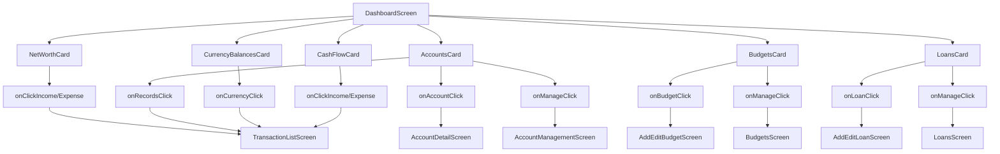
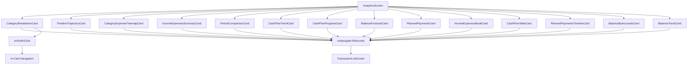
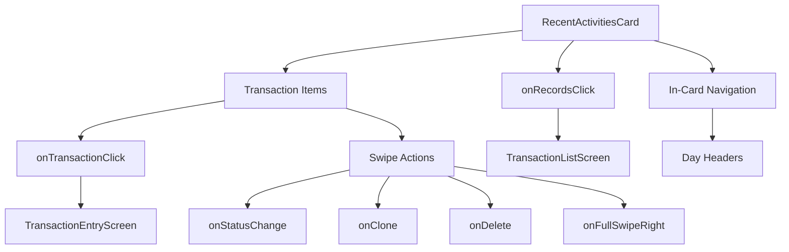

# Component Linking and Navigation Documentation

## Overview

This document maps all UI components, their relationships, navigation paths, and data flow between screens and components in the OSS Wallet application.

## Component Architecture

### Card System Architecture

The application uses a **Unified Card Renderer** pattern that allows screens to render different card types through a single entry point. This is implemented in:
- `ui/components/cards/UnifiedCardRenderer.kt`
- `ui/components/cards/CardRenderData.kt`
- `ui/components/cards/CardCallbacks.kt`

### Card Types Hierarchy

```
CardRenderData (Sealed Class)
├── NetWorth
├── CurrencyBalances
├── CashFlow
├── Accounts
├── Budgets
├── Loans
├── AccountHero
├── CategoryBreakdown
├── TimelineTrajectory
├── CategoryExpenseTreemap
├── IncomeExpensesSummary
├── PeriodComparison
├── CashFlowTrend
├── CashFlowProgress
├── BalanceForecast
├── PlannedPayments
├── IncomeExpensesBook
├── CashFlowTable
├── PlannedPaymentsTimeline
├── BalanceByAccounts
└── BalanceTrend
```

## Dashboard Cards

### 1. NetWorthCard

**Location**: `ui/dashboard/components/NetWorthCard.kt`

**Purpose**: Displays net worth with income/expense breakdown badges

**Data Flow**:
- **From**: `NetWorthUiState` from ViewModel
- **To**: Navigation to TransactionListScreen via onClickIncome/onClickExpense

**Navigation Links**:
- **onClickIncome** → TransactionListScreen with filter (income type, timeline range)
- **onClickExpense** → TransactionListScreen with filter (expense type, timeline range)

**Configuration**:
- Font size (Small, Medium, Large, X-Large)
- Timeline range (AllTime, ThisPeriod, LastPeriod, CustomRange)

**Used In**:
- DashboardScreen
- AccountsViewScreen (if configured)

---

### 2. AccountsCard

**Location**: `ui/dashboard/components/AccountsCard.kt`

**Purpose**: Displays accounts in grid or scroll layout with account statistics

**Data Flow**:
- **From**: Accounts list and AccountSummaryItem map from ViewModel
- **To**: Navigation to AccountDetailScreen or TransactionListScreen

**Navigation Links**:
- **onAccountClick(accountId)** → AccountDetailScreen
- **onManageClick** → AccountManagementScreen
- **onRecordsClick(filter)** → TransactionListScreen with account filter
- **AeonAccountCard (click)** → AccountDetailScreen

**Configuration**:
- Layout (grid/scroll)
- Grid columns (1, 2, 3, 4)
- Show add account card (true/false)
- Timeline range

**Sub-Components**:
- AeonAccountCardLarge (gridColumns = 1)
- AeonAccountCardMedium (gridColumns = 2)
- AeonAccountCardSmall (gridColumns = 3+)
- AeonAddAccountCard

**Used In**:
- DashboardScreen
- AccountsViewScreen

---

### 3. CurrencyBalancesCard

**Location**: `ui/dashboard/components/CurrencyBalancesCard.kt`

**Purpose**: Displays aggregated currency balances across all accounts

**Data Flow**:
- **From**: CurrencyAggregationItem list from ViewModel
- **To**: Navigation to TransactionListScreen via currency click

**Navigation Links**:
- **onCurrencyClick(currency, timelineRange)** → TransactionListScreen with currency filter

**Configuration**:
- Layout (scroll/grid)
- Show base conversion (true/false)
- Timeline range

**Sub-Components**:
- CurrencyBalanceItem

**Used In**:
- DashboardScreen
- AccountsViewScreen

---

### 4. CashFlowCard

**Location**: `ui/dashboard/components/CashFlowCard.kt`

**Purpose**: Displays income/expense breakdown by currency

**Data Flow**:
- **From**: CashFlowResult from ViewModel
- **To**: Navigation to TransactionListScreen via income/expense click

**Navigation Links**:
- **onClickIncome** → TransactionListScreen with income filter
- **onClickExpense** → TransactionListScreen with expense filter

**Configuration**:
- Show base conversion (true/false)
- Timeline range

**Sub-Components**:
- AeonFlowCard
- AeonFlowBreakdownItem

**Used In**:
- DashboardScreen
- AccountsViewScreen

---

### 5. BudgetsCard

**Location**: `ui/dashboard/components/BudgetsCard.kt`

**Purpose**: Displays budget progress indicators

**Data Flow**:
- **From**: BudgetAnalysis list from BudgetViewModel
- **To**: Navigation to BudgetsScreen or AddEditBudgetScreen

**Navigation Links**:
- **onBudgetClick(budgetId)** → AddEditBudgetScreen (edit mode)
- **onManageClick** → BudgetsScreen
- **onRecordsClick(filter)** → TransactionListScreen with budget filter

**Configuration**:
- Show progress labels (true/false)

**Used In**:
- DashboardScreen
- AccountsViewScreen

---

### 6. LoansCard

**Location**: `ui/dashboard/components/LoansCard.kt`

**Purpose**: Displays loan/debt cards with progress

**Data Flow**:
- **From**: LoanAnalysis list from LoanViewModel
- **To**: Navigation to LoansScreen or AddEditLoanScreen

**Navigation Links**:
- **onLoanClick(accountId)** → AddEditLoanScreen (edit mode)
- **onManageClick** → LoansScreen
- **onRecordsClick(filter)** → TransactionListScreen with loan filter

**Used In**:
- DashboardScreen
- AccountsViewScreen

---

## Analytics Cards

### 7. CategoryBreakdownCard

**Location**: `ui/analytics/components/CategoryBreakdownCard.kt`

**Purpose**: Pie chart showing category spending breakdown with drill-down capability

**Data Flow**:
- **From**: CategoryBreakdownData list from ViewModel
- **To**: Navigation to TransactionListScreen via category click

**Navigation Links**:
- **onNavigateToRecords** → TransactionListScreen with category filter
- **onDrillInClick** → Drill down to subcategories (in-card navigation)

**Configuration**:
- Filter (accounts, categories, tags, date range)
- Show legend (true/false)

**Sub-Components**:
- AeonPieChart
- CategoryLegend

**Used In**:
- AnalyticsScreen

**In-Card Navigation**:
- Breadcrumb navigation for drill-down
- Navigation stack management for subcategory views

---

### 8. TimelineTrajectoryCard

**Location**: `ui/analytics/components/TimelineTrajectoryCard.kt`

**Purpose**: Line chart showing spending/income over time

**Data Flow**:
- **From**: TimelineTrajectoryData list from ViewModel
- **To**: Navigation to TransactionListScreen

**Navigation Links**:
- **onRecordsClick** → TransactionListScreen with date filter

**Used In**:
- AnalyticsScreen

---

### 9. CategoryExpenseTreemapCard

**Location**: `ui/analytics/components/CategoryExpenseTreemapCard.kt`

**Purpose**: Treemap visualization of category expenses

**Data Flow**:
- **From**: CategoryExpenseTreemapData list from ViewModel
- **To**: Navigation to TransactionListScreen

**Navigation Links**:
- **onRecordsClick** → TransactionListScreen with category filter

**Used In**:
- AnalyticsScreen

---

### 10. IncomeExpensesSummaryCard

**Location**: `ui/analytics/components/IncomeExpensesSummaryCard.kt`

**Purpose**: Summary cards showing total income/expense

**Data Flow**:
- **From**: IncomeExpensesSummaryData from ViewModel
- **To**: Navigation to TransactionListScreen

**Navigation Links**:
- **onRecordsClick** → TransactionListScreen

**Used In**:
- AnalyticsScreen

---

### 11. PeriodComparisonCard

**Location**: `ui/analytics/components/PeriodComparisonCard.kt`

**Purpose**: Compare current period with previous period

**Data Flow**:
- **From**: PeriodComparisonData from ViewModel
- **To**: Navigation to TransactionListScreen

**Navigation Links**:
- **onRecordsClick** → TransactionListScreen

**Used In**:
- AnalyticsScreen

---

### 12. CashFlowTrendCard

**Location**: `ui/analytics/components/CashFlowTrendCard.kt`

**Purpose**: Trend line showing cash flow over time

**Data Flow**:
- **From**: CashFlowTrendData from ViewModel
- **To**: Navigation to TransactionListScreen

**Navigation Links**:
- **onRecordsClick** → TransactionListScreen

**Used In**:
- AnalyticsScreen

---

### 13. CashFlowProgressCard

**Location**: `ui/analytics/components/CashFlowProgressCard.kt`

**Purpose**: Progress bars showing cash flow metrics

**Data Flow**:
- **From**: CashFlowProgressData from ViewModel
- **To**: Navigation to TransactionListScreen

**Navigation Links**:
- **onRecordsClick** → TransactionListScreen

**Used In**:
- AnalyticsScreen

---

### 14. BalanceForecastCard

**Location**: `ui/analytics/components/BalanceForecastCard.kt`

**Purpose**: Forecast future balance based on trends

**Data Flow**:
- **From**: BalanceForecastData from ViewModel
- **To**: Navigation to TransactionListScreen

**Navigation Links**:
- **onRecordsClick** → TransactionListScreen

**Used In**:
- AnalyticsScreen

---

### 15. PlannedPaymentsCard

**Location**: `ui/analytics/components/PlannedPaymentsCard.kt`

**Purpose**: Display planned/recurring payments

**Data Flow**:
- **From**: PlannedPaymentsData from ViewModel
- **To**: Navigation to TransactionListScreen

**Navigation Links**:
- **onRecordsClick** → TransactionListScreen

**Used In**:
- AnalyticsScreen

---

### 16. IncomeExpensesBookCard

**Location**: `ui/analytics/components/IncomeExpensesBookCard.kt`

**Purpose**: Book-style income/expense display

**Data Flow**:
- **From**: IncomeExpensesBookData from ViewModel
- **To**: Navigation to TransactionListScreen

**Navigation Links**:
- **onRecordsClick** → TransactionListScreen

**Used In**:
- AnalyticsScreen

---

### 17. CashFlowTableCard

**Location**: `ui/analytics/components/CashFlowTableCard.kt`

**Purpose**: Table view of cash flow by period

**Data Flow**:
- **From**: CashFlowTableData from ViewModel
- **To**: Navigation to TransactionListScreen

**Navigation Links**:
- **onRecordsClick** → TransactionListScreen

**Used In**:
- AnalyticsScreen

---

### 18. PlannedPaymentsTimelineCard

**Location**: `ui/analytics/components/PlannedPaymentsTimelineCard.kt`

**Purpose**: Timeline view of planned payments

**Data Flow**:
- **From**: PlannedPaymentsTimelineData from ViewModel
- **To**: Navigation to TransactionListScreen

**Navigation Links**:
- **onRecordsClick** → TransactionListScreen

**Used In**:
- AnalyticsScreen

---

### 19. BalanceByAccountsCard

**Location**: `ui/analytics/components/BalanceByAccountsCard.kt`

**Purpose**: Bar chart showing balance by account

**Data Flow**:
- **From**: BalanceByAccountsData from ViewModel
- **To**: Navigation to TransactionListScreen

**Navigation Links**:
- **onRecordsClick** → TransactionListScreen

**Used In**:
- AnalyticsScreen

---

### 20. BalanceTrendCard

**Location**: `ui/analytics/components/BalanceTrendCard.kt`

**Purpose**: Line chart showing balance trend over time

**Data Flow**:
- **From**: BalanceTrendData from ViewModel
- **To**: Navigation to TransactionListScreen

**Navigation Links**:
- **onRecordsClick** → TransactionListScreen

**Used In**:
- AnalyticsScreen

---

## Transaction Components

### 21. RecentActivitiesCard

**Location**: `ui/components/transactions/RecentActivitiesCard.kt`

**Purpose**: Displays recent transactions grouped by day with swipe actions

**Data Flow**:
- **From**: TransactionWithBalance list from ViewModel
- **To**: Navigation to TransactionEntryScreen (edit) or TransactionListScreen

**Navigation Links**:
- **onRecordsClick** → TransactionListScreen (view all)
- **onTransactionClick(transactionId)** → TransactionEntryScreen (edit mode)
- **Swipe actions**:
  - onStatusChange → Update transaction status
  - onClone → Clone transaction
  - onDelete → Delete transaction
  - onFullSwipeRight → Quick action (configurable)

**Configuration**:
- limit (default 20) - max transactions to show
- days (default 7) - days to include
- applyFilter (true/false) - whether to apply recent filter

**Sub-Components**:
- TransactionHeader
- SwipeableTransactionItem
- AeonTransactionItem

**Filter Logic**:
```kotlin
// Returns transactions from last 7 days OR last 20 transactions, whichever is more
filterToRecentTransactions(allTransactions, limit = 20, days = 7)
```

**Grouping**:
- Transactions grouped by day (YYYY-MM-DD)
- Each day shows:
  - Day header with date
  - Transaction count
  - Income/expense totals by currency
  - Net flow
  - Closing balance

**Used In**:
- DashboardScreen
- AccountsViewScreen
- AccountDetailScreen

---

### 22. SwipeableTransactionItem

**Location**: `ui/components/transactions/SwipeableTransactionItem.kt`

**Purpose**: Swipeable transaction item with action buttons

**Data Flow**:
- **From**: Transaction entity
- **To**: Callbacks for swipe actions

**Callback Links**:
- onExpandLeft/onExpandRight → Reveal actions
- onCollapse → Hide actions
- onFullSwipeRight → Execute quick action
- onStatusChange → Update transaction status
- onClone → Clone transaction
- onDelete → Delete transaction
- onSplit → Split transaction

**Sub-Components**:
- AeonTransactionItem

**Used In**:
- RecentActivitiesCard
- TransactionListScreen

---

### 23. TransactionHeader

**Location**: `ui/components/transactions/TransactionHeader.kt`

**Purpose**: Header for transaction groups showing day summary

**Data Flow**:
- **From**: Day's transaction data
- **To**: Display only (no navigation)

**Used In**:
- RecentActivitiesCard
- TransactionListScreen

---

## Account Detail Components

### 24. AccountHeroCard

**Location**: `ui/accountdetail/components/AccountHeroCard.kt`

**Purpose**: Hero card showing account balance with currency badges

**Data Flow**:
- **From**: Account entity, balance, exchange rates
- **To**: Navigation (optional onClick)

**Navigation Links**:
- **onClick** → Optional callback (typically to edit account)

**Configuration**:
- Show currency badges (true/false)

**Used In**:
- AccountDetailScreen

---

## Navigation Flow Diagrams

### Dashboard Screen Navigation



### Analytics Screen Navigation



### RecentActivitiesCard Navigation



## Component Reuse Matrix

| Component | Dashboard | AccountsView | Analytics | AccountDetail |
|-----------|-----------|--------------|-----------|---------------|
| NetWorthCard | ✅ | ✅ | ❌ | ❌ |
| AccountsCard | ✅ | ✅ | ❌ | ❌ |
| CurrencyBalancesCard | ✅ | ✅ | ❌ | ❌ |
| CashFlowCard | ✅ | ✅ | ❌ | ❌ |
| BudgetsCard | ✅ | ✅ | ❌ | ❌ |
| LoansCard | ✅ | ✅ | ❌ | ❌ |
| AccountHeroCard | ❌ | ❌ | ❌ | ✅ |
| CategoryBreakdownCard | ❌ | ❌ | ✅ | ❌ |
| TimelineTrajectoryCard | ❌ | ❌ | ✅ | ❌ |
| RecentActivitiesCard | ✅ | ✅ | ❌ | ✅ |

## Card Configuration Persistence

Card configurations are persisted in SettingsDataStore as JSON:
- `dashboardCardsConfig`
- `accountsViewCardsConfig`
- `accountDetailCardsConfig`
- `analyticsCardsConfig`

Each config includes:
- Card type
- Card ID
- Display order
- Type-specific settings (timeline range, layout, filters, etc.)

## Callback System

The `CardCallbacks` sealed class provides type-safe callbacks for each card type:

- **Common**: onDelete
- **WithTimeline**: onTimelineRangeChange
- **WithFontSize**: onFontSizeChange
- **WithFontSizeAndTimeline**: onFontSizeChange + onTimelineRangeChange
- **WithClickActions**: onClickIncome, onClickExpense, onCurrencyClick
- **CurrencyBalances**: onLayoutChange, onShowBaseConversionChange
- **CashFlow**: onShowBaseConversionChange, onClickIncome, onClickExpense
- **Analytics**: onUpdate, onRecordsClick
- **AccountHero**: onShowCurrencyBadgesChange, onClick
- **Accounts**: onGridColumnsChange, onLayoutChange, onManageClick, onAccountClick, onRecordsClick
- **Budgets**: onShowProgressLabelsChange, onManageClick, onBudgetClick, onRecordsClick
- **Loans**: onManageClick, onLoanClick, onRecordsClick

## Data Flow Patterns

### Pattern 1: Card → TransactionListScreen Filter
Most cards navigate to TransactionListScreen with a filter context:
- Account filter
- Category filter
- Currency filter
- Date range filter
- Transaction type filter

### Pattern 2: Card → Detail Screen
- AccountsCard → AccountDetailScreen
- BudgetsCard → AddEditBudgetScreen
- LoansCard → AddEditLoanScreen

### Pattern 3: Card → Management Screen
- AccountsCard → AccountManagementScreen
- BudgetsCard → BudgetsScreen
- LoansCard → LoansScreen

### Pattern 4: In-Card Navigation
- CategoryBreakdownCard drill-down to subcategories
- Breadcrumb navigation within card

## Shared Components

### AeonFlowSectionHeader
Used by all cards for consistent header styling with:
- Title
- Timeline label
- Settings button
- Custom trailing content

### TimelineFilterBar
Used by cards with timeline range configuration:
- NetWorthCard
- AccountsCard
- CurrencyBalancesCard
- CashFlowCard
- And all analytics cards

### AeonCardSettingsSheet
Unified settings sheet for analytics cards with:
- Filter configuration
- Account selection
- Category selection
- Tag selection
- Saved filter selection

## Component Dependencies

### Dashboard Cards Dependencies
- NetWorthCard: NetWorthUiState, NetWorthCardConfig
- AccountsCard: Account list, AccountSummaryItem, AccountsCardConfig
- CurrencyBalancesCard: CurrencyAggregationItem, CurrencyBalancesCardConfig
- CashFlowCard: CashFlowResult, CashFlowCardConfig
- BudgetsCard: BudgetAnalysis, BudgetsCardConfig
- LoansCard: LoanAnalysis, LoansCardConfig

### Analytics Cards Dependencies
- All analytics cards: Config class, Data class
- CategoryBreakdownCard: CategoryBreakdownData
- TimelineTrajectoryCard: TimelineTrajectoryData
- CategoryExpenseTreemapCard: CategoryExpenseTreemapData
- IncomeExpensesSummaryCard: IncomeExpensesSummaryData
- PeriodComparisonCard: PeriodComparisonData
- CashFlowTrendCard: CashFlowTrendData
- CashFlowProgressCard: CashFlowProgressData
- BalanceForecastCard: BalanceForecastData
- PlannedPaymentsCard: PlannedPaymentsData
- IncomeExpensesBookCard: IncomeExpensesBookData
- CashFlowTableCard: CashFlowTableData
- PlannedPaymentsTimelineCard: PlannedPaymentsTimelineData
- BalanceByAccountsCard: BalanceByAccountsData
- BalanceTrendCard: BalanceTrendData

### Transaction Components Dependencies
- RecentActivitiesCard: TransactionWithBalance, CategoryEntity
- SwipeableTransactionItem: Transaction, TransactionStatus
- TransactionHeader: Currency data, balance data

## Summary

The OSS Wallet app uses a unified card system with:
1. **20+ card types** across dashboard and analytics
2. **Unified renderer** for type-safe card rendering
3. **Consistent navigation patterns** to TransactionListScreen with filters
4. **Card configuration persistence** via SettingsDataStore
5. **Type-safe callbacks** via CardCallbacks sealed class
6. **Shared components** for consistent UI (headers, filters, settings)
7. **In-card navigation** for drill-down capabilities (CategoryBreakdownCard)
8. **Component reuse** across multiple screens
