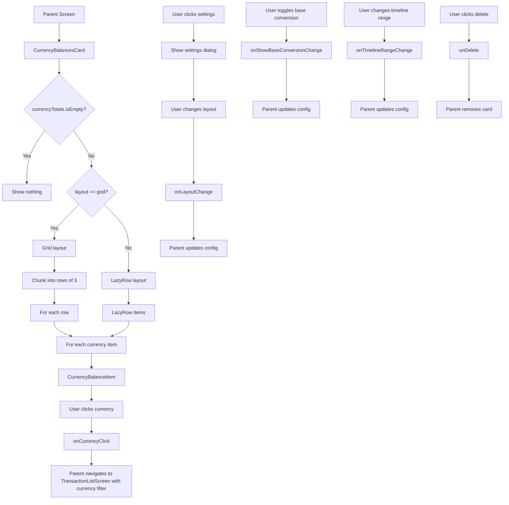

# CurrencyBalancesCard Functional Logic

## 1. Component Overview
- **Component Name**: CurrencyBalancesCard
- **Purpose**: Displays aggregated currency balances across all accounts with optional base currency conversion
- **Parent Screen**: DashboardScreen, AccountsViewScreen
- **Related Components**: CurrencyBalanceItem, AeonLayoutToggle, AeonBaseConversionToggle
- **Configuration Class**: CurrencyBalancesSettings

## 2. Input Analysis

### Component Inputs (Parent Screen → Component)
- **currencyTotals**: List<CurrencyAggregationItem> - Currency totals by currency code
- **baseCurrency**: String - Base currency for conversions
- **cardId**: String - Unique card identifier
- **layout**: String - Layout mode ("scroll" or "grid")
- **showBaseConversion**: Boolean - Whether to show base currency conversion
- **timelineRange**: TimelineRange - Timeline range for calculations
- **precision**: Int - Decimal precision for currency formatting
- **onLayoutChange**: (String, String) -> Unit - Update layout (cardId, layout)
- **onShowBaseConversionChange**: (String, Boolean) -> Unit - Toggle base conversion (cardId, show)
- **onTimelineRangeChange**: (String, TimelineRange) -> Unit - Update timeline range
- **onDelete**: () -> Unit - Delete card callback
- **onCurrencyClick**: (String, TimelineRange) -> Unit - Navigate to currency-filtered transactions

### Component Inputs (ViewModel → Parent Screen)
- **CurrencyAggregationItem**: From AccountsViewViewModel or AnalyticsViewModel
  - currency: String
  - amount: BigDecimal (in original currency)
  - amountInBase: BigDecimal (in base currency)

## 3. Output Analysis

### Component Outputs (Component → Parent Screen)
- **Navigation Events**:
  - onCurrencyClick(currency, timelineRange) - Navigate to TransactionListScreen with currency filter
- **Configuration Changes**:
  - onLayoutChange(cardId, layout) - Update layout mode
  - onShowBaseConversionChange(cardId, show) - Toggle base conversion display
  - onTimelineRangeChange(cardId, range) - Update timeline range
  - onDelete() - Delete card from configuration

### Displayed Data Structure
```kotlin
// Currency balance item displays:
- Currency code (e.g., USD, EUR)
- Amount in original currency
- Amount in base currency (if showBaseConversion and not base currency)
- Clickable for navigation
```

## 4. Computation Logic

### Value: Timeline Label
- **Value Name**: timelineLabel
- **Input Data**: timelineRange
- **Computation Formula/Logic**:
  ```kotlin
  val timelineLabel = when (timelineRange) {
      is TimelineRange.AllTime -> "All Time"
      is TimelineRange.ThisPeriod -> timelineRange.period.label
      is TimelineRange.LastPeriod -> timelineRange.period.label
      is TimelineRange.CustomRange -> {
          val formatter = DateTimeFormatter.ofPattern("MMM d, yyyy").withZone(ZoneId.systemDefault())
          val start = formatter.format(Instant.ofEpochMilli(timelineRange.start))
          val end = formatter.format(Instant.ofEpochMilli(timelineRange.end))
          "$start - $end"
      }
  }
  ```
- **Use Case Involvement**: None
- **Transformation Steps**: TimelineRange → Display string

### Value: Grid Layout Chunks
- **Value Name**: chunks
- **Input Data**: currencyTotals
- **Computation Formula/Logic**:
  ```kotlin
  val chunks = currencyTotals.chunked(3)
  ```
- **Use Case Involvement**: None
- **Transformation Steps**: List → List of lists (3 items per chunk)

### Value: Grid Spacer Count
- **Value Name**: Spacer count
- **Input Data**: rowItems.size, gridColumns
- **Computation Formula/Logic**:
  ```kotlin
  if (rowItems.size < 3) {
      repeat(3 - rowItems.size) {
          Spacer(modifier = Modifier.weight(1f))
      }
  }
  ```
- **Use Case Involvement**: None
- **Transformation Steps**: Calculate missing items → Add spacers

### Value: Base Conversion Display
- **Value Name**: Show base conversion text
- **Input Data**: curr, baseCurrency, showBaseConversion
- **Computation Formula/Logic**:
  ```kotlin
  if (showBaseConversion && curr != baseCurrency) {
      Text("≈ ${formatCurrencyRight(inBase, baseCurrency, precision)}")
  } else if (showBaseConversion) {
      Text("") // Empty text to maintain spacing
  }
  ```
- **Use Case Involvement**: None
- **Transformation Steps**: Condition check → Display conversion or placeholder

## 5. Data Flow Diagram



## 6. Data Sources
- **Repository Interfaces**: AccountRepository, TransactionRepository (via ViewModel)
- **Database Entities**: AccountEntity, TransactionEntity
- **Remote Data Sources**: None
- **Local Data Stores**: SettingsDataStore (base currency, dashboardCardsConfig)

## 7. Business Logic Summary
- **Key Business Rules**:
  - Layout can be grid (3 columns) or scroll
  - Grid layout chunks items into rows of 3
  - Spacers added to align grid items
  - Base currency conversion can be toggled
  - Base conversion not shown for base currency itself
  - Placeholder text shown when base conversion enabled but currency is base
  - Timeline range affects currency totals calculation
  - Empty state shows nothing (card not rendered)
- **Validation Logic**: None
- **Calculations Performed**:
  - Timeline label formatting
  - Grid chunking
  - Spacer count calculation
- **State Management Approach**:
  - Local state for settings dialog visibility
  - Configuration passed as parameters
  - Callbacks for all configuration changes
  - Stateless rendering (no internal state)

## 8. Dependencies

### Component Dependencies
- CurrencyBalanceItem
- AeonLayoutToggle
- AeonBaseConversionToggle
- TimelineFilterBar

### Parent Screen Dependencies
- AccountsViewViewModel or AnalyticsViewModel (for CurrencyAggregationItem)
- SettingsDataStore (for base currency, dashboardCardsConfig)

### External Services/APIs
- None
