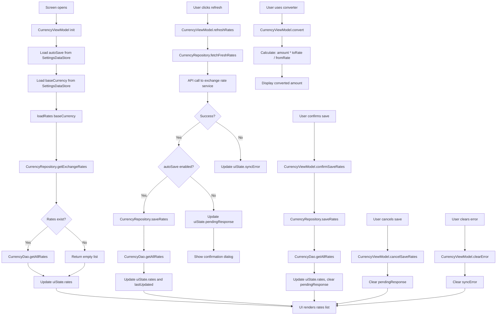

# ExchangeRatesScreen Functional Logic

## 1. Component Overview
- **Screen Name**: ExchangeRatesScreen
- **Purpose**: Displays current exchange rates with base currency selection, manual refresh, and currency converter tool
- **ViewModel Class**: CurrencyViewModel
- **Related Use Cases**: None (uses direct repository methods)

## 2. Input Analysis

### Component Inputs (UI → ViewModel)
- **onBackClick**: Navigation callback to return to previous screen
- **User Actions**:
  - Select base currency
  - Refresh exchange rates manually
  - Confirm save of fetched rates (if auto-save disabled)
  - Cancel save of fetched rates
  - Use currency converter tool
  - Convert amounts between currencies

### ViewModel Inputs (Use Cases/Repositories)
- **Data Sources**:
  - CurrencyRepository: For fetching and saving exchange rates
  - CurrencyDao: For reading stored rates
  - SettingsDataStore: For base currency and auto-save setting
- **Initial State Parameters**: None
- **Configuration Parameters**: autoSave from SettingsDataStore

## 3. Output Analysis

### ViewModel Outputs (UI State)
```kotlin
val uiState: StateFlow<CurrencyUiState>
```

**CurrencyUiState Structure**:
```kotlin
data class CurrencyUiState(
    val rates: List<CurrencyRateEntity> = emptyList(),
    val baseCurrency: String = "USD",
    val lastUpdated: Long = 0L,
    val isLoading: Boolean = false,
    val syncError: String? = null,
    val pendingResponse: CurrencyResponse? = null
)
```

**CurrencyRateEntity Structure**:
```kotlin
data class CurrencyRateEntity(
    val id: Long = 0,
    val currencyCode: String,
    val rate: Double,
    val timestamp: Long = System.currentTimeMillis(),
    val baseCurrency: String
)
```

**CurrencyResponse Structure**:
```kotlin
data class CurrencyResponse(
    val result: String,
    val baseCode: String,
    val rates: Map<String, Double>,
    val timestamp: Long = System.currentTimeMillis()
)
```

**Loading/Error States**: isLoading during fetch, syncError on failure, pendingResponse for confirmation

**Navigation Events**: None (handled via callback parameters)

### Component Outputs (User Actions)
- **Navigation**: onBackClick
- **Side Effects**:
  - Show confirmation dialog for rate save (if auto-save disabled)
  - Show error message on sync failure
  - Clear error message

## 4. Computation Logic

### Value: Load Exchange Rates
- **Value Name**: loadRates
- **Input Data**: baseCurrency: String
- **Computation Formula/Logic**:
  ```kotlin
  fun loadRates(baseCurrency: String) {
      viewModelScope.launch {
          _uiState.update { it.copy(isLoading = true, syncError = null) }
          try {
              repository.getExchangeRates(baseCurrency)
              val rates = dao.getAllRates()
              _uiState.update {
                  it.copy(
                      rates = rates,
                      lastUpdated = rates.firstOrNull()?.timestamp ?: 0L,
                      isLoading = false
                  )
              }
          } catch (e: Exception) {
              _uiState.update { it.copy(isLoading = false, syncError = "Sync Failed: ${e.localizedMessage}") }
          }
      }
  }
  ```
- **Use Case Involvement**: CurrencyRepository.getExchangeRates
- **Transformation Steps**: Currency code → API fetch → Database read → UI state update

### Value: Refresh Exchange Rates
- **Value Name**: refreshRates
- **Input Data**: None (uses current baseCurrency)
- **Computation Formula/Logic**:
  ```kotlin
  fun refreshRates() {
      val baseCurrency = _uiState.value.baseCurrency
      viewModelScope.launch {
          _uiState.update { it.copy(isLoading = true, syncError = null) }
          try {
              val response = repository.fetchFreshRates(baseCurrency)
              if (autoSave) {
                  repository.saveRates(baseCurrency, response)
                  val rates = dao.getAllRates()
                  _uiState.update {
                      it.copy(
                          rates = rates,
                          lastUpdated = rates.firstOrNull()?.timestamp ?: 0L,
                          isLoading = false
                      )
                  }
              } else {
                  _uiState.update { it.copy(pendingResponse = response, isLoading = false) }
              }
          } catch (e: Exception) {
              _uiState.update { it.copy(isLoading = false, syncError = "Refresh Failed: ${e.localizedMessage}") }
          }
      }
  }
  ```
- **Use Case Involvement**: CurrencyRepository.fetchFreshRates, CurrencyRepository.saveRates
- **Transformation Steps**: API fetch → Save if auto-save enabled → Update state or show confirmation

### Value: Confirm Save Rates
- **Value Name**: confirmSaveRates
- **Input Data**: None (uses pendingResponse)
- **Computation Formula/Logic**:
  ```kotlin
  fun confirmSaveRates() {
      val response = _uiState.value.pendingResponse ?: return
      val baseCurrency = _uiState.value.baseCurrency
      viewModelScope.launch {
          _uiState.update { it.copy(isLoading = true) }
          try {
              repository.saveRates(baseCurrency, response)
              val rates = dao.getAllRates()
              _uiState.update {
                  it.copy(
                      rates = rates,
                      lastUpdated = rates.firstOrNull()?.timestamp ?: 0L,
                      pendingResponse = null,
                      isLoading = false
                  )
              }
          } catch (e: Exception) {
              _uiState.update { it.copy(isLoading = false, syncError = "Save Failed") }
          }
      }
  }
  ```
- **Use Case Involvement**: CurrencyRepository.saveRates
- **Transformation Steps**: Pending response → Database save → Clear pending → Update state

### Value: Cancel Save Rates
- **Value Name**: cancelSaveRates
- **Input Data**: None
- **Computation Formula/Logic**:
  ```kotlin
  fun cancelSaveRates() {
      _uiState.update { it.copy(pendingResponse = null) }
  }
  ```
- **Use Case Involvement**: None
- **Transformation Steps**: Clear pendingResponse state

### Value: Clear Error
- **Value Name**: clearError
- **Input Data**: None
- **Computation Formula/Logic**:
  ```kotlin
  fun clearError() {
      _uiState.update { it.copy(syncError = null) }
  }
  ```
- **Use Case Involvement**: None
- **Transformation Steps**: Clear syncError state

### Value: Currency Conversion
- **Value Name**: convert
- **Input Data**: amount: Double, from: String, to: String
- **Computation Formula/Logic**:
  ```kotlin
  fun convert(amount: Double, from: String, to: String): Double {
      val rates = _uiState.value.rates
      val fromRate = rates.find { it.currencyCode == from }?.rate ?: 1.0
      val toRate = rates.find { it.currencyCode == to }?.rate ?: 1.0
      
      return if (fromRate != 0.0) (amount / fromRate) * toRate else 0.0
  }
  ```
- **Use Case Involvement**: None
- **Transformation Steps**: Amount × (toRate / fromRate) → Converted amount

### Value: Auto-Save Setting
- **Value Name**: autoSave (internal state)
- **Input Data**: SettingsDataStore.autoSaveExchangeRates
- **Computation Formula/Logic**:
  ```kotlin
  init {
      viewModelScope.launch {
          settingsDataStore.autoSaveExchangeRates.collect {
              autoSave = it
          }
      }
  }
  ```
- **Use Case Involvement**: None
- **Transformation Steps**: DataStore flow → Local state

### Value: Base Currency Change
- **Value Name**: baseCurrency (from DataStore)
- **Input Data**: SettingsDataStore.currency
- **Computation Formula/Logic**:
  ```kotlin
  init {
      viewModelScope.launch {
          settingsDataStore.currency.collect { base ->
              _uiState.update { it.copy(baseCurrency = base) }
              loadRates(base)
          }
      }
  }
  ```
- **Use Case Involvement**: None
- **Transformation Steps**: DataStore flow → Update state → Load rates

## 5. Data Flow Diagram



## 6. Data Sources
- **Repository Interfaces**: CurrencyRepository
- **Database Entities**: CurrencyRateEntity
- **Remote Data Sources**: Exchange rate API (via CurrencyRepository)
- **Local Data Stores**: SettingsDataStore (currency, autoSaveExchangeRates)

## 7. Business Logic Summary
- **Key Business Rules**:
  - Exchange rates are fetched from external API
  - Rates are stored in database with timestamp
  - Auto-save setting determines if fetched rates are automatically saved
  - If auto-save is disabled, user must confirm before saving
  - Currency converter uses current rates from uiState
  - Base currency is loaded from SettingsDataStore
  - Base currency change triggers automatic rate load
  - Error messages are displayed for sync failures
  - Last updated timestamp shows when rates were last fetched
- **Validation Logic**: None
- **Calculations Performed**:
  - Currency conversion: amount × (toRate / fromRate)
- **State Management Approach**:
  - uiState contains all rate data and sync status
  - pendingResponse for confirmation dialog (if auto-save disabled)
  - autoSave local state tracks DataStore value
  - Reactive state loading from DataStore for base currency

## 8. Dependencies

### ViewModel Dependencies
- CurrencyRepository
- CurrencyDao
- SettingsDataStore

### Use Case Dependencies
- None (ViewModel uses repository directly)

### External Services/APIs
- Exchange rate API (via CurrencyRepository)
