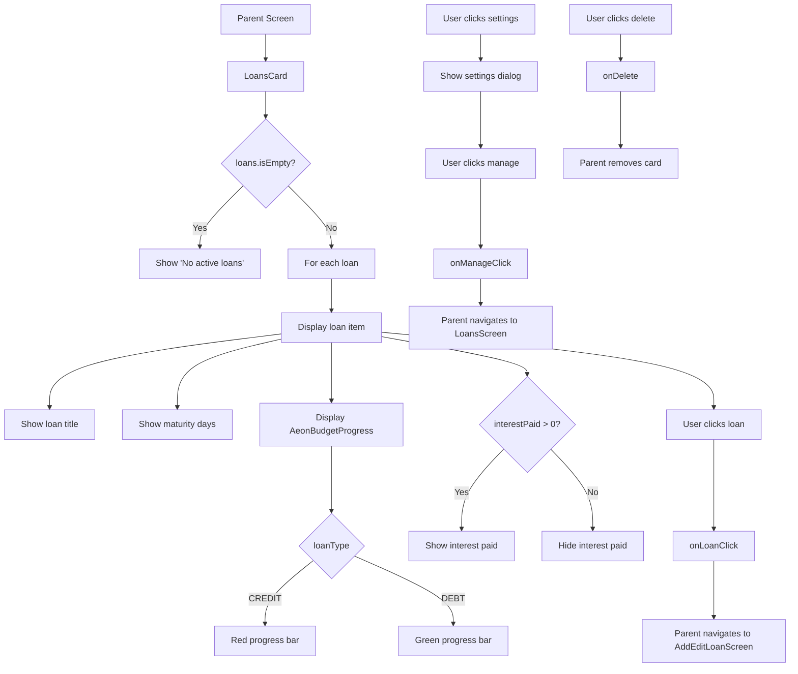

# LoansCard Functional Logic

## 1. Component Overview
- **Component Name**: LoansCard
- **Purpose**: Displays loan/debt cards with principal paid progress and maturity information
- **Parent Screen**: DashboardScreen, AccountsViewScreen
- **Related Components**: AeonBudgetProgress
- **Configuration Class**: None (uses default settings)

## 2. Input Analysis

### Component Inputs (Parent Screen → Component)
- **onManageClick**: () -> Unit - Navigate to loan management
- **onLoanClick**: (String) -> Unit - Navigate to loan edit (loan ID)
- **onRecordsClick**: (RecordsFilterContext) -> Unit - Navigate to filtered transaction list (unused in current implementation)
- **loans**: List<LoanAnalysis> - Loan analysis data
- **baseCurrency**: String - Base currency for display
- **cardId**: String - Unique card identifier
- **precision**: Int - Decimal precision for currency formatting
- **onDelete**: () -> Unit - Delete card callback

### Component Inputs (ViewModel → Parent Screen)
- **LoanAnalysis**: From LoanViewModel
  - loan: Loan
    - id: String
    - title: String
    - principal: BigDecimal
    - loanType: LoanType (DEBT or CREDIT)
  - principalPaid: BigDecimal
  - interestPaid: BigDecimal
  - remainingMaturityDays: Int

## 3. Output Analysis

### Component Outputs (Component → Parent Screen)
- **Navigation Events**:
  - onLoanClick(loanId) - Navigate to AddEditLoanScreen (edit mode)
  - onManageClick() - Navigate to LoansScreen
- **Configuration Changes**:
  - onDelete() - Delete card from configuration

### Displayed Data Structure
```kotlin
// For each loan:
- Loan title (uppercase)
- Maturity days remaining
- Progress bar showing principal paid vs principal
- Progress bar color:
  - Red (0xFFC62828) for CREDIT type
  - Green (0xFF2E7D32) for DEBT type
- Interest paid (if > 0)
```

## 4. Computation Logic

### Value: Progress Bar Color
- **Value Name**: color
- **Input Data**: loan.loanType
- **Computation Formula/Logic**:
  ```kotlin
  color = if (loan.loanType == LoanType.CREDIT) Color(0xFFC62828) else Color(0xFF2E7D32)
  ```
- **Use Case Involvement**: None
- **Transformation Steps**: LoanType → Color (red for credit, green for debt)

### Value: Interest Paid Display
- **Value Name**: showInterestPaid
- **Input Data**: analysis.interestPaid
- **Computation Formula/Logic**:
  ```kotlin
  if (analysis.interestPaid > BigDecimal.ZERO) {
      Text("INTEREST PAID: ${analysis.interestPaid} $baseCurrency")
  }
  ```
- **Use Case Involvement**: None
- **Transformation Steps**: Condition check → Display or hide

## 5. Data Flow Diagram



## 6. Data Sources
- **Repository Interfaces**: LoanRepository, TransactionRepository (via ViewModel)
- **Database Entities**: LoanEntity, TransactionEntity
- **Remote Data Sources**: None
- **Local Data Stores**: SettingsDataStore (base currency, dashboardCardsConfig)

## 7. Business Logic Summary
- **Key Business Rules**:
  - Loans displayed in order received from ViewModel
  - Progress bar shows principal paid vs total principal
  - Progress bar color differentiates loan types (red for credit, green for debt)
  - Maturity days shown for each loan
  - Interest paid shown only if > 0
  - Empty state shows "No active loans"
  - Settings dialog allows manage navigation
  - No configurable settings (simpler than other cards)
- **Validation Logic**: None
- **Calculations Performed**:
  - Progress bar color selection based on loan type
  - Interest paid display condition
- **State Management Approach**:
  - Local state for settings dialog visibility
  - Configuration passed as parameters
  - Callbacks for configuration changes
  - Stateless rendering (no internal state)

## 8. Dependencies

### Component Dependencies
- AeonBudgetProgress

### Parent Screen Dependencies
- LoanViewModel (for LoanAnalysis)
- SettingsDataStore (for base currency, dashboardCardsConfig)

### External Services/APIs
- None
