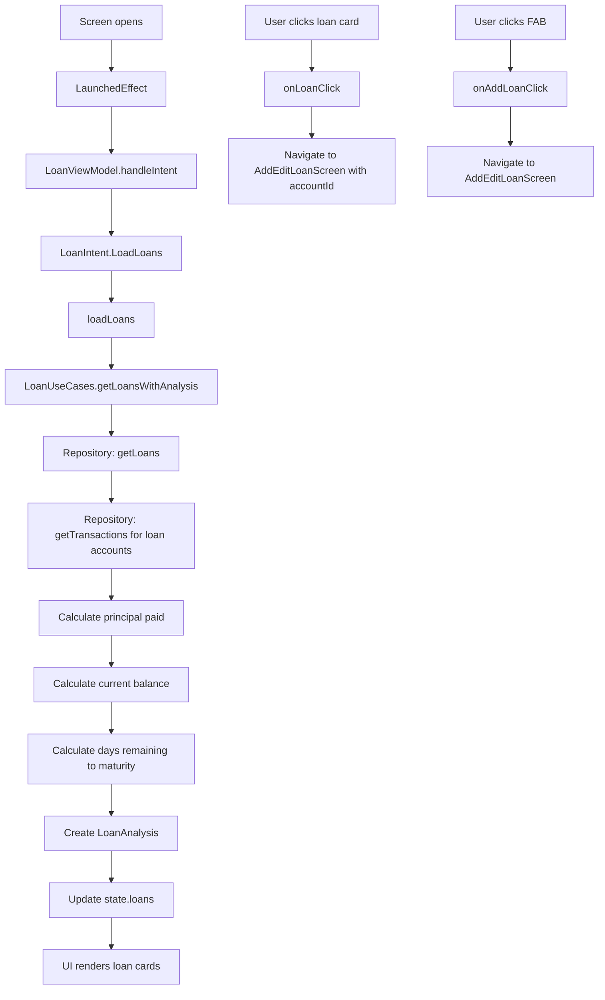

# LoansScreen Functional Logic

## 1. Component Overview
- **Screen Name**: LoansScreen
- **Purpose**: Displays a list of all loans/debts with progress indicators for principal paid, current balance, and days remaining to maturity
- **ViewModel Class**: LoanViewModel (primary), plus supporting ViewModel
- **Related Use Cases**: LoanUseCases

## 2. Input Analysis

### Component Inputs (UI → ViewModel)
- **onBackClick**: Navigation callback to return to previous screen
- **onAddLoanClick**: Navigation callback to add new loan
- **onLoanClick**: Navigation callback to edit/view loan details (accountId: String)
- **User Actions**:
  - Click on loan card to view details
  - Click FAB to add new loan

### ViewModel Inputs (Use Cases/Repositories)
- **Data Sources**:
  - LoanUseCases: For loan data and analysis
  - SettingsDataStore: For base currency (via SettingsViewModel)
- **Initial State Parameters**: None
- **Configuration Parameters**: None

## 3. Output Analysis

### ViewModel Outputs (UI State)
```kotlin
val state: StateFlow<LoanState>
```

**LoanState Structure**:
```kotlin
data class LoanState(
    val loans: List<LoanAnalysis> = emptyList(),
    val isLoading: Boolean = false,
    val error: String? = null
)
```

**LoanAnalysis Structure**:
```kotlin
data class LoanAnalysis(
    val loan: Loan,
    val principalPaid: BigDecimal,
    val remainingMaturityDays: Int
)
```

**Loan Model Structure**:
```kotlin
data class Loan(
    val account: Account,
    val principal: BigDecimal,
    val interestRate: BigDecimal,
    val maturityDate: Long,
    val loanType: LoanType
)
```

**LoanType Enum**: Credit, Debt

**Account Model Structure** (embedded in Loan):
```kotlin
data class Account(
    val id: String,
    val name: String,
    val balance: BigDecimal,
    val currencyCode: String,
    val structureType: String,
    val colorHex: String,
    val icon: String,
    val allowedCurrencies: List<String>,
    val isArchived: Boolean,
    val displayOrder: Int
)
```

**Loading/Error States**: isLoading during operations, error message on failure

**Navigation Events**: None (handled via callback parameters)

### Component Outputs (User Actions)
- **Navigation**: onBackClick, onAddLoanClick, onLoanClick
- **Side Effects**: None

## 4. Computation Logic

### Value: Loan Loading with Analysis
- **Value Name**: loadLoans
- **Input Data**: None (loads all loans for current profile)
- **Computation Formula/Logic**:
  ```kotlin
  private fun loadLoans() {
      viewModelScope.launch {
          _state.update { it.copy(isLoading = true) }
          loanUseCases.getLoansWithAnalysis()
              .catch { e -> _state.update { it.copy(isLoading = false, error = e.message) } }
              .collect { analysis ->
                  _state.update { it.copy(loans = analysis, isLoading = false) }
              }
      }
  }
  ```
- **Use Case Involvement**: LoanUseCases.getLoansWithAnalysis
- **Transformation Steps**: Loan entities → LoanAnalysis (with principal paid calculation, days remaining)

### Value: Loan Analysis Calculations
- **Value Name**: LoanAnalysis (computed in LoanUseCases)
- **Input Data**: Loan entity, transactions matching loan account
- **Computation Formula/Logic**:
  ```kotlin
  // Principal paid calculation
  principalPaid = sum of payment transactions (positive amounts) to loan account
  
  // Current balance calculation
  currentBalance = principal - principalPaid
  
  // Days remaining calculation
  remainingMaturityDays = maturityDate - currentDate
  
  // For Credit loans: balance is negative (liability)
  // For Debt loans: balance is positive (asset)
  ```
- **Use Case Involvement**: LoanUseCases
- **Transformation Steps**: Loan + Transactions → LoanAnalysis

## 5. Data Flow Diagram



## 6. Data Sources
- **Repository Interfaces**: LoanRepository (via LoanUseCases), TransactionRepository (via LoanUseCases)
- **Database Entities**: LoanEntity, TransactionEntity
- **Remote Data Sources**: None
- **Local Data Stores**: SettingsDataStore (base currency via SettingsViewModel)

## 7. Business Logic Summary
- **Key Business Rules**:
  - Loans display progress based on principal paid vs total principal
  - Progress color differs by loan type (error for Credit, primary for Debt)
  - Current balance shows remaining amount to pay
  - Days remaining shows time until loan maturity
  - Credit loans are labeled as "DEBT" (liability)
  - Debt loans are labeled as "CREDIT" (asset)
  - Loan cards are clickable for editing/viewing details
- **Validation Logic**: None
- **Calculations Performed**:
  - Principal paid (sum of payment transactions)
  - Current balance (principal - principal paid)
  - Days remaining (maturity date - current date)
- **State Management Approach**:
  - LoanViewModel state for loan list with analysis
  - SettingsViewModel for base currency
  - Reactive state loading via LaunchedEffect

## 8. Dependencies

### ViewModel Dependencies
- LoanViewModel (primary)
- SettingsViewModel (for base currency)

### Use Case Dependencies
- LoanUseCases (getLoansWithAnalysis)

### External Services/APIs
- None
