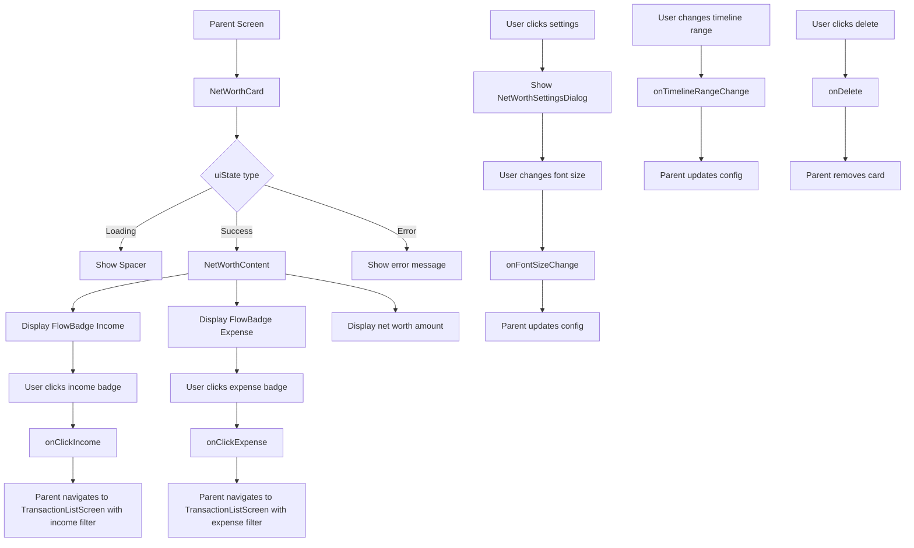

# NetWorthCard Functional Logic

## 1. Component Overview
- **Component Name**: NetWorthCard
- **Purpose**: Displays net worth with income/expense breakdown badges and configurable font size
- **Parent Screen**: DashboardScreen, AccountsViewScreen
- **Related Components**: FlowBadge, NetWorthSettingsDialog
- **Configuration Class**: NetWorthSettings

## 2. Input Analysis

### Component Inputs (Parent Screen → Component)
- **uiState**: NetWorthUiState - Net worth state from ViewModel
- **cardId**: String - Unique card identifier
- **fontSize**: String - Font size (Small, Medium, Large, X-Large)
- **timelineRange**: TimelineRange - Timeline range for calculations
- **onFontSizeChange**: (String, String) -> Unit - Update font size (cardId, fontSize)
- **onTimelineRangeChange**: (String, TimelineRange) -> Unit - Update timeline range
- **onDelete**: () -> Unit - Delete card callback
- **onClickIncome**: (TimelineRange) -> Unit - Navigate to income transactions
- **onClickExpense**: (TimelineRange) -> Unit - Navigate to expense transactions

### Component Inputs (ViewModel → Parent Screen)
- **NetWorthUiState**: From NetWorthViewModel or AccountsViewViewModel
  - Loading state
  - Success state with:
    - netWorth: BigDecimal
    - netIncome: BigDecimal
    - netExpense: BigDecimal
    - baseCurrency: String
    - precision: Int
  - Error state

## 3. Output Analysis

### Component Outputs (Component → Parent Screen)
- **Navigation Events**:
  - onClickIncome(timelineRange) - Navigate to TransactionListScreen with income filter
  - onClickExpense(timelineRange) - Navigate to TransactionListScreen with expense filter
- **Configuration Changes**:
  - onFontSizeChange(cardId, fontSize) - Update font size
  - onTimelineRangeChange(cardId, range) - Update timeline range
  - onDelete() - Delete card from configuration

### Displayed Data Structure
```kotlin
// Card displays:
- Net worth amount (centered, large text)
- Income badge (with trend icon)
- Expense badge (with trend icon)
- Timeline label (header)
- Settings button
```

## 4. Computation Logic

### Value: Text Style Selection
- **Value Name**: textStyle
- **Input Data**: fontSize
- **Computation Formula/Logic**:
  ```kotlin
  val textStyle = when (fontSize) {
      "Small" -> MaterialTheme.typography.displaySmall
      "Large" -> MaterialTheme.typography.displayLarge
      "X-Large" -> MaterialTheme.typography.displayLarge.copy(fontSize = 64.sp)
      else -> MaterialTheme.typography.displayMedium
  }
  ```
- **Use Case Involvement**: None
- **Transformation Steps**: Font size string → TextStyle

### Value: Timeline Label
- **Value Name**: timelineLabel
- **Input Data**: timelineRange
- **Computation Formula/Logic**:
  ```kotlin
  val timelineLabel = when (timelineRange) {
      is TimelineRange.AllTime -> "All Time"
      is TimelineRange.ThisPeriod -> timelineRange.period.label
      is TimelineRange.LastPeriod -> timelineRange.period.label
      is TimelineRange.CustomRange -> {
          val formatter = DateTimeFormatter.ofPattern("MMM d, yyyy").withZone(ZoneId.systemDefault())
          val start = formatter.format(Instant.ofEpochMilli(timelineRange.start))
          val end = formatter.format(Instant.ofEpochMilli(timelineRange.end))
          "$start - $end"
      }
  }
  ```
- **Use Case Involvement**: None
- **Transformation Steps**: TimelineRange → Display string

### Value: Badge Color
- **Value Name**: color
- **Input Data**: isIncome
- **Computation Formula/Logic**:
  ```kotlin
  val color = if (isIncome) PositiveAmountColor else NegativeAmountColor
  ```
- **Use Case Involvement**: None
- **Transformation Steps**: Boolean → Color

### Value: Badge Icon
- **Value Name**: icon
- **Input Data**: isIncome
- **Computation Formula/Logic**:
  ```kotlin
  val icon = if (isIncome) Icons.AutoMirrored.Filled.TrendingUp else Icons.AutoMirrored.Filled.TrendingDown
  ```
- **Use Case Involvement**: None
- **Transformation Steps**: Boolean → Icon

## 5. Data Flow Diagram



## 6. Data Sources
- **Repository Interfaces**: AccountRepository, TransactionRepository (via ViewModel)
- **Database Entities**: AccountEntity, TransactionEntity
- **Remote Data Sources**: None
- **Local Data Stores**: SettingsDataStore (base currency, precision, dashboardCardsConfig)

## 7. Business Logic Summary
- **Key Business Rules**:
  - Font size configurable (Small, Medium, Large, X-Large)
  - Timeline range affects net worth calculation
  - Income badge shows with green color and up arrow
  - Expense badge shows with red color and down arrow
  - Badges are clickable for navigation
  - Settings dialog allows font size and timeline range changes
  - Loading state shows placeholder
  - Error state shows error message
- **Validation Logic**: None
- **Calculations Performed**:
  - Text style selection based on font size
  - Timeline label formatting
- **State Management Approach**:
  - Local state for settings dialog visibility
  - Configuration passed as parameters
  - Callbacks for all configuration changes
  - Stateless rendering (no internal state)

## 8. Dependencies

### Component Dependencies
- FlowBadge
- NetWorthSettingsDialog
- TimelineFilterBar
- SingleChoiceSegmentedButtonRow

### Parent Screen Dependencies
- NetWorthViewModel or AccountsViewViewModel (for NetWorthUiState)
- SettingsDataStore (for dashboardCardsConfig)

### External Services/APIs
- None
