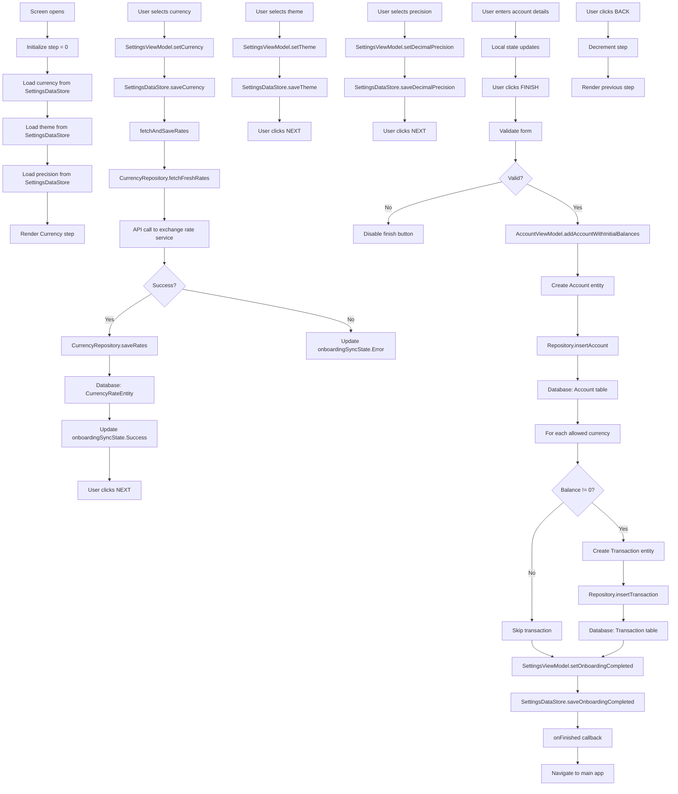

# OnboardingScreen Functional Logic

## 1. Component Overview
- **Screen Name**: OnboardingScreen
- **Purpose**: First-time setup wizard that guides users through initial app configuration (currency, theme, precision, account creation)
- **ViewModel Class**: SettingsViewModel (primary), plus supporting ViewModel
- **Related Use Cases**: None (uses direct repository/DataStore methods)

## 2. Input Analysis

### Component Inputs (UI → ViewModel)
- **onFinished**: Navigation callback to complete onboarding and navigate to main app
- **User Actions**:
  - Select base currency
  - Select theme (Light/Dark/System)
  - Select decimal precision (0-4)
  - Enter account name
  - Enter initial balances for allowed currencies
  - Select allowed currencies
  - Navigate between steps (back/next)
  - Complete onboarding

### ViewModel Inputs (Use Cases/Repositories)
- **Data Sources**:
  - SettingsDataStore: For currency, theme, precision, onboarding status
  - CurrencyRepository: For exchange rate fetching
  - AccountRepository: For account creation (via AccountViewModel)
  - TransactionRepository: For initial balance transactions (via AccountViewModel)
- **Initial State Parameters**: None
- **Configuration Parameters**: None

## 3. Output Analysis

### ViewModel Outputs (UI State)
```kotlin
val currency: StateFlow<String>
val theme: StateFlow<String>
val decimalPrecision: StateFlow<Int>
val onboardingSyncState: StateFlow<SyncState>
```

**SyncState Structure**:
```kotlin
sealed interface SyncState {
    data object Idle : SyncState
    data object Loading : SyncState
    data class Error(val message: String) : SyncState
    data object Success : SyncState
}
```

**Loading/Error States**: onboardingSyncState for exchange rate sync during currency selection

**Navigation Events**: None (handled via callback parameters)

### Component Outputs (User Actions)
- **Navigation**: onFinished
- **Side Effects**:
  - Show currency picker
  - Show theme picker
  - Show precision picker
  - Show numpad for amount input
  - Show currency management section for initial balances

## 4. Computation Logic

### Value: Currency Selection
- **Value Name**: setCurrency
- **Input Data**: currency: String
- **Computation Formula/Logic**:
  ```kotlin
  fun setCurrency(currency: String) {
      viewModelScope.launch {
          settingsDataStore.saveCurrency(currency)
          fetchAndSaveRates(currency)
      }
  }
  ```
- **Use Case Involvement**: CurrencyRepository.fetchFreshRates, CurrencyRepository.saveRates
- **Transformation Steps**: Currency selection → DataStore save → Fetch rates → Save rates to database

### Value: Theme Selection
- **Value Name**: setTheme
- **Input Data**: theme: String
- **Computation Formula/Logic**:
  ```kotlin
  fun setTheme(theme: String) {
      viewModelScope.launch {
          settingsDataStore.saveTheme(theme)
      }
  }
  ```
- **Use Case Involvement**: None
- **Transformation Steps**: Theme selection → DataStore save

### Value: Decimal Precision Selection
- **Value Name**: setDecimalPrecision
- **Input Data**: precision: Int
- **Computation Formula/Logic**:
  ```kotlin
  fun setDecimalPrecision(precision: Int) {
      viewModelScope.launch {
          settingsDataStore.saveDecimalPrecision(precision)
      }
  }
  ```
- **Use Case Involvement**: None
- **Transformation Steps**: Precision selection → DataStore save

### Value: Onboarding Completion
- **Value Name**: setOnboardingCompleted
- **Input Data**: completed: Boolean
- **Computation Formula/Logic**:
  ```kotlin
  fun setOnboardingCompleted(completed: Boolean) {
      viewModelScope.launch {
          settingsDataStore.saveOnboardingCompleted(completed)
      }
  }
  ```
- **Use Case Involvement**: None
- **Transformation Steps**: Completion flag → DataStore save

### Value: Account Creation with Initial Balances
- **Value Name**: addAccountWithInitialBalances (via AccountViewModel)
- **Input Data**: name, initialBalances (Map<String, String>), currency, structureType, colorHex, icon, allowedCurrencies
- **Computation Formula/Logic**:
  ```kotlin
  fun addAccountWithInitialBalances(...) {
      viewModelScope.launch {
          withProfile { profileId ->
              // 1. Create Account with balance = 0
              val account = Account(
                  id = UUID.randomUUID().toString(),
                  name = name,
                  balance = BigDecimal.ZERO,
                  currencyCode = currency,
                  structureType = structureType,
                  colorHex = colorHex,
                  icon = icon,
                  allowedCurrencies = allowedCurrencies,
                  isArchived: false,
                  displayOrder: accounts.value.size
              )
              repository.insertAccount(account, profileId)
              
              // 2. Create initial balance transactions for each currency
              allowedCurrencies.forEach { currencyCode ->
                  val balance = initialBalances[currencyCode]?.toBigDecimalOrNull() ?: BigDecimal.ZERO
                  if (balance.signum() != 0) {
                      val transactionType = if (balance.signum() > 0) "income" else "expense"
                      val initialTransaction = Transaction(
                          title = "Initial Balance",
                          amount = balance,
                          category = "Adjustment",
                          timestamp = System.currentTimeMillis(),
                          currency = currencyCode,
                          transactionType = transactionType,
                          accountId = accountId,
                          note = "Initial balance for $name in $currencyCode",
                          paymentMethod = structureType,
                          payee = "System"
                      )
                      transactionRepository.insertTransaction(initialTransaction, profileId)
                  }
              }
          }
      }
  }
  ```
- **Use Case Involvement**: None (direct repository access via AccountViewModel)
- **Transformation Steps**: Form data → Account entity → Transaction entities → Database

### Value: Step Navigation Validation
- **Value Name**: canProceed
- **Input Data**: step, accountName, initialBalances
- **Computation Formula/Logic**:
  ```kotlin
  canProceed = when (step) {
      0 -> true // Currency step always valid
      1 -> true // Theme step always valid
      2 -> true // Precision step always valid
      3 -> { // Account step
          val isBalanceValid = initialBalances.values.all { it.isEmpty() || it.toBigDecimalOrNull() != null }
          accountName.isNotBlank() && isBalanceValid && allowedCurrencies.isNotEmpty()
      }
      else -> true
  }
  ```
- **Use Case Involvement**: None
- **Transformation Steps**: Step + form data → Boolean validation

## 5. Data Flow Diagram



## 6. Data Sources
- **Repository Interfaces**: CurrencyRepository, AccountRepository, TransactionRepository
- **Database Entities**: CurrencyRateEntity, AccountEntity, TransactionEntity
- **Remote Data Sources**: Exchange rate API (via CurrencyRepository)
- **Local Data Stores**: SettingsDataStore (currency, theme, decimalPrecision, isOnboardingCompleted)

## 7. Business Logic Summary
- **Key Business Rules**:
  - Onboarding consists of 4 steps: Currency, Theme, Precision, Account
  - Currency selection triggers automatic exchange rate fetch
  - Account creation follows same logic as AccountSetupScreen
  - Initial balances are created as separate "Adjustment" category transactions
  - Onboarding completion flag is set to prevent showing onboarding again
  - Navigation between steps is validated
  - Account step requires valid name and at least one allowed currency
  - Exchange rate sync state is tracked during currency selection
- **Validation Logic**:
  - Account name must not be blank
  - All balance inputs must be valid BigDecimal or empty
  - At least one allowed currency must be selected
- **Calculations Performed**:
  - None (all data is direct user input)
- **State Management Approach**:
  - Local state for step index and form fields
  - SettingsViewModel for app settings
  - AccountViewModel for account creation
  - Reactive state for currency, theme, precision
  - Navigation trigger guard to prevent double navigation

## 8. Dependencies

### ViewModel Dependencies
- SettingsViewModel (primary)
- AccountViewModel (for account creation)

### Use Case Dependencies
- None (ViewModels use repositories directly)

### External Services/APIs
- Exchange rate API (via CurrencyRepository)
