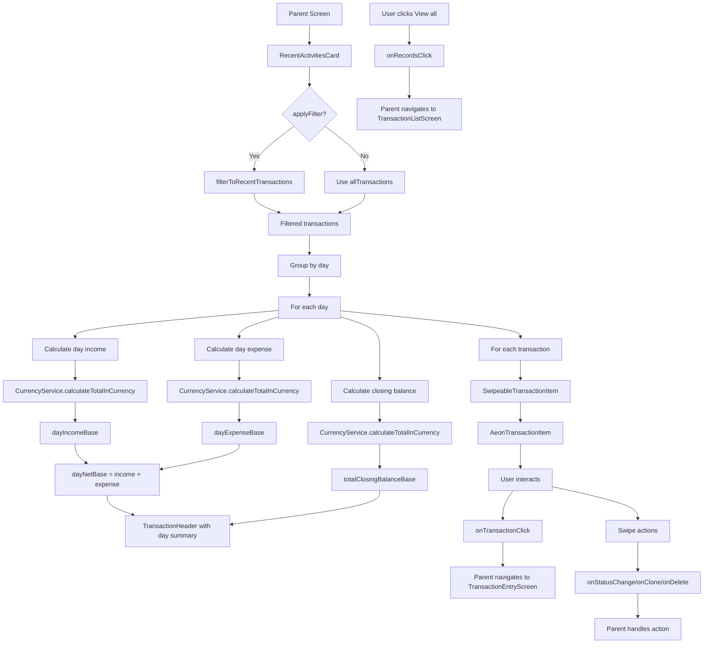

# RecentActivitiesCard Functional Logic

## 1. Component Overview
- **Component Name**: RecentActivitiesCard
- **Purpose**: Displays recent transactions grouped by day with swipe actions for quick operations
- **Parent Screen**: DashboardScreen, AccountsViewScreen, AccountDetailScreen
- **Related Components**: TransactionHeader, SwipeableTransactionItem, AeonTransactionItem

## 2. Input Analysis

### Component Inputs (Parent Screen → Component)
- **allTransactions**: List<TransactionWithBalance> - All transactions with balance data
- **accountNamesMap**: Map<String, String> - Account ID to name mapping
- **categoryMap**: Map<Long, CategoryEntity> - Category ID to entity mapping
- **decimalPrecision**: Int - Number of decimal places for currency formatting
- **onRecordsClick**: (RecordsFilterContext) -> Unit - Navigation to full transaction list
- **onTransactionClick**: (Long) -> Unit - Navigation to transaction edit (transaction ID)
- **baseCurrency**: String - Base currency for conversions
- **exchangeRates**: Map<String, BigDecimal> - Exchange rates for currency conversion
- **accountCurrencyMap**: Map<String, String> - Account ID to currency mapping
- **contentPadding**: PaddingValues - Padding for content
- **revealedCardIds**: List<Long> - IDs of cards with revealed swipe actions
- **onItemExpanded**: (Long) -> Unit - Callback when swipe action revealed
- **onItemCollapsed**: (Long) -> Unit - Callback when swipe action collapsed
- **onStatusChange**: (Long, TransactionStatus) -> Unit - Callback for status update
- **onClone**: (Long) -> Unit - Callback for clone transaction
- **onDelete**: (Long) -> Unit - Callback for delete transaction
- **onSplit**: (Long) -> Unit - Callback for split transaction
- **onFullSwipeRight**: (Long) -> Unit - Callback for full swipe right action
- **limit**: Int - Maximum transactions to show (default 20)
- **days**: Int - Number of days to include (default 7)
- **applyFilter**: Boolean - Whether to apply recent filter (default true)

### Component Inputs (ViewModel → Parent Screen)
- **TransactionWithBalance**: From TransactionViewModel or AccountViewModel
- **CategoryEntity**: From CategoryDao
- **Account entities**: From AccountRepository
- **Exchange rates**: From AnalyticsViewModel or CurrencyViewModel

## 3. Output Analysis

### Component Outputs (Component → Parent Screen)
- **Navigation Events**:
  - onRecordsClick() - Navigate to TransactionListScreen
  - onTransactionClick(transactionId) - Navigate to TransactionEntryScreen
- **Action Callbacks**:
  - onStatusChange(transactionId, newStatus) - Update transaction status
  - onClone(transactionId) - Clone transaction
  - onDelete(transactionId) - Delete transaction
  - onSplit(transactionId) - Split transaction
  - onFullSwipeRight(transactionId) - Execute quick action
- **UI State Changes**:
  - onItemExpanded(transactionId) - Mark card as revealed
  - onItemCollapsed(transactionId) - Mark card as collapsed

### Displayed Data Structure
```kotlin
// Grouped by day
groupedByDay: Map<String, List<TransactionWithBalance>>
// Key format: "year-month-day"

// Day summary includes:
- Date display (Today or formatted date)
- Transaction count
- Income totals by currency
- Expense totals by currency
- Net flow in base currency
- Closing balance in base currency
```

## 4. Computation Logic

### Value: Recent Transactions Filter
- **Value Name**: filterToRecentTransactions
- **Input Data**: allTransactions, limit (default 20), days (default 7)
- **Computation Formula/Logic**:
  ```kotlin
  private fun filterToRecentTransactions(
      allTransactions: List<TransactionWithBalance>,
      limit: Int = 20,
      days: Int = 7
  ): List<TransactionWithBalance> {
      // Get transactions from last 7 days
      val cutoffTime = System.currentTimeMillis() - (days * 24 * 60 * 60 * 1000L)
      val transactionsFromLastDays = allTransactions.filter { 
          it.transaction.timestamp >= cutoffTime 
      }

      // Get last 20 transactions
      val lastLimitTransactions = allTransactions.take(limit)

      // Return whichever has more transactions
      return if (transactionsFromLastDays.size > lastLimitTransactions.size) {
          transactionsFromLastDays
      } else {
          lastLimitTransactions
      }
  }
  ```
- **Use Case Involvement**: None (local computation)
- **Transformation Steps**: All transactions → Filter by date OR limit → Return larger set

### Value: Day Grouping
- **Value Name**: groupedByDay
- **Input Data**: recentTransactions
- **Computation Formula/Logic**:
  ```kotlin
  val calendar = Calendar.getInstance()
  val groupedByDay = recentTransactions.groupBy {
      calendar.timeInMillis = it.transaction.timestamp
      val day = calendar.get(Calendar.DAY_OF_MONTH)
      val month = calendar.get(Calendar.MONTH)
      val year = calendar.get(Calendar.YEAR)
      "$year-$month-$day"
  }
  ```
- **Use Case Involvement**: None
- **Transformation Steps**: Transaction list → Map by day string

### Value: Day Income Calculation
- **Value Name**: dayIncomeBase
- **Input Data**: dayTransactions, baseCurrency, exchangeRates, precision
- **Computation Formula/Logic**:
  ```kotlin
  val incomeByCurrency = dayTransactions.filter { it.transaction.amount.signum() >= 0 }
      .groupBy { it.transaction.currency }
      .mapValues { entry -> entry.value.fold(BigDecimal.ZERO) { acc, tx -> acc.add(tx.transaction.amount) } }
  val dayIncomeBase = CurrencyService.calculateTotalInCurrency(
      incomeByCurrency, 
      baseCurrency, 
      exchangeRates, 
      precision
  )
  ```
- **Use Case Involvement**: CurrencyService.calculateTotalInCurrency
- **Transformation Steps**: Transactions → Group by currency → Sum → Convert to base currency

### Value: Day Expense Calculation
- **Value Name**: dayExpenseBase
- **Input Data**: dayTransactions, baseCurrency, exchangeRates, precision
- **Computation Formula/Logic**:
  ```kotlin
  val expenseByCurrency = dayTransactions.filter { it.transaction.amount.signum() < 0 }
      .groupBy { it.transaction.currency }
      .mapValues { entry -> entry.value.fold(BigDecimal.ZERO) { acc, tx -> acc.add(tx.transaction.amount) } }
  val dayExpenseBase = CurrencyService.calculateTotalInCurrency(
      expenseByCurrency, 
      baseCurrency, 
      exchangeRates, 
      precision
  )
  ```
- **Use Case Involvement**: CurrencyService.calculateTotalInCurrency
- **Transformation Steps**: Transactions → Group by currency → Sum → Convert to base currency

### Value: Day Net Flow
- **Value Name**: dayNetBase
- **Input Data**: dayIncomeBase, dayExpenseBase
- **Computation Formula/Logic**:
  ```kotlin
  val dayNetBase = dayIncomeBase.add(dayExpenseBase)
  ```
- **Use Case Involvement**: None
- **Transformation Steps**: Income + Expense = Net

### Value: Closing Balance Calculation
- **Value Name**: totalClosingBalanceBase
- **Input Data**: recentTransactions, dayEndTimestamp, baseCurrency, exchangeRates, precision
- **Computation Formula/Logic**:
  ```kotlin
  val dayEndTimestamp = dayTransactions.maxOf { it.transaction.timestamp }
  val closingBalancesByCurrency = recentTransactions
      .filter { it.transaction.timestamp <= dayEndTimestamp }
      .groupBy { it.transaction.accountId }
      .mapValues { (_, accountTxs) -> accountTxs.maxBy { it.transaction.timestamp } }
      .values
      .groupBy { it.transaction.currency }
      .mapValues { (_, latestTxs) ->
          latestTxs.fold(BigDecimal.ZERO) { acc, tx -> acc.add(tx.balanceAfter) }
      }

  val totalClosingBalanceBase = CurrencyService.calculateTotalInCurrency(
      closingBalancesByCurrency,
      baseCurrency,
      exchangeRates,
      precision
  )
  ```
- **Use Case Involvement**: CurrencyService.calculateTotalInCurrency
- **Transformation Steps**: Get latest transaction per account before day end → Group by currency → Sum → Convert to base currency

### Value: Date Display
- **Value Name**: displayDate
- **Input Data**: dayTransactions.first().transaction.timestamp
- **Computation Formula/Logic**:
  ```kotlin
  val date = SimpleDateFormat("MMM dd, yyyy", Locale.getDefault())
      .format(Date(dayTransactions.first().transaction.timestamp))
  val isToday = SimpleDateFormat("MMM dd, yyyy", Locale.getDefault())
      .format(Date(System.currentTimeMillis())) == date
  val displayDate = if (isToday) "Today" else date
  ```
- **Use Case Involvement**: None
- **Transformation Steps**: Timestamp → Formatted date → Check if today → Display

## 5. Data Flow Diagram



## 6. Data Sources
- **Repository Interfaces**: TransactionRepository (via ViewModel), CategoryDao, AccountRepository
- **Database Entities**: TransactionEntity, CategoryEntity, AccountEntity
- **Remote Data Sources**: None
- **Local Data Stores**: SettingsDataStore (for decimal precision, base currency)

## 7. Business Logic Summary
- **Key Business Rules**:
  - Recent filter returns transactions from last 7 days OR last 20 transactions, whichever is more
  - Transactions are grouped by day for better organization
  - Day header shows summary of income, expense, net flow, and closing balance
  - All currency amounts are converted to base currency for day summary
  - Closing balance is calculated based on latest transaction per account before day end
  - Today's date is displayed as "Today" instead of formatted date
  - Swipe actions provide quick access to common operations
  - Navigation guard prevents double navigation
- **Validation Logic**: None
- **Calculations Performed**:
  - Date-based filtering
  - Currency aggregation and conversion
  - Balance calculation
  - Day grouping
- **State Management Approach**:
  - Stateless component (all state from parent)
  - Local computation for filtering and grouping
  - Callbacks for all user actions
  - revealedCardIds managed by parent for swipe state

## 8. Dependencies

### Component Dependencies
- CurrencyService (for currency conversion)
- CategoryIcons (for category icons)
- TransactionHeader
- SwipeableTransactionItem
- AeonTransactionItem

### Parent Screen Dependencies
- TransactionViewModel (for TransactionWithBalance)
- CategoryDao (for category mapping)
- AccountRepository (for account mapping)
- AnalyticsViewModel (for exchange rates)
- SettingsDataStore (for decimal precision, base currency)

### External Services/APIs
- None
