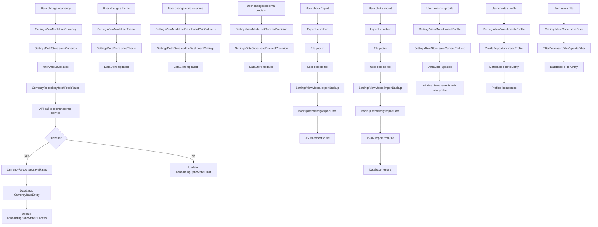

# SettingsScreen Functional Logic

## 1. Component Overview
- **Screen Name**: SettingsScreen
- **Purpose**: Allows users to configure app settings including currency, theme, decimal precision, grid columns, backup/restore, and profile management
- **ViewModel Class**: SettingsViewModel
- **Related Use Cases**: None (uses direct repository/DataStore methods)

## 2. Input Analysis

### Component Inputs (UI → ViewModel)
- **Navigation Callbacks**:
  - onManageAccountsClick, onManageLabelsClick, onManageCategoriesClick
  - onTemplatesClick, onManageFiltersClick, onBackClick
- **User Actions**:
  - Change currency
  - Change theme (Light/Dark/System)
  - Change dashboard grid columns
  - Change decimal precision
  - Toggle auto-save exchange rates
  - Toggle card animations
  - Export backup
  - Import backup
  - Switch profiles
  - Create new profile
  - Manage filters

### ViewModel Inputs (Use Cases/Repositories)
- **Data Sources**:
  - SettingsDataStore: For all app settings
  - ProfileRepository: For profile management
  - BackupRepository: For backup/restore operations
  - CurrencyRepository: For exchange rate fetching
  - FilterDao: For saved filter management
- **Initial State Parameters**: None
- **Configuration Parameters**: None

## 3. Output Analysis

### ViewModel Outputs (UI State)
```kotlin
val currency: StateFlow<String>
val theme: StateFlow<String>
val dashboardGridColumns: StateFlow<Int>
val decimalPrecision: StateFlow<Int>
val autoSaveExchangeRates: StateFlow<Boolean>
val cardAnimationEnabled: StateFlow<Boolean>
val isOnboardingCompleted: StateFlow<Boolean?>
val profiles: StateFlow<List<ProfileEntity>>
val currentProfile: StateFlow<ProfileEntity?>
val onboardingSyncState: StateFlow<SyncState>
val allFilters: Flow<List<FilterEntity>>
```

**ProfileEntity Structure**:
```kotlin
data class ProfileEntity(
    val id: Int = 0,
    val name: String,
    val type: String
)
```

**FilterEntity Structure**:
```kotlin
data class FilterEntity(
    val id: Long = 0,
    val name: String,
    val filterJson: String,
    val createdAt: Long = System.currentTimeMillis()
)
```

**SyncState Structure**:
```kotlin
sealed interface SyncState {
    data object Idle : SyncState
    data object Loading : SyncState
    data class Error(val message: String) : SyncState
    data object Success : SyncState
}
```

**Loading/Error States**: onboardingSyncState for exchange rate sync

**Navigation Events**: None (handled via callback parameters)

### Component Outputs (User Actions)
- **Navigation**: All navigation callbacks passed to screen
- **Side Effects**:
  - Show currency picker dialog
  - Show theme picker dialog
  - Trigger file picker for export/import
  - Show toast messages (via Toast)

## 4. Computation Logic

### Value: Currency Change
- **Value Name**: setCurrency
- **Input Data**: currency: String
- **Computation Formula/Logic**:
  ```kotlin
  fun setCurrency(currency: String) {
      viewModelScope.launch {
          settingsDataStore.saveCurrency(currency)
          fetchAndSaveRates(currency)
      }
  }
  ```
- **Use Case Involvement**: CurrencyRepository.fetchFreshRates, CurrencyRepository.saveRates
- **Transformation Steps**: Currency selection → DataStore save → Fetch rates → Save rates to database

### Value: Theme Change
- **Value Name**: setTheme
- **Input Data**: theme: String
- **Computation Formula/Logic**:
  ```kotlin
  fun setTheme(theme: String) {
      viewModelScope.launch {
          settingsDataStore.saveTheme(theme)
      }
  }
  ```
- **Use Case Involvement**: None
- **Transformation Steps**: Theme selection → DataStore save

### Value: Grid Columns Change
- **Value Name**: setDashboardGridColumns / setAccountsViewGridColumns
- **Input Data**: columns: Int
- **Computation Formula/Logic**:
  ```kotlin
  fun setDashboardGridColumns(columns: Int) {
      viewModelScope.launch {
          settingsDataStore.updateDashboardSettings { it.copy(accountsSection = it.accountsSection.copy(gridColumns = columns)) }
      }
  }
  ```
- **Use Case Involvement**: None
- **Transformation Steps**: Columns count → Settings update → DataStore save

### Value: Decimal Precision Change
- **Value Name**: setDecimalPrecision
- **Input Data**: precision: Int
- **Computation Formula/Logic**:
  ```kotlin
  fun setDecimalPrecision(precision: Int) {
      viewModelScope.launch {
          settingsDataStore.saveDecimalPrecision(precision)
      }
  }
  ```
- **Use Case Involvement**: None
- **Transformation Steps**: Precision value → DataStore save

### Value: Auto-Save Exchange Rates Toggle
- **Value Name**: setAutoSaveExchangeRates
- **Input Data**: autoSave: Boolean
- **Computation Formula/Logic**:
  ```kotlin
  fun setAutoSaveExchangeRates(autoSave: Boolean) {
      viewModelScope.launch {
          settingsDataStore.saveAutoSaveExchangeRates(autoSave)
      }
  }
  ```
- **Use Case Involvement**: None
- **Transformation Steps**: Boolean toggle → DataStore save

### Value: Card Animation Toggle
- **Value Name**: setCardAnimationEnabled
- **Input Data**: enabled: Boolean
- **Computation Formula/Logic**:
  ```kotlin
  fun setCardAnimationEnabled(enabled: Boolean) {
      viewModelScope.launch {
          settingsDataStore.saveCardAnimationEnabled(enabled)
      }
  }
  ```
- **Use Case Involvement**: None
- **Transformation Steps**: Boolean toggle → DataStore save

### Value: Export Backup
- **Value Name**: exportBackup
- **Input Data**: uri: Uri (from file picker)
- **Computation Formula/Logic**:
  ```kotlin
  fun exportBackup(uri: Uri) {
      viewModelScope.launch {
          backupRepository.exportData(uri.toString())
      }
  }
  ```
- **Use Case Involvement**: BackupRepository.exportData
- **Transformation Steps**: Uri → Backup export → JSON file

### Value: Import Backup
- **Value Name**: importBackup
- **Input Data**: uri: Uri (from file picker)
- **Computation Formula/Logic**:
  ```kotlin
  fun importBackup(uri: Uri) {
      viewModelScope.launch {
          backupRepository.importData(uri.toString())
      }
  }
  ```
- **Use Case Involvement**: BackupRepository.importData
- **Transformation Steps**: Uri → Backup import → Database restore

### Value: Profile Switching
- **Value Name**: switchProfile
- **Input Data**: profileId: Int
- **Computation Formula/Logic**:
  ```kotlin
  fun switchProfile(profileId: Int) {
      viewModelScope.launch {
          settingsDataStore.saveCurrentProfileId(profileId)
      }
  }
  ```
- **Use Case Involvement**: None
- **Transformation Steps**: Profile ID → DataStore save

### Value: Profile Creation
- **Value Name**: createProfile
- **Input Data**: name: String, type: String
- **Computation Formula/Logic**:
  ```kotlin
  fun createProfile(name: String, type: String) {
      viewModelScope.launch {
          profileRepository.insertProfile(ProfileEntity(name = name, type = type))
      }
  }
  ```
- **Use Case Involvement**: ProfileRepository.insertProfile
- **Transformation Steps**: Profile data → Database insert

### Value: Filter Management
- **Value Name**: saveFilter, deleteFilter
- **Input Data**: FilterEntity
- **Computation Formula/Logic**:
  ```kotlin
  fun saveFilter(filter: FilterEntity) {
      viewModelScope.launch {
          if (filter.id == 0L) {
              filterDao.insertFilter(filter)
          } else {
              filterDao.updateFilter(filter)
          }
      }
  }
  ```
- **Use Case Involvement**: FilterDao
- **Transformation Steps**: Filter entity → Database insert/update

### Value: Exchange Rate Fetching (Onboarding)
- **Value Name**: fetchAndSaveRates
- **Input Data**: baseCurrency: String
- **Computation Formula/Logic**:
  ```kotlin
  private fun fetchAndSaveRates(baseCurrency: String) {
      viewModelScope.launch {
          _onboardingSyncState.value = SyncState.Loading
          try {
              val response = currencyRepository.fetchFreshRates(baseCurrency)
              currencyRepository.saveRates(baseCurrency, response)
              _onboardingSyncState.value = SyncState.Success
          } catch (e: Exception) {
              _onboardingSyncState.value = SyncState.Error(e.localizedMessage ?: "Unknown Error")
          }
      }
  }
  ```
- **Use Case Involvement**: CurrencyRepository.fetchFreshRates, CurrencyRepository.saveRates
- **Transformation Steps**: Currency code → API fetch → Database save

## 5. Data Flow Diagram



## 6. Data Sources
- **Repository Interfaces**: ProfileRepository, BackupRepository, CurrencyRepository
- **Database Entities**: ProfileEntity, FilterEntity, CurrencyRateEntity
- **Remote Data Sources**: Exchange rate API (via CurrencyRepository)
- **Local Data Stores**: SettingsDataStore (all app settings)

## 7. Business Logic Summary
- **Key Business Rules**:
  - Currency change triggers automatic exchange rate fetch
  - Theme can be Light, Dark, or System (follows device)
  - Decimal precision affects all currency displays
  - Grid columns affect dashboard and accounts view layouts
  - Auto-save exchange rates determines if fetched rates are automatically saved
  - Card animations can be disabled for performance
  - Backup exports all data to JSON
  - Import restores all data from JSON
  - Profiles allow separating financial data (e.g., personal vs business)
  - Filters can be saved for quick access
- **Validation Logic**: None
- **Calculations Performed**: None
- **State Management Approach**:
  - All settings persisted in DataStore
  - Each setting has its own StateFlow
  - Profile switching triggers data flow re-emission
  - Sync state tracks exchange rate fetch status
  - Navigation trigger guard to prevent double navigation

## 8. Dependencies

### ViewModel Dependencies
- SettingsDataStore
- ProfileRepository
- BackupRepository
- CurrencyRepository
- FilterDao

### Use Case Dependencies
- None (ViewModel uses repositories directly)

### External Services/APIs
- Exchange rate API (via CurrencyRepository)
