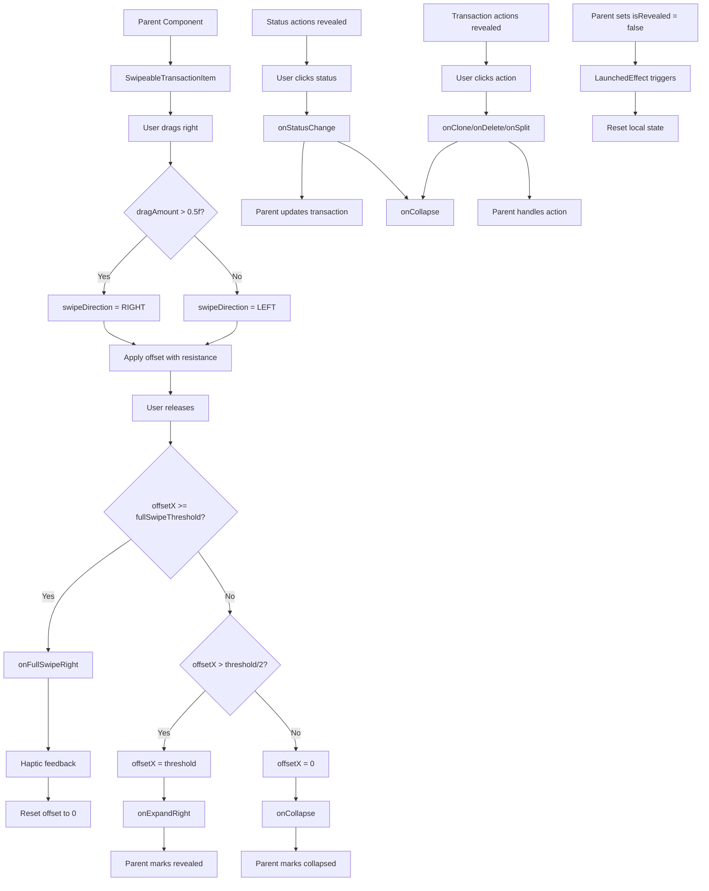

# SwipeableTransactionItem Functional Logic

## 1. Component Overview
- **Component Name**: SwipeableTransactionItem
- **Purpose**: Swipeable transaction item with action buttons for quick operations (status change, clone, delete, split)
- **Parent Component**: RecentActivitiesCard, TransactionListScreen
- **Related Components**: StatusActionsRow, TransactionActionsRow, ExpressiveActionButton

## 2. Input Analysis

### Component Inputs (Parent Component → Component)
- **transaction**: Transaction - Transaction entity
- **isRevealed**: Boolean - Whether swipe actions are currently revealed
- **onExpandLeft**: () -> Unit - Callback when left swipe reveals actions
- **onExpandRight**: () -> Unit - Callback when right swipe reveals actions
- **onCollapse**: () -> Unit - Callback when swipe collapses
- **onFullSwipeRight**: () -> Unit - Callback when full swipe right occurs
- **onStatusChange**: (TransactionStatus) -> Unit - Callback for status change
- **onClone**: () -> Unit - Callback for clone transaction
- **onDelete**: () -> Unit - Callback for delete transaction
- **onSplit**: () -> Unit - Callback for split transaction
- **content**: @Composable () -> Unit - Transaction item content (AeonTransactionItem)

### Component Internal State
- **offsetX**: Float - Horizontal offset for swipe animation
- **swipeDirection**: SwipeDirection - Current swipe direction (NONE, LEFT, RIGHT)

## 3. Output Analysis

### Component Outputs (Component → Parent Component)
- **Action Callbacks**:
  - onStatusChange(status) - Update transaction status
  - onClone() - Clone transaction
  - onDelete() - Delete transaction
  - onSplit() - Split transaction
  - onFullSwipeRight() - Execute quick action on full swipe
- **State Change Callbacks**:
  - onExpandLeft() - Mark card as revealed (left swipe)
  - onExpandRight() - Mark card as revealed (right swipe)
  - onCollapse() - Mark card as collapsed

### Displayed Data Structure
```kotlin
// Right swipe reveals (left side):
- Status actions (CLEARED, RECONCILE, UNCLEARED)
- Expressed as circular buttons with icons
- Animated scale based on swipe progress

// Left swipe reveals (right side):
- Transaction actions (Split, Clone, Delete)
- Expressed as circular buttons with icons
- Animated scale based on swipe progress
```

## 4. Computation Logic

### Value: Swipe Thresholds
- **Value Name**: leftSwipeThresholdPx, rightSwipeThresholdPx, fullSwipeThresholdPx
- **Input Data**: ACTION_ITEM_SIZE (64), density
- **Computation Formula/Logic**:
  ```kotlin
  val leftSwipeThresholdPx = with(density) { (ACTION_ITEM_SIZE.dp * 3).toPx() } // 192px
  val rightSwipeThresholdPx = with(density) { (ACTION_ITEM_SIZE.dp * 2).toPx() } // 128px
  val fullSwipeThresholdPx = with(density) { 220.dp.toPx() } // 220px
  ```
- **Use Case Involvement**: None
- **Transformation Steps**: Constants → Pixels using density

### Value: Swipe Direction Initialization
- **Value Name**: swipeDirection
- **Input Data**: dragAmount
- **Computation Formula/Logic**:
  ```kotlin
  if (swipeDirection == SwipeDirection.NONE && abs(dragAmount) > 0.5f) {
      swipeDirection = if (dragAmount > 0) SwipeDirection.RIGHT else SwipeDirection.LEFT
  }
  ```
- **Use Case Involvement**: None
- **Transformation Steps**: Drag amount → Direction (once threshold crossed)

### Value: Offset with Resistance
- **Value Name**: offsetX (with resistance)
- **Input Data**: newOffset, swipeDirection, fullSwipeThresholdPx, thresholds
- **Computation Formula/Logic**:
  ```kotlin
  offsetX = when (swipeDirection) {
      SwipeDirection.RIGHT -> {
          if (newOffset > fullSwipeThresholdPx) {
              fullSwipeThresholdPx + (newOffset - fullSwipeThresholdPx) * 0.3f // 30% resistance
          } else newOffset.coerceAtLeast(0f)
      }
      SwipeDirection.LEFT -> {
          if (newOffset < -leftSwipeThresholdPx) {
              -leftSwipeThresholdPx + (newOffset + leftSwipeThresholdPx) * 0.3f // 30% resistance
          } else newOffset.coerceAtMost(0f)
      }
      else -> newOffset
  }
  ```
- **Use Case Involvement**: None
- **Transformation Steps**: Apply 30% resistance beyond threshold

### Value: Swipe Progress
- **Value Name**: progress
- **Input Data**: animatedOffset, thresholds
- **Computation Formula/Logic**:
  ```kotlin
  val progress = when {
      animatedOffset > 0f -> (animatedOffset / rightSwipeThresholdPx).coerceIn(0f, 1f)
      animatedOffset < 0f -> (abs(animatedOffset) / leftSwipeThresholdPx).coerceIn(0f, 1f)
      else -> 0f
  }
  ```
- **Use Case Involvement**: None
- **Transformation Steps**: Offset / threshold → Progress (0 to 1)

### Value: Status Action Item Progress
- **Value Name**: itemProgress
- **Input Data**: progress, index
- **Computation Formula/Logic**:
  ```kotlin
  val itemProgress = (progress * 1.5f - (index * 0.2f)).coerceIn(0f, 1f)
  ```
- **Use Case Involvement**: None
- **Transformation Steps**: Staggered animation based on index

### Value: Transaction Action Item Progress
- **Value Name**: itemProgress
- **Input Data**: progress, index
- **Computation Formula/Logic**:
  ```kotlin
  val itemProgress = (progress * 1.5f - (index * 0.15f)).coerceIn(0f, 1f)
  ```
- **Use Case Involvement**: None
- **Transformation Steps**: Staggered animation based on index

### Value: Drag End Behavior
- **Value Name**: finalOffset
- **Input Data**: offsetX, swipeDirection, thresholds
- **Computation Formula/Logic**:
  ```kotlin
  when (swipeDirection) {
      SwipeDirection.RIGHT -> {
          if (offsetX >= fullSwipeThresholdPx) {
              onFullSwipeRight()
              offsetX = 0f
              swipeDirection = SwipeDirection.NONE
          } else if (offsetX > rightSwipeThresholdPx / 2) {
              offsetX = rightSwipeThresholdPx // Snap to revealed
              onExpandRight()
          } else {
              offsetX = 0f // Snap to closed
              swipeDirection = SwipeDirection.NONE
              onCollapse()
          }
      }
      SwipeDirection.LEFT -> {
          if (abs(offsetX) > leftSwipeThresholdPx / 2) {
              offsetX = -leftSwipeThresholdPx // Snap to revealed
              onExpandLeft()
          } else {
              offsetX = 0f // Snap to closed
              swipeDirection = SwipeDirection.NONE
              onCollapse()
          }
      }
  }
  ```
- **Use Case Involvement**: None
- **Transformation Steps**: Snap to threshold or reset based on drag distance

### Value: External State Sync
- **Value Name**: LaunchedEffect(isRevealed)
- **Input Data**: isRevealed
- **Computation Formula/Logic**:
  ```kotlin
  LaunchedEffect(isRevealed) {
      if (!isRevealed) {
          offsetX = 0f
          swipeDirection = SwipeDirection.NONE
      }
  }
  ```
- **Use Case Involvement**: None
- **Transformation Steps**: Reset state when external revealed state changes to false

## 5. Data Flow Diagram



## 6. Data Sources
- **Repository Interfaces**: None (pure UI component)
- **Database Entities**: None
- **Remote Data Sources**: None
- **Local Data Stores**: None

## 7. Business Logic Summary
- **Key Business Rules**:
  - Right swipe reveals status actions (CLEARED, RECONCILE, UNCLEARED)
  - Left swipe reveals transaction actions (Split, Clone, Delete)
  - Full swipe right triggers quick action (configurable)
  - Swipe beyond threshold has 30% resistance
  - Snap behavior: snap to revealed if past half threshold, else snap to closed
  - Actions animate in with staggered scaling based on swipe progress
  - External state synchronization with parent component
  - Haptic feedback on full swipe
  - Elevation changes when swiped (tonalElevation, shadowElevation)
- **Validation Logic**: None
- **Calculations Performed**:
  - Swipe threshold calculations
  - Offset with resistance
  - Swipe progress calculation
  - Staggered animation progress
  - Snap behavior logic
- **State Management Approach**:
  - Local state for offset and swipe direction
  - External state synchronization via LaunchedEffect
  - Animated offset using animateFloatAsState
  - Spring animation for bouncy feel
  - Callbacks for all actions

## 8. Dependencies

### Component Dependencies
- StatusActionsRow
- TransactionActionsRow
- ExpressiveActionButton

### Parent Component Dependencies
- TransactionViewModel (for transaction updates)

### External Services/APIs
- HapticFeedback (for feedback on full swipe)
