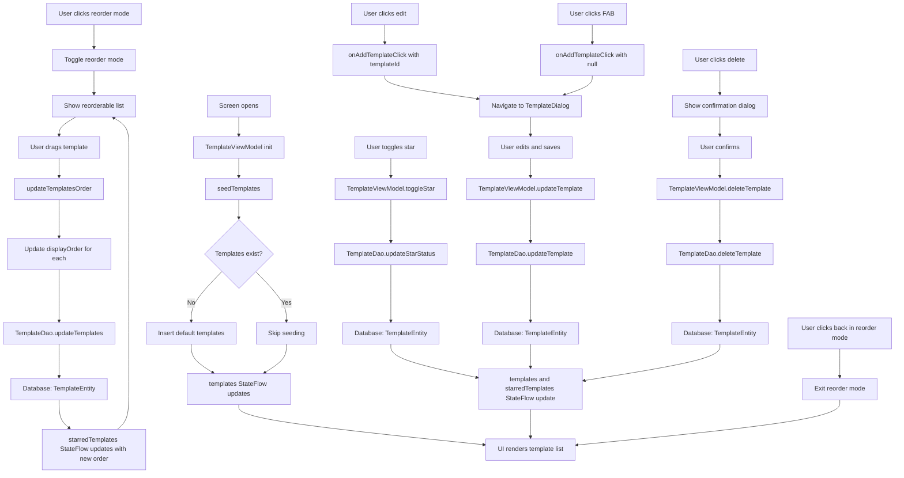

# TemplatesScreen Functional Logic

## 1. Component Overview
- **Screen Name**: TemplatesScreen
- **Purpose**: Displays a list of transaction templates with support for starring, reordering, editing, and deleting templates
- **ViewModel Class**: TemplateViewModel (primary), plus supporting ViewModel
- **Related Use Cases**: None (uses direct DAO methods)

## 2. Input Analysis

### Component Inputs (UI → ViewModel)
- **onAddTemplateClick**: Navigation callback to add/edit template (templateId: Long?)
- **onBackClick**: Navigation callback to return to previous screen
- **User Actions**:
  - Toggle template star status
  - Enter reorder mode for starred templates
  - Reorder starred templates via drag and drop
  - Edit template
  - Delete template
  - Add new template

### ViewModel Inputs (Use Cases/Repositories)
- **Data Sources**:
  - TemplateDao: For template CRUD operations
  - AccountRepository: For account list (via AccountViewModel)
- **Initial State Parameters**: None
- **Configuration Parameters**: None

## 3. Output Analysis

### ViewModel Outputs (UI State)
```kotlin
val templates: StateFlow<List<TemplateEntity>>
val starredTemplates: StateFlow<List<TemplateEntity>>
```

**TemplateEntity Structure**:
```kotlin
data class TemplateEntity(
    val id: Long = 0,
    val name: String,
    val category: String,
    val amount: BigDecimal,
    val transactionType: Int, // 0=expense, 1=income, 2=transfer
    val note: String? = null,
    val accountId: String? = null,
    val payee: String? = null,
    val location: String? = null,
    val paymentMethod: String? = null,
    val currency: String? = null,
    val tags: String = "", // Comma-separated
    val isStarred: Boolean = false,
    val displayOrder: Int = 0
)
```

**Loading/Error States**: None (uses empty list as initial state)

**Navigation Events**: None (handled via callback parameters)

### Component Outputs (User Actions)
- **Navigation**: onBackClick, onAddTemplateClick
- **Side Effects**:
  - Show reorder mode toggle
  - Show delete confirmation dialog
  - Show template dialog for add/edit

## 4. Computation Logic

### Value: Template Seeding
- **Value Name**: seedTemplates
- **Input Data**: None (runs on init if no templates exist)
- **Computation Formula/Logic**:
  ```kotlin
  private fun seedTemplates() {
      viewModelScope.launch {
          val list = templateDao.getAllTemplates().first()
          if (list.isEmpty()) {
              val initialTemplates = listOf(
                  TemplateEntity(name = "Grocery Run", category = "Food", amount = BigDecimal.ZERO, transactionType = 0, isStarred = true, accountId = "default-cash-id", displayOrder = 0),
                  TemplateEntity(name = "Salary Deposit", category = "Salary", amount = BigDecimal.ZERO, transactionType = 1, isStarred = true, accountId = "default-cash-id", displayOrder = 1),
                  TemplateEntity(name = "Rent Payment", category = "Rent", amount = BigDecimal.ZERO, transactionType = 0, isStarred = true, accountId = "default-cash-id", displayOrder = 2),
                  TemplateEntity(name = "Coffee", category = "Food", amount = BigDecimal.ZERO, transactionType = 0, isStarred = true, accountId = "default-cash-id", displayOrder = 3)
              )
              initialTemplates.forEach { templateDao.insertTemplate(it) }
          }
      }
  }
  ```
- **Use Case Involvement**: None
- **Transformation Steps**: Initial templates → TemplateDao insert

### Value: Toggle Star Status
- **Value Name**: toggleStar
- **Input Data**: template: TemplateEntity
- **Computation Formula/Logic**:
  ```kotlin
  fun toggleStar(template: TemplateEntity) {
      viewModelScope.launch {
          templateDao.updateStarStatus(template.id, !template.isStarred)
      }
  }
  ```
- **Use Case Involvement**: None
- **Transformation Steps**: Template → Star status flip → DAO update

### Value: Add Template
- **Value Name**: addTemplate
- **Input Data**: name, category, amount, type, note, accountId, payee, location, paymentMethod, currency, tags
- **Computation Formula/Logic**:
  ```kotlin
  fun addTemplate(
      name: String,
      category: String,
      amount: BigDecimal,
      type: Int,
      note: String? = null,
      accountId: String? = null,
      payee: String? = null,
      location: String? = null,
      paymentMethod: String? = null,
      currency: String? = null,
      tags: List<String> = emptyList()
  ) {
      viewModelScope.launch {
          templateDao.insertTemplate(
              TemplateEntity(
                  name = name,
                  category = category,
                  amount = amount,
                  transactionType = type,
                  note = note,
                  accountId = accountId,
                  payee = payee,
                  location = location,
                  paymentMethod = paymentMethod,
                  currency = currency,
                  tags = tags.joinToString(",")
              )
          )
      }
  }
  ```
- **Use Case Involvement**: None
- **Transformation Steps**: Template data → TemplateEntity → DAO insert

### Value: Update Template
- **Value Name**: updateTemplate
- **Input Data**: template: TemplateEntity
- **Computation Formula/Logic**:
  ```kotlin
  fun updateTemplate(template: TemplateEntity) {
      viewModelScope.launch {
          templateDao.updateTemplate(template)
      }
  }
  ```
- **Use Case Involvement**: None
- **Transformation Steps**: TemplateEntity → DAO update

### Value: Delete Template
- **Value Name**: deleteTemplate
- **Input Data**: template: TemplateEntity
- **Computation Formula/Logic**:
  ```kotlin
  fun deleteTemplate(template: TemplateEntity) {
      viewModelScope.launch {
          templateDao.deleteTemplate(template)
      }
  }
  ```
- **Use Case Involvement**: None
- **Transformation Steps**: TemplateEntity → DAO delete

### Value: Update Templates Order
- **Value Name**: updateTemplatesOrder
- **Input Data**: orderedTemplates: List<TemplateEntity>
- **Computation Formula/Logic**:
  ```kotlin
  fun updateTemplatesOrder(orderedTemplates: List<TemplateEntity>) {
      viewModelScope.launch {
          val entities = orderedTemplates.mapIndexed { index, template ->
              template.copy(displayOrder = index)
          }
          templateDao.updateTemplates(entities)
      }
  }
  ```
- **Use Case Involvement**: None
- **Transformation Steps**: Reordered list → Update displayOrder → DAO update

### Value: Edit List State Management
- **Value Name**: editList (local state in screen)
- **Input Data**: starredTemplates
- **Computation Formula/Logic**:
  ```kotlin
  LaunchedEffect(starredTemplates) {
      if (editList.isEmpty() || editList.size != starredTemplates.size || editList.map { it.id }.toSet() != starredTemplates.map { it.id }.toSet()) {
          editList = starredTemplates
      } else {
          // Update properties but keep order
          val orderMap = editList.withIndex().associate { it.value.id to it.index }
          editList = starredTemplates.sortedBy { orderMap[it.id] ?: Int.MAX_VALUE }
      }
  }
  ```
- **Use Case Involvement**: None
- **Transformation Steps**: starredTemplates → editList (with order preservation)

## 5. Data Flow Diagram



## 6. Data Sources
- **Repository Interfaces**: None (direct DAO access)
- **Database Entities**: TemplateEntity
- **Remote Data Sources**: None
- **Local Data Stores**: None

## 7. Business Logic Summary
- **Key Business Rules**:
  - Templates are seeded with default values if none exist
  - Starred templates can be reordered via drag and drop
  - Template order is stored in displayOrder field
  - Tags are stored as comma-separated string in database
  - Transaction type: 0=expense, 1=income, 2=transfer
  - Reorder mode only affects starred templates
  - Edit list preserves order while updating properties
  - Navigation trigger guard prevents double navigation
- **Validation Logic**: None
- **Calculations Performed**: None
- **State Management Approach**:
  - TemplateViewModel state for template lists
  - Local state for edit list and reorder mode
  - LaunchedEffect for edit list synchronization
  - Navigation trigger guard to prevent double navigation

## 8. Dependencies

### ViewModel Dependencies
- TemplateViewModel (primary)
- AccountViewModel (for account picker in dialog)

### Use Case Dependencies
- None (ViewModel uses DAO directly)

### External Services/APIs
- None
