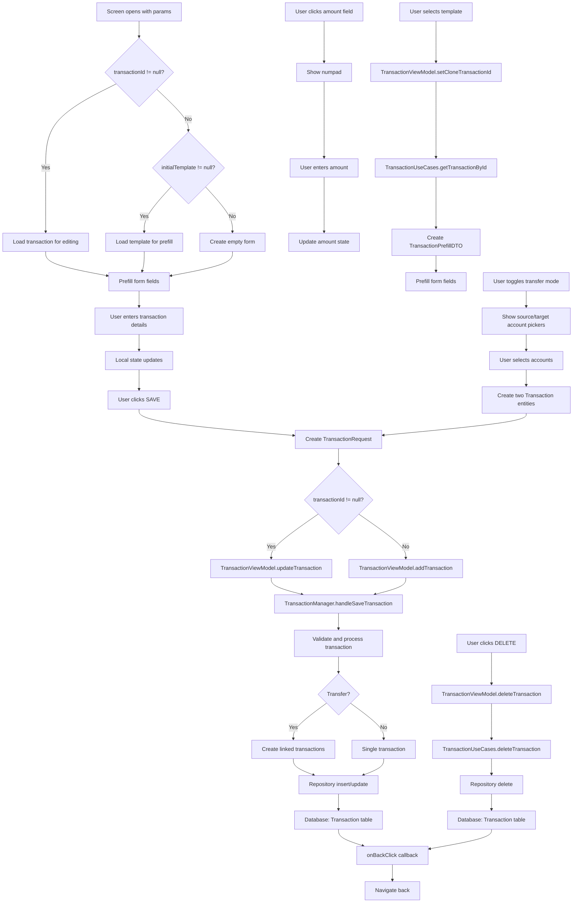

# TransactionEntryScreen Functional Logic

## 1. Component Overview
- **Screen Name**: TransactionEntryScreen
- **Purpose**: Allows users to create or edit financial transactions with support for income, expense, and transfer types, including currency conversion and template prefill
- **ViewModel Class**: TransactionViewModel (primary), plus multiple supporting ViewModels
- **Related Use Cases**: TransactionUseCases, TransactionManager

## 2. Input Analysis

### Component Inputs (UI → ViewModel)
- **transactionId**: Long? (null for new transaction, existing ID for edit)
- **accountId**: String? (optional account filter)
- **initialType**: Int (0=expense, 1=income, 2=transfer)
- **initialTemplate**: String? (template name for prefill)
- **onBackClick**: Navigation callback to return to previous screen
- **User Actions**:
  - Enter transaction title
  - Enter amount (via numpad)
  - Select account
  - Select category
  - Select date/time
  - Enter note
  - Select payment method
  - Enter payee
  - Select tags/labels
  - Toggle transaction type (income/expense/transfer)
  - For transfer: select source and target accounts
  - Save transaction
  - Delete transaction (edit mode only)

### ViewModel Inputs (Use Cases/Repositories)
- **Data Sources**:
  - TransactionUseCases: For transaction CRUD operations
  - TransactionManager: For complex transaction operations (status, clone, split)
  - AccountViewModel: For account list
  - AnalyticsViewModel: For exchange rates and currency conversion
  - TemplateViewModel: For template list and prefill data
  - TagViewModel: For tag list
  - SettingsDataStore: For decimal precision
- **Initial State Parameters**: transactionId, accountId, initialType, initialTemplate
- **Configuration Parameters**: decimalPrecision from SettingsDataStore

## 3. Output Analysis

### ViewModel Outputs (UI State)
```kotlin
val transactions: StateFlow<List<Transaction>>
val categories: StateFlow<List<CategoryEntity>>
val prefillDto: StateFlow<TransactionPrefillDTO?>
val decimalPrecision: StateFlow<Int>
```

**Transaction Model Structure**:
```kotlin
data class Transaction(
    val id: Long = 0,
    val title: String,
    val amount: BigDecimal,
    val category: String,
    val timestamp: Long,
    val currency: String,
    val transactionType: String,
    val accountId: String,
    val note: String? = null,
    val paymentMethod: String? = null,
    val payee: String? = null,
    val location: String? = null,
    val tags: List<String> = emptyList(),
    val status: TransactionStatus = TransactionStatus.CLEARED,
    val linkedTransactionId: Long? = null
)
```

**TransactionStatus Enum**: CLEARED, UNCLEARED, PENDING

**TransactionPrefillDTO Structure**:
```kotlin
data class TransactionPrefillDTO(
    val title: String? = null,
    val amount: BigDecimal? = null,
    val category: String? = null,
    val accountId: String? = null,
    val currency: String? = null,
    val transactionType: Int? = null,
    val note: String? = null,
    val payee: String? = null,
    val location: String? = null,
    val paymentMethod: String? = null,
    val tags: List<String> = emptyList(),
    val clonedFromTransactionId: Long? = null
)
```

**Loading/Error States**: None (synchronous operations for most actions)

**Navigation Events**: None (handled via callback parameters)

### Component Outputs (User Actions)
- **Navigation**: onBackClick
- **Side Effects**:
  - Show numpad for amount input
  - Show account picker
  - Show category picker
  - Show date/time picker
  - Show tag picker
  - Show transfer account picker (for transfers)
  - Show confirmation dialogs

## 4. Computation Logic

### Value: Transaction Creation
- **Value Name**: addTransaction
- **Input Data**: TransactionRequest
- **Computation Formula/Logic**:
  ```kotlin
  fun addTransaction(
      request: TransactionRequest,
      onComplete: ((Long) -> Unit)? = null
  ) {
      viewModelScope.launch {
          withProfile { profileId ->
              val id = transactionManager.handleSaveTransaction(null, request, profileId)
              onComplete?.invoke(id)
          }
      }
  }
  ```
- **Use Case Involvement**: TransactionManager.handleSaveTransaction
- **Transformation Steps**: TransactionRequest → Transaction entity → Repository → Database

### Value: Transaction Update
- **Value Name**: updateTransaction
- **Input Data**: oldTransaction: Transaction, request: TransactionRequest
- **Computation Formula/Logic**:
  ```kotlin
  fun updateTransaction(
      oldTransaction: Transaction,
      request: TransactionRequest
  ) {
      viewModelScope.launch {
          withProfile { profileId ->
              transactionManager.handleSaveTransaction(oldTransaction, request, profileId)
          }
      }
  }
  ```
- **Use Case Involvement**: TransactionManager.handleSaveTransaction
- **Transformation Steps**: TransactionRequest → Transaction entity update → Repository → Database

### Value: Transfer Save
- **Value Name**: saveTransfer
- **Input Data**: sourceTransaction: Transaction, targetTransaction: Transaction
- **Computation Formula/Logic**:
  ```kotlin
  fun saveTransfer(
      sourceTransaction: Transaction,
      targetTransaction: Transaction,
      onComplete: (() -> Unit)? = null
  ) {
      viewModelScope.launch {
          withProfile { profileId ->
              transactionUseCases.saveTransfer(sourceTransaction, targetTransaction, profileId)
              onComplete?.invoke()
          }
      }
  }
  ```
- **Use Case Involvement**: TransactionUseCases.saveTransfer
- **Transformation Steps**: Two Transaction entities → Repository → Database (linked)

### Value: Transaction Deletion
- **Value Name**: deleteTransaction
- **Input Data**: id: Long
- **Computation Formula/Logic**:
  ```kotlin
  fun deleteTransaction(id: Long) {
      viewModelScope.launch {
          transactionUseCases.deleteTransaction(id)
      }
  }
  ```
- **Use Case Involvement**: TransactionUseCases.deleteTransaction
- **Transformation Steps**: Transaction ID → Repository deletion

### Value: Clone Transaction
- **Value Name**: setCloneTransactionId
- **Input Data**: transactionId: Long
- **Computation Formula/Logic**:
  ```kotlin
  fun setCloneTransactionId(transactionId: Long) {
      viewModelScope.launch {
          val transaction = transactionUseCases.getTransactionById(transactionId)
          if (transaction != null) {
              _prefillDto.value = TransactionPrefillDTO.fromTransaction(transaction, clonedFromTransactionId = transactionId)
          } else {
              _prefillDto.value = null
          }
      }
  }
  ```
- **Use Case Involvement**: TransactionUseCases.getTransactionById
- **Transformation Steps**: Transaction ID → Transaction entity → TransactionPrefillDTO

### Value: Prefill DTO Clear
- **Value Name**: clearPrefillDto
- **Input Data**: None
- **Computation Formula/Logic**:
  ```kotlin
  fun clearPrefillDto() {
      _prefillDto.value = null
  }
  ```
- **Use Case Involvement**: None
- **Transformation Steps**: None (clears state)

### Value: Transaction Type Determination
- **Value Name**: determineTransactionType
- **Input Data**: amount: BigDecimal
- **Computation Formula/Logic**:
  ```kotlin
  fun determineTransactionType(amount: BigDecimal): Int {
      return when {
          amount > BigDecimal.ZERO -> 1 // Income
          amount < BigDecimal.ZERO -> 0 // Expense
          else -> 0 // Default to expense
      }
  }
  ```
- **Use Case Involvement**: None
- **Transformation Steps**: Amount sign → Transaction type code

### Value: Currency Conversion
- **Value Name**: CurrencyService.convertAmount (used in UI)
- **Input Data**: amount, fromCurrency, toCurrency, exchangeRates, precision
- **Computation Formula/Logic**: Converts amount from source currency to target currency using exchange rates
- **Use Case Involvement**: CurrencyService
- **Transformation Steps**: Amount × (toRate / fromRate) → Converted amount

## 5. Data Flow Diagram



## 6. Data Sources
- **Repository Interfaces**: TransactionRepository (via TransactionUseCases), AccountRepository
- **Database Entities**: TransactionEntity, CategoryEntity, TagEntity
- **Remote Data Sources**: None
- **Local Data Stores**: SettingsDataStore (decimal precision)

## 7. Business Logic Summary
- **Key Business Rules**:
  - Transactions can be income, expense, or transfer
  - Transfers create two linked transactions (source and target)
  - Template prefill populates form fields from saved templates
  - Clone functionality creates a copy of existing transaction
  - Transaction status can be CLEARED, UNCLEARED, or PENDING
  - Currency conversion uses exchange rates from AnalyticsViewModel
  - Decimal precision affects amount display and calculation
  - Tags are stored as comma-separated string in database
- **Validation Logic**:
  - Title must not be blank
  - Amount must be valid BigDecimal
  - Account must be selected
  - Category must be selected
- **Calculations Performed**:
  - Currency conversion for multi-currency transactions
  - Transaction type determination from amount sign
  - Transfer amount calculation (negative for source, positive for target)
- **State Management Approach**:
  - Local state for form fields
  - prefillDto for template/clone prefill
  - TransactionViewModel for transaction operations
  - Supporting ViewModels for picker data
  - Navigation trigger guard to prevent double navigation
  - DisposableEffect to clear prefill on screen exit

## 8. Dependencies

### ViewModel Dependencies
- TransactionViewModel (primary)
- AccountViewModel
- AnalyticsViewModel
- TemplateViewModel
- TagViewModel
- SettingsDataStore

### Use Case Dependencies
- TransactionUseCases (getTransactionById, deleteTransaction, saveTransfer)
- TransactionManager (handleSaveTransaction, updateStatus, cloneTransaction, toggleStatus)
- CurrencyService (convertAmount)

### External Services/APIs
- None
