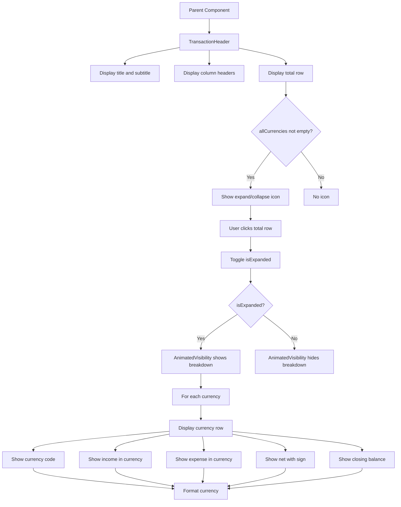

# TransactionHeader Functional Logic

## 1. Component Overview
- **Component Name**: TransactionHeader
- **Purpose**: Header for transaction groups showing day/period summary with expandable currency breakdown
- **Parent Component**: RecentActivitiesCard, TransactionListScreen
- **Related Components**: None (self-contained)

## 2. Input Analysis

### Component Inputs (Parent Component → Component)
- **title**: String - Header title (e.g., "TODAY", "WEEK 1")
- **subtitle**: String - Header subtitle (e.g., "Jan 1 - Jan 7", "5 transactions")
- **incomeByCurrency**: Map<String, BigDecimal> - Income totals by currency
- **expenseByCurrency**: Map<String, BigDecimal> - Expense totals by currency
- **closingBalancesByCurrency**: Map<String, BigDecimal> - Closing balances by currency
- **allCurrencies**: List<String> - List of all currencies present
- **incomeBase**: BigDecimal - Total income in base currency
- **expenseBase**: BigDecimal - Total expense in base currency
- **netBase**: BigDecimal - Net flow in base currency
- **totalClosingBalanceBase**: BigDecimal - Total closing balance in base currency
- **baseCurrency**: String - Base currency code
- **precision**: Int - Decimal precision for currency formatting

### Component Internal State
- **isExpanded**: Boolean - Whether currency breakdown is expanded

## 3. Output Analysis

### Component Outputs (Component → Parent Component)
- **None** (display-only component)

### Displayed Data Structure
```kotlin
// Header displays:
- Title (uppercase)
- Subtitle (uppercase, smaller)
- Column headers: INCOME, EXPENSE, NET, BALANCE
- Total row (clickable if currencies exist):
  - TOTAL label with expand/collapse icon
  - Income total in base currency (green)
  - Expense total in base currency (red)
  - Net total in base currency (color based on sign)
  - Closing balance in base currency
- Currency breakdown (expandable):
  - For each currency:
    - Currency code
    - Income in currency
    - Expense in currency
    - Net in currency (with +/- sign)
    - Closing balance in currency
```

## 4. Computation Logic

### Value: Net Sign
- **Value Name**: netSign
- **Input Data**: net
- **Computation Formula/Logic**:
  ```kotlin
  val netSign = if (net >= BigDecimal.ZERO) "+ " else "- "
  ```
- **Use Case Involvement**: None
- **Transformation Steps**: Sign check → Prefix string

### Value: Can Expand
- **Value Name**: canExpand
- **Input Data**: allCurrencies
- **Computation Formula/Logic**:
  ```kotlin
  val canExpand = allCurrencies.isNotEmpty()
  ```
- **Use Case Involvement**: None
- **Transformation Steps**: Check if list is not empty

### Value: Currency Breakdown Row
- **Value Name**: inc, exp, net, bal
- **Input Data**: curr, incomeByCurrency, expenseByCurrency, closingBalancesByCurrency
- **Computation Formula/Logic**:
  ```kotlin
  val inc = incomeByCurrency[curr] ?: BigDecimal.ZERO
  val exp = expenseByCurrency[curr] ?: BigDecimal.ZERO
  val net = inc.add(exp)
  val bal = closingBalancesByCurrency[curr]
  ```
- **Use Case Involvement**: None
- **Transformation Steps**: Lookup currency maps → Extract values

### Value: Net Color
- **Value Name**: netColor
- **Input Data**: netBase
- **Computation Formula/Logic**:
  ```kotlin
  color = if (netBase >= BigDecimal.ZERO) positiveColor else negativeColor
  ```
- **Use Case Involvement**: None
- **Transformation Steps**: Sign check → Color selection

### Value: Balance Display
- **Value Name**: balanceText
- **Input Data**: bal, curr, precision
- **Computation Formula/Logic**:
  ```kotlin
  if (bal != null) formatCurrencyRight(bal, curr, precision) else "0.00 $curr"
  ```
- **Use Case Involvement**: None
- **Transformation Steps**: Null check → Format or default

## 5. Data Flow Diagram



## 6. Data Sources
- **Repository Interfaces**: None (pure UI component)
- **Database Entities**: None
- **Remote Data Sources**: None
- **Local Data Stores**: None

## 7. Business Logic Summary
- **Key Business Rules**:
  - Expandable currency breakdown for multi-currency transactions
  - Total row clickable only if currencies exist
  - Expand/collapse icon indicates expandability
  - Income displayed in green, expense in red
  - Net color based on sign (green for positive, red for negative)
  - Net values prefixed with "+" or "-" sign
  - Closing balance defaults to "0.00" if null
  - All text uppercase for consistent styling
  - Column headers for clear data organization
  - Animated visibility for smooth expand/collapse
- **Validation Logic**: None
- **Calculations Performed**:
  - Net sign calculation
  - Currency breakdown row calculations
  - Color selection based on values
- **State Management Approach**:
  - Local state for expand/collapse
  - AnimatedVisibility for smooth transitions
  - Stateless rendering (no external dependencies)

## 8. Dependencies

### Component Dependencies
- None (self-contained)

### Parent Component Dependencies
- CurrencyService (for currency conversion - done before passing to component)
- formatCurrencyRight (utility function)

### External Services/APIs
- None
