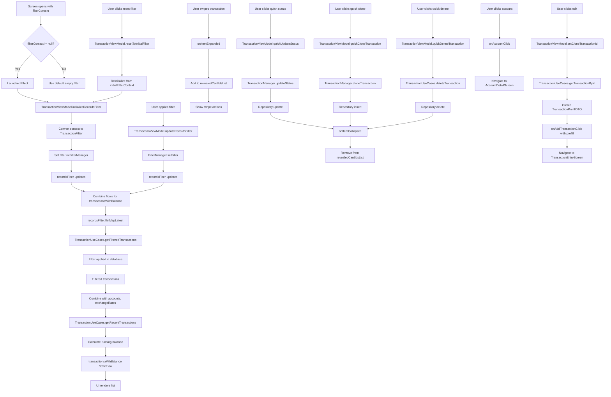

# TransactionListScreen Functional Logic

## 1. Component Overview
- **Screen Name**: TransactionListScreen
- **Purpose**: Displays a list of transactions with filtering, swipe actions (edit, clone, delete, status toggle), and navigation to transaction entry and account detail
- **ViewModel Class**: TransactionViewModel (primary), plus multiple supporting ViewModels
- **Related Use Cases**: TransactionUseCases, TransactionManager

## 2. Input Analysis

### Component Inputs (UI → ViewModel)
- **filterContext**: RecordsFilterContext (for initial filter from navigation)
- **onBackClick**: Navigation callback to return to previous screen
- **onAddTransactionClick**: Navigation callback to add new transaction
- **onAccountClick**: Navigation callback to view account details
- **User Actions**:
  - Filter by account
  - Filter by category
  - Filter by date range
  - Filter by transaction type (income/expense)
  - Apply saved filter
  - Swipe transaction card to reveal actions
  - Quick update status (cleared/uncleared)
  - Quick clone transaction
  - Quick delete transaction
  - Edit transaction
  - View account details

### ViewModel Inputs (Use Cases/Repositories)
- **Data Sources**:
  - TransactionUseCases: For transaction CRUD and filtering
  - TransactionManager: For status, clone, and toggle operations
  - AccountRepository: For account data and balance calculation
  - AnalyticsViewModel: For exchange rates and currency conversion
  - TemplateViewModel: For template list
  - SettingsDataStore: For decimal precision and records settings
  - FilterDao: For saved filters
- **Initial State Parameters**: filterContext (optional navigation parameter)
- **Configuration Parameters**: 
  - decimalPrecision from SettingsDataStore
  - recordsSettings from SettingsDataStore

## 3. Output Analysis

### ViewModel Outputs (UI State)
```kotlin
val transactionsWithBalance: StateFlow<List<TransactionWithBalance>>
val transactions: StateFlow<List<Transaction>>
val recordsFilter: StateFlow<TransactionFilter>
val savedFilters: StateFlow<List<FilterEntity>>
val categories: StateFlow<List<CategoryEntity>>
val decimalPrecision: StateFlow<Int>
val recordsSettings: StateFlow<TransactionSectionSettings>
val revealedCardIdsList: StateFlow<List<Long>>
val prefillDto: StateFlow<TransactionPrefillDTO?>
```

**TransactionWithBalance Structure**:
```kotlin
data class TransactionWithBalance(
    val transaction: Transaction,
    val balanceBefore: BigDecimal,
    val balanceAfter: BigDecimal
)
```

**TransactionFilter Structure**:
```kotlin
data class TransactionFilter(
    val accountIds: List<String> = emptyList(),
    val categoryIds: List<Long> = emptyList(),
    val currencies: List<String> = emptyList(),
    val paymentMethods: List<String> = emptyList(),
    val transactionType: String? = null,
    val startDate: Long? = null,
    val endDate: Long? = null,
    val minAmount: BigDecimal? = null,
    val maxAmount: BigDecimal? = null,
    val queryNote: String? = null,
    val queryPayee: String? = null
)
```

**TransactionSectionSettings Structure**:
```kotlin
data class TransactionSectionSettings(
    val showBalance: Boolean = true,
    val showDate: Boolean = true,
    val showCategory: Boolean = true,
    val showAccount: Boolean = true,
    val showNotes: Boolean = false,
    val showTags: Boolean = false,
    val showPayee: Boolean = false,
    val showPaymentMethod: Boolean = false,
    val groupByDate: Boolean = true,
    val showBalanceInBaseCurrency: Boolean = false
)
```

**Loading/Error States**: None (uses empty list as initial state)

**Navigation Events**: None (handled via callback parameters)

### Component Outputs (User Actions)
- **Navigation**: onBackClick, onAddTransactionClick, onAccountClick
- **Side Effects**:
  - Show filter sheet
  - Show saved filter picker
  - Show confirmation dialogs
  - Expand/collapse swipe actions

## 4. Computation Logic

### Value: Filtered Transactions with Balance
- **Value Name**: transactionsWithBalance
- **Input Data**: currentProfileId, recordsFilter, accounts, analyticsState (exchangeRates, precision)
- **Computation Formula/Logic**:
  ```kotlin
  val transactionsWithBalance: StateFlow<List<TransactionWithBalance>> = settingsDataStore.currentProfileId
      .flatMapLatest { profileId ->
          combine(
              recordsFilter.flatMapLatest { transactionUseCases.getFilteredTransactions(profileId, it) },
              accountRepository.getAllAccounts(profileId),
              analyticsViewModel.uiState,
              recordsFilter
          ) { filteredTransactions, accounts, analyticsState, currentFilter ->
              val rates = analyticsState.exchangeRates
              val precision = analyticsState.decimalPrecision

              transactionUseCases.getRecentTransactions(
                  allTransactions = filteredTransactions,
                  accounts = accounts,
                  exchangeRates = rates,
                  precision = precision,
                  limit = Int.MAX_VALUE
              )
          }
      }.stateIn(
          scope = viewModelScope,
          started = SharingStarted.WhileSubscribed(5000),
          initialValue = emptyList()
      )
  ```
- **Use Case Involvement**: TransactionUseCases.getFilteredTransactions, TransactionUseCases.getRecentTransactions
- **Transformation Steps**: Filter → Filtered transactions → Balance calculation → TransactionWithBalance

### Value: Filter Management
- **Value Name**: updateRecordsFilter
- **Input Data**: newFilter: TransactionFilter
- **Computation Formula/Logic**:
  ```kotlin
  fun updateRecordsFilter(newFilter: TransactionFilter) {
      recordsFilterManager.setFilter("manual", newFilter)
      _recordsFilterInitialized.value = true
  }
  ```
- **Use Case Involvement**: FilterManager (internal)
- **Transformation Steps**: Filter → FilterManager.setFilter

### Value: Filter Initialization from Navigation
- **Value Name**: initializeRecordsFilter
- **Input Data**: context: RecordsFilterContext
- **Computation Formula/Logic**:
  ```kotlin
  fun initializeRecordsFilter(context: RecordsFilterContext) {
      _initialFilterContext.value = context
      recordsFilterManager.clear()
      
      val filter = when (context) {
          is RecordsFilterContext.None -> TransactionFilter()
          is RecordsFilterContext.ByAccount -> TransactionFilter(accountIds = listOf(context.accountId))
          is RecordsFilterContext.ByAccountAndType -> TransactionFilter(
              accountIds = listOf(context.accountId),
              transactionType = if (context.isIncome) "income" else "expense"
          )
          is RecordsFilterContext.ByAccountAndCurrency -> TransactionFilter(
              accountIds = listOf(context.accountId),
              currencies = listOf(context.currency)
          )
          is RecordsFilterContext.Custom -> TransactionFilter(
              accountIds = context.accountIds,
              transactionType = context.isIncome?.let { if (it) "income" else "expense" },
              startDate = context.startDate,
              endDate = context.endDate,
              categoryIds = context.categoryIds.map { it.toLong() },
              currencies = context.currencies,
              paymentMethods = context.paymentMethods,
              queryNote = context.queryNote,
              minAmount = context.minAmount?.let { java.math.BigDecimal(it) },
              maxAmount = context.maxAmount?.let { java.math.BigDecimal(it) },
              queryPayee = context.queryPayee
          )
      }
      
      recordsFilterManager.setFilter("initial", filter)
      _recordsFilterInitialized.value = true
  }
  ```
- **Use Case Involvement**: FilterManager (internal)
- **Transformation Steps**: Navigation context → TransactionFilter

### Value: Quick Status Update
- **Value Name**: quickUpdateStatus
- **Input Data**: transactionId: Long, newStatus: TransactionStatus
- **Computation Formula/Logic**:
  ```kotlin
  fun quickUpdateStatus(transactionId: Long, newStatus: TransactionStatus) {
      viewModelScope.launch {
          withProfile { profileId ->
              if (transactionManager.updateStatus(transactionId, newStatus, profileId)) {
                  onItemCollapsed(transactionId)
              }
          }
      }
  }
  ```
- **Use Case Involvement**: TransactionManager.updateStatus
- **Transformation Steps**: Transaction ID + Status → Repository update

### Value: Quick Clone Transaction
- **Value Name**: quickCloneTransaction
- **Input Data**: transactionId: Long
- **Computation Formula/Logic**:
  ```kotlin
  fun quickCloneTransaction(transactionId: Long) {
      viewModelScope.launch {
          withProfile { profileId ->
              if (transactionManager.cloneTransaction(transactionId, profileId) != null) {
                  onItemCollapsed(transactionId)
              }
          }
      }
  }
  ```
- **Use Case Involvement**: TransactionManager.cloneTransaction
- **Transformation Steps**: Transaction ID → Clone → Repository insert

### Value: Quick Delete Transaction
- **Value Name**: quickDeleteTransaction
- **Input Data**: transactionId: Long
- **Computation Formula/Logic**:
  ```kotlin
  fun quickDeleteTransaction(transactionId: Long) {
      viewModelScope.launch {
          deleteTransaction(transactionId)
          onItemCollapsed(transactionId)
      }
  }
  ```
- **Use Case Involvement**: TransactionUseCases.deleteTransaction
- **Transformation Steps**: Transaction ID → Repository delete

### Value: Toggle Status (Cleared/Uncleared)
- **Value Name**: toggleStatusClearedUncleared
- **Input Data**: transactionId: Long
- **Computation Formula/Logic**:
  ```kotlin
  fun toggleStatusClearedUncleared(transactionId: Long) {
      viewModelScope.launch {
          withProfile { profileId ->
              if (transactionManager.toggleStatus(transactionId, profileId) != null) {
                  onItemCollapsed(transactionId)
              }
          }
      }
  }
  ```
- **Use Case Involvement**: TransactionManager.toggleStatus
- **Transformation Steps**: Transaction ID → Toggle status → Repository update

### Value: Swipe Action State Management
- **Value Name**: onItemExpanded, onItemCollapsed
- **Input Data**: cardId: Long
- **Computation Formula/Logic**:
  ```kotlin
  fun onItemExpanded(cardId: Long) {
      if (_revealedCardIdsList.value.contains(cardId)) return
      _revealedCardIdsList.value = _revealedCardIdsList.value.toMutableList().also { list ->
          list.add(cardId)
      }
  }
  
  fun onItemCollapsed(cardId: Long) {
      if (!_revealedCardIdsList.value.contains(cardId)) return
      _revealedCardIdsList.value = _revealedCardIdsList.value.toMutableList().also { list ->
          list.remove(cardId)
      }
  }
  ```
- **Use Case Involvement**: None
- **Transformation Steps**: Card ID → Revealed card IDs list management

### Value: Filter Modification Detection
- **Value Name**: hasModifiedFilter
- **Input Data**: None (uses internal state)
- **Computation Formula/Logic**:
  ```kotlin
  fun hasModifiedFilter(): Boolean {
      val initialFilter = when (_initialFilterContext.value) {
          is RecordsFilterContext.None -> TransactionFilter()
          is RecordsFilterContext.ByAccount -> TransactionFilter(accountIds = listOf((_initialFilterContext.value as RecordsFilterContext.ByAccount).accountId))
          is RecordsFilterContext.ByAccountAndType -> {
              val ctx = _initialFilterContext.value as RecordsFilterContext.ByAccountAndType
              TransactionFilter(accountIds = listOf(ctx.accountId), transactionType = if (ctx.isIncome) "income" else "expense")
          }
          is RecordsFilterContext.ByAccountAndCurrency -> {
              val ctx = _initialFilterContext.value as RecordsFilterContext.ByAccountAndCurrency
              TransactionFilter(accountIds = listOf(ctx.accountId), currencies = listOf(ctx.currency))
          }
          is RecordsFilterContext.Custom -> {
              val ctx = _initialFilterContext.value as RecordsFilterContext.Custom
              TransactionFilter(
                  accountIds = ctx.accountIds,
                  transactionType = ctx.isIncome?.let { if (it) "income" else "expense" },
                  startDate = ctx.startDate,
                  endDate = ctx.endDate,
                  categoryIds = ctx.categoryIds.map { it.toLong() },
                  currencies = ctx.currencies,
                  paymentMethods = ctx.paymentMethods,
                  queryNote = ctx.queryNote,
                  minAmount = ctx.minAmount?.let { java.math.BigDecimal(it) },
                  maxAmount = ctx.maxAmount?.let { java.math.BigDecimal(it) },
                  queryPayee = ctx.queryPayee
              )
          }
      }
      return recordsFilter.value != initialFilter
  }
  ```
- **Use Case Involvement**: None
- **Transformation Steps**: Initial context → Filter comparison → Boolean

## 5. Data Flow Diagram



## 6. Data Sources
- **Repository Interfaces**: TransactionRepository (via TransactionUseCases), AccountRepository
- **Database Entities**: TransactionEntity, CategoryEntity, FilterEntity
- **Remote Data Sources**: None
- **Local Data Stores**: SettingsDataStore (decimalPrecision, recordsSettings, currentProfileId)

## 7. Business Logic Summary
- **Key Business Rules**:
  - Filter can be initialized from navigation context (deep linking)
  - FilterManager supports multiple filter sources (manual, account, category, date, type, initial)
  - Filters are merged to create the final filter
  - Swipe actions reveal quick actions (status, clone, delete)
  - Quick actions auto-collapse the swipe card
  - Running balance is calculated for each transaction
  - Balance is calculated in account's currency, optionally converted to base currency
  - Filter modification can be detected to show reset button
  - Saved filters can be applied for quick access
- **Validation Logic**: None
- **Calculations Performed**:
  - Running balance calculation (balance before and after each transaction)
  - Currency conversion for balance display (if enabled)
  - Filter merging from multiple sources
- **State Management Approach**:
  - FilterManager for multi-source filter management
  - recordsFilter as merged filter StateFlow
  - revealedCardIdsList for swipe action state
  - prefillDto for edit/clone prefill
  - initialFilterContext for navigation-based filter initialization
  - Navigation trigger guard to prevent double navigation
  - DisposableEffect to clear filter on screen exit

## 8. Dependencies

### ViewModel Dependencies
- TransactionViewModel (primary)
- AccountViewModel
- AnalyticsViewModel
- TemplateViewModel
- SettingsDataStore

### Use Case Dependencies
- TransactionUseCases (getFilteredTransactions, getRecentTransactions, deleteTransaction, getTransactionById)
- TransactionManager (updateStatus, cloneTransaction, toggleStatus)

### External Services/APIs
- None
